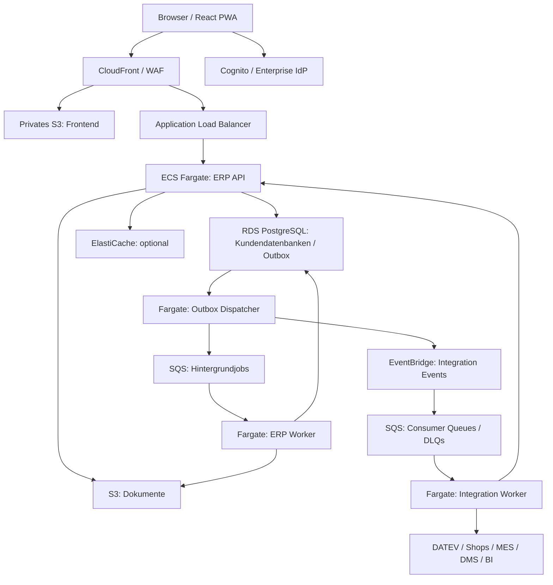

Stand: 12. Oktober 2026 — überarbeitet für AWS Cloud-first

**Verbindliche Entscheidung:** Die ERP-Plattform wird nativ Cloud-first auf AWS entwickelt und betrieben. Eine hybride Cloud-/On-Premises-ERP-Lösung, eine lokal installierbare Produktvariante und Multi-Cloud-Parität sind nicht Bestandteil der Zielarchitektur. AWS-Managed-Services dürfen bewusst genutzt werden.

Kundenseitige MES-, Druck-, Scanner- oder Bestandssysteme können angebunden werden. Ein optionaler lokaler Connector vermittelt ausschließlich Integrationen; er betreibt weder ERP-Kern noch führende ERP-Datenbank. Begrenzte Offline-Erfassung in der PWA ist ebenfalls keine lokale ERP-Installation.

# 1. Zielsetzung

Die neue ERP-Lösung richtet sich an mittelständische Unternehmen im
DACH-Raum mit typischerweise **30--50 gleichzeitig bzw. regelmäßig
arbeitenden Anwendern**.

Die primären Zielgruppen sind:

• Handelsunternehmen

• Produktionsunternehmen

• Dienstleistungsunternehmen

• Mischformen aus Handel, Produktion und Service

Die Architektur muss insbesondere folgende Anforderungen erfüllen:

1 -- Sehr hohe Performance auch bei großen Datenbeständen

2 -- Unterstützung mehrerer Mandanten

3 -- Geräteunabhängige Nutzung

4 -- Umfangreiche Integrationsmöglichkeiten

5 -- Nativer Cloud-first-Betrieb auf AWS mit Managed Services

6 -- Hohe Datenhoheit für den jeweiligen Kunden

7 -- Gute Wartbarkeit über einen Lebenszyklus von 10+ Jahren

8 -- Erweiterbarkeit ohne kundenspezifische Forks des ERP-Kerns

9 -- Skalierbarkeit von kleinen SaaS-Kunden bis zu deutlich größeren
Mittelstandskunden

# 2. Architekturentscheidung

## Empfehlung

Als grundlegende Architektur wird ein **modularer Monolith mit klar
definierten Domänen, API-first-Ansatz und eventbasierter
Integrationsarchitektur** empfohlen.

Microservices sollten zunächst **nicht** die primäre Architektur
darstellen.

Für Installationen mit 30--50 Anwendern würden klassische Microservices
unnötige Komplexität bei Deployment, Monitoring, Datenkonsistenz,
Fehlersuche und Betrieb erzeugen.

Die Architektur sollte allerdings so gestaltet werden, dass einzelne
Komponenten später problemlos als eigenständige Services herausgelöst
werden können.

### Architekturprinzip

Modular Monolith first -- Distributed Services where needed.

# 3. Zielarchitektur auf AWS

Dies ist ein logisches Deploymentbild. Kundenverwaltung, IAM, KMS, Secrets Manager und Telemetrie wirken übergreifend; sie sind zugunsten der Lesbarkeit nicht als Datenpfade eingezeichnet.

# 4. Fachliche Modularisierung

Der ERP-Kern sollte aus klar getrennten Domänen bestehen.

## Basisplattform

• Benutzer

• Rollen und Berechtigungen

• Mandanten

• Organisationseinheiten

• Nummernkreise

• Währungen

• Sprachen

• Steuern

• Einheiten

• Customizing

• Workflow

• Audit Trail

## Stammdaten

• Adressen

• Kunden

• Lieferanten

• Ansprechpartner

• Artikel

• Varianten

• Stücklisten

• Preise

• Konditionen

• Lagerorte

## Vertrieb

• Angebote

• Aufträge

• Lieferscheine

• Rechnungen

• Gutschriften

• Retouren

## Einkauf

• Anfragen

• Bestellungen

• Wareneingänge

• Eingangsrechnungen

• Lieferantenbewertung

Der erste Umsetzungsschnitt ist Roadmap E-1 (festgelegt am 15. Oktober 2026): Lieferant, Bestellung mit Positionen aus dem Artikelstamm, Wareneingang von Hand aus dieser Bestellung, optionale Charge mit Einstandspreis je Basiseinheit, und die Marge dieser Charge auf der Auftragsposition. Der Versand der Bestellung per E-Mail beginnt, sobald ein Beleg existiert. ZUGFeRD bleibt Epic E-2.

## Warenwirtschaft

• Bestände

• Lagerbewegungen

• Reservierungen

• Chargen

• Seriennummern

• Inventuren

## Produktion

• Stücklisten

• Arbeitspläne

• Fertigungsaufträge

• Materialbedarf

• MRP

• Rückmeldungen

• Fremdfertigung

## Dienstleistungen

• Projekte

• Serviceaufträge

• Leistungen

• Zeiten

• Ressourcen

• Abrechnung

Jede Domäne erhält einen klar definierten fachlichen API-Vertrag.
Direkte Abhängigkeiten zwischen den Modulen werden möglichst vermieden.

# 5. Datenarchitektur auf AWS

**Amazon RDS for PostgreSQL** ist die führende transaktionale Datenhaltung. PostgreSQL bleibt aufgrund von ACID, SQL, Indizes, JSONB und guter Integrität geeignet; Cloudneutralität und lokale Installierbarkeit sind keine Auswahlkriterien mehr.

Produktiv wird eine Multi-AZ-Konfiguration vorgesehen. Ein Standby einer klassischen Multi-AZ-DB-Instance dient der Verfügbarkeit, nicht als Reporting-Read-Replica. Read Replicas sind separate, optionale Ressourcen; verbindliche Buchungs- und Bestandsentscheidungen lesen vom Writer.

Aurora PostgreSQL-Compatible wird erst nach einem belegten Verfügbarkeits-, Skalierungs- oder Kostenvorteil geprüft. RDS Proxy ist optional und muss mit dem Kundendatenbankmodell sowie Session-/RLS-Verhalten getestet werden. Connection-Pool-Budgets gelten pro Kunde und für die gesamte RDS-Instanz.

# 6. Umgang mit großen Datenmengen

Insbesondere folgende Tabellen können innerhalb weniger Jahre sehr groß
werden:

    Belege
    BelegPositionen
    Lagerbewegungen
    Artikelbewegungen
    PreisHistorien
    AuditLogs
    Adressen
    Kommunikationsdaten
    WorkflowEvents

Beispielsweise können aus 20.000 Rechnungen pro Jahr mit
durchschnittlich 15 Positionen bereits **300.000 Rechnungspositionen pro
Jahr** entstehen. Bei Lieferscheinen, Aufträgen, Einkaufsbelegen und
Lagerbewegungen entstehen schnell mehrere Millionen Datensätze.

## Primärschlüssel

Intern sollten kompakte numerische Schlüssel verwendet werden:

    id BIGINT
    tenant_id BIGINT

Zusätzlich kann für externe Schnittstellen eine UUID verwendet werden:

    public_id UUID

Damit wird intern maximale Datenbankperformance erzielt, während externe
Systeme stabile, global eindeutige IDs erhalten.

# 7. Partitionierung

Partitionierung wird vorbereitet und nur anhand gemessener Zugriffsmuster aktiviert. Große Bewegungs-, Audit-, Outbox- und Historientabellen können nach Monat, Quartal oder Jahr partitioniert werden. Nicht pauschal eine Partition pro Gesellschaft anlegen. Partition Pruning, Schlüssel-/Unique-Constraints und Aufbewahrung werden im physischen Datenmodell geprüft.

# 8. Indexstrategie

Indizes müssen konsequent am Mandantenmodell ausgerichtet werden.
Beispiele:

    (tenant_id, document_number)
    (tenant_id, customer_id, document_date)
    (tenant_id, article_id, document_date)
    (tenant_id, article_number)
    (tenant_id, search_name)

Ein isolierter Index ausschließlich auf article_id ist in einem
mandantenfähigen System oftmals weniger sinnvoll als tenant_id +
article_id.

Zusätzlich sollten eingesetzt werden:

• Covering Indexes

• Partial Indexes

• GIN-Indizes

• Trigram-Indizes für unscharfe Suche

# 9. Read Models

ERP-Bildschirme sollten nicht permanent komplexe Joins über sehr große
operative Tabellen durchführen.

Beispielsweise benötigt die Auftragsübersicht Informationen wie
Auftragsnummer, Kunde, Datum, Status, Wert, Lieferstatus,
Rechnungsstatus und Zahlungsstatus. Diese Daten können als optimiertes
**Read Model** bereitgestellt werden.

Damit wird selektiv ein CQRS-Ansatz verwendet:

    Write Model
        │
        ├── Domain Event
        ▼
    Read Model

CQRS sollte allerdings nur dort eingesetzt werden, wo daraus ein
konkreter Performancevorteil entsteht.

# 10. Caching

Optional wird Amazon ElastiCache for Valkey für Konfiguration, häufige Referenzdaten und gezielt gemessene Lesepfade eingesetzt. Cache-Schlüssel enthalten customer_id und tenant_id. TTL und Invalidierung sind explizit. Berechtigungsänderungen müssen zeitnah wirksam werden.

Der Cache ist keine führende Datenquelle. Bei Ausfall greift die Anwendung kontrolliert auf RDS zurück; Lastschutz verhindert eine Überlastung. Buchungen und verbindliche Bestände werden gegen die Datenbank geprüft.

# 11. Suche

Für den normalen Betrieb reicht zunächst PostgreSQL. Beispiele für
Suchfelder:

    Artikelnummer
    Artikelbezeichnung
    Kundennummer
    Firmenname
    PLZ
    Ort
    Belegnummer

Mit Trigram- und Full-Text-Indizes können bereits sehr große
Datenbestände performant durchsucht werden.

Erst bei sehr umfangreichen Anforderungen kann optional eine Suchengine
wie **Amazon OpenSearch Service** ergänzt werden. Damit wird unnötige Infrastruktur für
kleinere Kunden vermieden.

# 12. Mandantenfähigkeit

**Database per Customer** bleibt die Standardstrategie: Jeder SaaS-Kunde erhält eine eigene logische PostgreSQL-Datenbank und eine eigene Datenbankrolle. Darin werden Gesellschaften über tenant_id getrennt. customer_id bezeichnet den SaaS-Kunden, tenant_id die Gesellschaft.

Eine serverseitige Kundenregistrierung ordnet die verifizierte customer_id ihrer Datenbank, Zugangsdaten und Deployment-Zelle zu. Clients dürfen keine Datenbankverbindung auswählen. RLS schützt zusätzlich Gesellschaftsgrenzen; Task-/DB-Rollen dürfen sie nicht umgehen, und bei Connection Pooling muss der Tenant-Kontext transaktionsgebunden gesetzt und zurückgesetzt werden.

**Gesellschaft anlegen (ADR-005, angenommen 2026-10-16).** Auf der Anmeldeseite kann ein neuer Mandant angefordert werden. Pflichtfelder sind Firmenname und E-Mail. Der erste Benutzer heißt `kunde` und bleibt gesperrt, bis `ckrause@cvs.de` den Link in der Freigabe-Mail bestätigt. Erst danach geht das Passwort an die angegebene Adresse. Jede Anmeldung verlangt Mandantennummer, Benutzer und Passwort; die E-Mail ist kein Anmeldename. Dieselbe Adresse kann später mehreren Benutzern gehören, auch mehr als einem Benutzer in einem Mandanten (Buchhalter und Administrator sind getrennte Anmeldungen). Rollen folgen später. Dieser Schritt legt eine Gesellschaft in der aktuellen Zelle an und ersetzt nicht Database per Customer.

Mehrere Kundendatenbanken können eine RDS-Instanz teilen. Das ist **logische Isolation**, keine eigene Infrastruktur- oder Ausfallgrenze. CPU, IOPS, Verbindungen, Wartung und instanzweite Wiederherstellung bleiben geteilt. Dedizierte RDS-Instanzen beziehungsweise separate AWS-Deployment-Zellen sind eine Premium-/Regulierungsoption.

Kundenspezifische Restore-Prozesse werden explizit implementiert: RDS-Snapshot und Point-in-Time Restore stellen eine neue Instanz wieder her. Für einen einzelnen Kunden auf einer geteilten Instanz wird anschließend dessen Datenbank kontrolliert exportiert und importiert, mit geprüften S3-Referenzen, Job-/Eventzuständen und fachlicher Konsistenz. Eigene logische Datenbanken garantieren daher keine unabhängigen Wartungsfenster oder sofortigen Einzelkunden-Restores.

# 13. Isolation und AWS-Deployment-Zellen

SaaS-Kunden werden auf begrenzte Deployment-Zellen aus ECS-Services, RDS und Queue-Ressourcen verteilt. Neue Zellen skalieren die Plattform kundenweise, ohne die Daten eines einzelnen Kunden vorzeitig zu sharden.

Kundenquoten, Fair Scheduling und getrennte Worker-Pools begrenzen Noisy-Neighbour-Effekte. Database per Customer erleichtert Export und Löschung, ersetzt aber weder Berechtigungsprüfungen noch physische Isolation.

# 14. Geräteunabhängigkeit

Die Benutzeroberfläche wird browserbasiert entwickelt. Empfohlen wird
eine **Responsive Progressive Web Application (PWA)**.

Damit kann dieselbe Anwendung genutzt werden auf Windows, macOS, Linux,
iPad, Android Tablets, Smartphones, Lagerterminals und Handscannern.

Eine Installation eines klassischen Desktopclients entfällt.

Die Oberfläche sollte konsequent zwischen verschiedenen
Arbeitsplatztypen unterscheiden:

• **Sachbearbeiter:** große Tabellen, Tastatursteuerung, Multiselect und
schnelle Dateneingabe

• **Vertrieb:** tabletoptimierte Kunden-, Artikel- und Auftragsansichten

• **Lager:** touchoptimiert, große Schaltflächen und Barcode-Workflow

• **Management:** Dashboards und Kennzahlen

Eine responsive Weboberfläche bedeutet deshalb nicht, denselben
Bildschirm lediglich kleiner darzustellen.

# 15. API-First

Sämtliche relevanten ERP-Funktionen sollten über eine dokumentierte API
erreichbar sein.

Empfehlung: **REST + OpenAPI**.

    GET  /api/v1/articles
    GET  /api/v1/customers
    POST /api/v1/sales-orders
    POST /api/v1/deliveries
    GET  /api/v1/stock

Wesentliche Geschäftsvorgänge sollten nicht ausschließlich über
Datenbanktabellen zugänglich sein. Externe Systeme dürfen insbesondere
**keinen direkten Schreibzugriff auf ERP-Tabellen erhalten**.

# 16. Eventbasierte Integration auf AWS

**Amazon EventBridge** routet versionierte Integration Events an **SQS-Queues pro Consumer beziehungsweise Workload**. Direkte Hintergrundjobs werden durch einen Outbox-Dispatcher an SQS übergeben. Unterschiedliche Consumer erhalten eigene Queues, damit sie Ereignisse unabhängig verarbeiten können.

Standard-Queues und Eventverarbeitung werden als **At-least-once** modelliert: Duplikate und fehlende globale Reihenfolge sind zu erwarten. Consumer speichern eine Inbox/Deduplizierung mit customer_id + event_id und bestätigen erst nach erfolgreicher Verarbeitung. Reihenfolgekritische Jobs können SQS FIFO mit bewusstem Message-Group-Konzept nutzen; EventBridge erzeugt keine garantierte End-to-End-Reihenfolge. Aggregate-Versionen erlauben Erkennung überholter oder fehlender Events.

Visibility Timeout, Retry mit Backoff, maximale Versuche, Dead-Letter Queues, Redrive und Queue-Alter-Alarme sind Pflicht. EventBridge-Zielzustellung erhält ebenfalls Retry-/DLQ-Regeln. Fehlgeschlagene Einträge einer PutEvents-Batchantwort werden einzeln behandelt. Größere Nutzdaten liegen in S3; Nachrichten enthalten berechtigte Referenzen statt ganzer Dokumente.

RabbitMQ, NATS und Kafka gehören nicht zum Standarddeployment.

# 17. Transactional Outbox

Eine der wichtigsten Architekturentscheidungen für zuverlässige
Integration ist das **Transactional-Outbox-Pattern**.

Bei einer Rechnungsbuchung werden innerhalb derselben
Datenbanktransaktion gespeichert:

    Invoice
    und
    IntegrationEvent: InvoicePosted

Ein Fargate-Outbox-Dispatcher veröffentlicht anschließend das Event auf EventBridge beziehungsweise einen Job auf SQS. Erst nach bestätigter Annahme wird der Eintrag als versendet markiert. Wiederholungen können Duplikate erzeugen; Inbox/Deduplizierung, Retry, DLQ und Alarme sichern die Verarbeitung. Die Outbox garantiert zunächst die atomare Speicherung, nicht die erfolgreiche Verarbeitung im Zielsystem.

# 18. Integration Hub

Schnittstellen sollten nicht direkt in die Fachmodule eingebaut werden.
Stattdessen:

    ERP
     │
     ▼
    Integration Hub
     │
     ├── REST
     ├── Webhooks
     ├── Messaging
     ├── CSV
     ├── XML
     ├── EDI
     ├── SFTP
     └── Connectoren

Typische Connectoren im DACH-Mittelstand wären beispielsweise DATEV,
Finanzbuchhaltung, DMS, E-Commerce-Systeme, Marktplätze,
Versanddienstleister, Banken, CRM, MES, PIM, BI und Zeiterfassung.

# 19. Erweiterungsmodell

Kundenspezifische Entwicklungen sollten niemals zu einem Fork des ERP
führen. Stattdessen wird ein Extension Framework vorgesehen.

Mögliche Erweiterungen:

    Custom Fields
    Custom Views
    Custom Reports
    Workflow Rules
    Business Rules
    Webhooks
    External Extensions

Kundenspezifischer Code sollte möglichst außerhalb des Kernprozesses
laufen:

    ERP Event
        │
        ▼
    Extension / Connector
        │
        ▼
    ERP API

Dadurch bleibt der ERP-Kern updatefähig.

# 20. Custom Fields

ERP-Systeme benötigen praktisch immer kundenspezifische Felder. Dafür
kann kontrolliert PostgreSQL JSONB eingesetzt werden.

    Customer
    id
    tenant_id
    customer_number
    name
    ...
    custom_fields JSONB

Geschäftskritische Standardfelder gehören weiterhin als echte,
typisierte Spalten in das Datenmodell. Für häufig gesuchte
kundenspezifische Felder müssen gezielt zusätzliche Indizes erzeugt
werden können.

# 21. Hintergrundverarbeitung

Langlaufende Prozesse dürfen nicht den Benutzerprozess blockieren. Dafür
werden eigene Worker eingesetzt.

Beispiele: MRP-Lauf, Preisneuberechnung, PDF-Erzeugung, E-Mail-Versand,
Import, Export, EDI, Indexierung, Reporting, große Datenänderungen und
Datenmigrationen.

    User Request
         │
         ▼
     ERP API
         │
         ▼
     Job Queue
         │
         ▼
    Worker Pool

Die Worker laufen als eigene ECS/Fargate-Services und verarbeiten SQS-Jobs. EventBridge Scheduler löst geplante Läufe aus. Jobstatus und Fortschritt werden in RDS gespeichert; Kundenquoten, Retry, DLQ und Datenbankbudgets begrenzen die unabhängige Skalierung.

# 22. Dokumente und Dateien

PDFs, Bilder und Anhänge liegen in privaten Amazon-S3-Buckets. RDS speichert Metadaten, customer_id, tenant_id, Objekt-ID und Version. Zugriff erfolgt erst nach fachlicher Berechtigungsprüfung über kurzlebige Presigned URLs oder autorisierte API-Downloads.

S3 Block Public Access, KMS-Verschlüsselung, Versionierung und Lifecycle-Regeln sind vorgesehen. Uploads durchlaufen eine Quarantäne-/Malwareprüfung. Object Lock wird für festgelegte Aufbewahrungsklassen geprüft; es ersetzt kein vollständiges fachliches Archivkonzept. DB und S3 sind nicht atomar: Statusmodell, idempotente Verarbeitung und Bereinigung verwaister Uploads sichern Konsistenz.

# 23. AWS-Deployment und Netzwerk

Die produktive Referenzumgebung liegt in **eu-central-1 (Frankfurt)**. AWS Organizations trennt Produktion, Nichtproduktion, Security und zentrale Logs in eigene Accounts. Die Workload-VPC umfasst mindestens zwei Availability Zones.

- CloudFront liefert die PWA aus einem privaten S3-Bucket über Origin Access Control. API-Aufrufe werden zum ALB weitergeleitet; API-Antworten werden standardmäßig nicht gecacht.
- AWS WAF schützt den Zugang, ACM verwaltet TLS-Zertifikate. ALB-Origin-Zugriff wird gegen Umgehung des CloudFront-/WAF-Pfads abgesichert.
- ERP-API und Worker laufen als getrennte ECS-Services auf Fargate in privaten Subnetzen, ohne öffentliche Task-IP. Der API-Service betreibt mindestens zwei Tasks über mehrere AZs.
- RDS und optional ElastiCache sind nicht öffentlich erreichbar. Security Groups erlauben ausschließlich erforderliche Verbindungen.
- AWS-Dienste werden über geeignete VPC Endpoints angebunden; externe Connectoren erhalten kontrollierten Egress. NAT-, Endpoint- und Transferkosten werden mit eingeplant.
- Autoscaling orientiert sich bei APIs an Last und Latenz, bei Workern an Queue-Alter und Rückstau. Datenbankverbindungen, Kundenquoten und Downstream-Limits begrenzen die Skalierung.

API Gateway ist eine spätere Option für ein gesondertes Partner-API-Produkt; es ist keine zusätzliche Pflichtschicht vor dem ALB.

# 24. Infrastruktur und CI/CD

AWS CDK definiert versionierte CloudFormation-Stacks für Accounts/Umgebungen, Netzwerk, IAM, Datenhaltung, ECS, Queues und Alarme. OCI-Images liegen in Amazon ECR, werden auf Schwachstellen geprüft und über unveränderliche Digests ausgerollt.

CI/CD nutzt kurzlebige föderierte AWS-Zugänge, automatisierte Checks und eine kontrollierte Produktionsfreigabe. Datenbankmigrationen laufen als einmalige, koordinierte Tasks pro Kundendatenbank, nicht beim Start jeder API-Replik. Expand → Migrate → Contract ermöglicht rollende Releases; inkompatible Schemaänderungen schließen einen simplen Image-Rollback aus. Vorwärtskorrektur und Restore werden in Runbooks beschrieben.

Die Entwicklung kann lokale Container und Test-Doubles verwenden; das AWS-Referenzdeployment bleibt die Integrations- und Betriebsreferenz. Lokale Entwicklung ist keine unterstützte On-Premises-Produktvariante.

# 25. Datenhoheit, Verfügbarkeit und AWS-Abhängigkeit

## Verfügbarkeit und Wiederherstellung

Multi-AZ schützt vor einem AZ-Ausfall, ersetzt aber kein Disaster-Recovery-Konzept für einen Regionsausfall. RDS-Backups/PITR, S3-Versionierung und geschützte Backup-Kopien in einem separaten Account werden eingerichtet. Restore-Tests umfassen DB, Dokumente, Schlüsselzugriff, Kundenrouting und noch offene Jobs/Events.

Vorläufige Planungsziele sind **RPO ≤ 15 Minuten** und **RTO ≤ 4 Stunden** für das definierte Wiederherstellungsszenario. Sie sind keine Zusage und müssen mit realistischen Datenmengen gemessen sowie vertraglich abgestimmt werden. Regionenübergreifende Kopien und Wiederanlauf werden nur in einer freigegebenen Region implementiert; der DR-Modus wird vor Produktivstart entschieden.

## Datenhoheit und Exit

Datenhoheit bedeutet hier dokumentierte Datenregionen, Zugriffskontrolle, Export-/Löschprozesse, Aufbewahrungsregeln und nachvollziehbare Schlüsselverwaltung. Kunden erhalten strukturierte Datenexporte samt Dokumenten und Schemainformationen. Das ist kein Versprechen, das ERP anschließend lokal betreiben zu können.

Regionale Speicherung allein garantiert keine DSGVO- oder Archivkonformität. Auch Backups, Logs, Supportzugriffe und externe Integrationen werden im Datenfluss erfasst. CloudFront ist ein globaler Dienst; dynamische ERP-Daten werden nicht am Edge gecacht. Strikte regionale Verarbeitungsanforderungen erfordern eine gesonderte Prüfung des Edge-Pfads.

AWS-Abhängigkeiten werden bewusst akzeptiert und als ADR dokumentiert. Fachmodule bleiben von AWS-SDKs getrennt; Adapter dienen Testbarkeit und klaren Verantwortlichkeiten, nicht der Verpflichtung zu Multi-Cloud-Parität.

# 26. Identity und Security

Amazon Cognito User Pools übernimmt Benutzeranmeldung und föderiert bei Bedarf mit Microsoft Entra ID oder anderen Enterprise-IdPs über OIDC/SAML. Die PWA verwendet Authorization Code Flow mit PKCE, ohne Client Secret. MFA, kurze Token-Laufzeiten und sichere Token-Verwaltung gehören zum Sicherheitskonzept.

Das Backend prüft Signatur, Issuer, Token-Typ und zum verwendeten Flow passende Audience-/Client- und Scope-Claims. **customer_id** und zulässige **tenant_id** werden serverseitig aus verifizierter Identität und Mitgliedschaft abgeleitet, niemals aus frei gewählten Request-Feldern. Fachliche Permissions bleiben Aufgabe des ERP.

Service-Integrationen erhalten eigene, begrenzte OAuth2-Identitäten. AWS-Ressourcen werden über IAM Task Roles und Least Privilege angesprochen; keine statischen AWS-Schlüssel im Anwendungscode. Secrets liegen in Secrets Manager, Datenverschlüsselung erfolgt über KMS. Administration nutzt IAM Identity Center; privilegierte Zugriffe werden protokolliert.

# 27. Audit Trail

Für ERP-Systeme ist ein lückenloses Audit-Konzept essenziell.

Erfasst werden beispielsweise Benutzer, Zeitpunkt, Mandant, Aktion,
Objekt, alter Wert, neuer Wert und Correlation ID.

Besonders wichtig bei Buchungen, Preisen, Rechnungen, Berechtigungen,
Bankdaten, Stammdaten und Statusänderungen.

Das Audit Log wird append-only konzipiert. Fachliche Audit-Einträge entstehen atomar mit den relevanten Buchungen in RDS und können in eine gegen Änderung geschützte S3-Aufbewahrung exportiert werden. AWS CloudTrail ergänzt Infrastruktur-Audits; es ersetzt den ERP-Audit-Trail nicht.

# 28. Observability

Die Anwendung sollte von Anfang an strukturierte Telemetrie liefern.

## Logging

    timestamp
    tenant
    user
    request_id
    correlation_id
    module
    duration
    error

## Metrics

Beispiele: HTTP Request Duration, DB Query Duration, Job Queue Length,
DB Connections, Slow Queries, Cache Hit Rate und Event Processing Time.

## Distributed Tracing

Eine Correlation ID begleitet einen Vorgang durch Web, API, ERP,
Datenbank, Event und Integration. Dadurch können Performanceprobleme
erheblich schneller analysiert werden.

# 29. Reporting und BI

Operatives Reporting und analytisches Reporting sollten getrennt
betrachtet werden.

## Operative Reports

Beispielsweise Auftragsbestand, offene Lieferungen, Bestände und
OP-Listen. Diese können direkt auf optimierte Read Models zugreifen.

## Analytics

Große BI-Auswertungen sollten langfristig nicht gegen die operative
ERP-Datenbank laufen.

    ERP Database
         │
         │ CDC / Events
         ▼
    Reporting Database
         │
         ▼
    BI

Damit können Power BI, Qlik oder andere Lösungen arbeiten, ohne die
ERP-Performance zu beeinträchtigen.

# 30. Technologieempfehlung

| Baustein | Festgelegter Zielstack |
| --- | --- |
| Frontend | React + TypeScript, responsive PWA |
| Backend | ASP.NET Core / .NET, modularer Monolith |
| API | REST + OpenAPI |
| Laufzeit | Amazon ECS auf AWS Fargate, Linux-OCI-Container |
| Edge | Route 53, CloudFront, AWS WAF, Application Load Balancer, ACM |
| Datenbank | Amazon RDS for PostgreSQL, produktiv Multi-AZ |
| Cache | Optional Amazon ElastiCache for Valkey |
| Events / Jobs | Amazon EventBridge / Amazon SQS mit Dead-Letter Queues |
| Dokumente | Amazon S3, Verschlüsselung mit AWS KMS |
| Identity | Amazon Cognito User Pools mit Enterprise-IdP-Föderation |
| Secrets / Zugriffe | Secrets Manager, IAM Task Roles, KMS |
| Telemetrie | OpenTelemetry, CloudWatch und AWS X-Ray |
| Infrastruktur / Releases | AWS CDK, CloudFormation, ECR und Git-basierte CI/CD |
| Suche / Analytics | Zunächst PostgreSQL; OpenSearch Service und separate Analytics nur bei Bedarf |

# 31. Performancearchitektur

    Browser
       │
       ▼
    API
       │
       ├──────────── ElastiCache for Valkey Cache
       │
       ▼
    Application Service
       │
       ▼
    optimierte SQL Query
       │
       ▼
    partitionierte PostgreSQL Tabellen
       │
       ▼
    Read Model

Langlaufende Aktionen:

    API
     │
     ▼
    Queue
     │
     ▼
    Worker

Suchvorgänge:

    UI
     │
     ▼
    Search API
     │
     ├── PostgreSQL Search
     └── optional OpenSearch

Damit können auch Datenbestände mit vielen Millionen Belegpositionen
effizient verarbeitet werden.

# 32. Zielwerte

**einfache Stammdatenabfrage:** \< 200 ms

**Artikelsuche:** \< 300 ms

**Beleg öffnen:** \< 500 ms

**Listenansicht:** \< 500 ms

**komplexe Auswertung:** \< 2 s

**Buchung:** \< 1 s

**große Reports:** asynchron

Diese Werte sind keine Garantien, sondern Architekturziele.

Entscheidend ist insbesondere, dass Listen niemals unlimitiert Millionen
Datensätze an den Client übertragen. Verwendet werden serverseitige
Filter, Pagination, Keyset Pagination, serverseitiges Sorting und
Projection Queries.

Bei sehr großen Tabellen sollte Keyset Pagination gegenüber klassischem
OFFSET bevorzugt werden.

# 33. Architekturprinzipien

1. **AWS Cloud-first:** Managed Services sind der Standard; keine hybride ERP-Betriebsvariante.

2. **Modular Monolith first:** Fachliche Grenzen ohne unnötig verteilte Transaktionen.

3. **API first / Database private:** Geschäftsvorgänge über APIs, keine externen Schreibzugriffe auf Tabellen.

4. **Tenant aware:** Kunden- und Gesellschaftsgrenzen in allen Daten-, Cache-, Job- und Eventpfaden.

5. **Stateless und asynchron:** APIs und Worker unabhängig skalieren.

6. **Zuverlässige Events:** Outbox, idempotente Consumer, Retry und DLQ.

7. **Performance by design:** Messbare SQL-, API- und Infrastruktur-Budgets.

8. **Extension over modification:** Erweiterungen ohne Forks des ERP-Kerns.

9. **Security und Observability:** Least Privilege, Audit, strukturierte Telemetrie.

10. **Infrastructure as Code:** Reproduzierbare Deployments und getestete Wiederherstellung.

# 34. Empfohlenes Gesamtbild

| Baustein | Festgelegter Zielstack |
| --- | --- |
| Frontend | React + TypeScript, responsive PWA |
| Backend | ASP.NET Core / .NET, modularer Monolith |
| API | REST + OpenAPI |
| Laufzeit | Amazon ECS auf AWS Fargate, Linux-OCI-Container |
| Edge | Route 53, CloudFront, AWS WAF, Application Load Balancer, ACM |
| Datenbank | Amazon RDS for PostgreSQL, produktiv Multi-AZ |
| Cache | Optional Amazon ElastiCache for Valkey |
| Events / Jobs | Amazon EventBridge / Amazon SQS mit Dead-Letter Queues |
| Dokumente | Amazon S3, Verschlüsselung mit AWS KMS |
| Identity | Amazon Cognito User Pools mit Enterprise-IdP-Föderation |
| Secrets / Zugriffe | Secrets Manager, IAM Task Roles, KMS |
| Telemetrie | OpenTelemetry, CloudWatch und AWS X-Ray |
| Infrastruktur / Releases | AWS CDK, CloudFormation, ECR und Git-basierte CI/CD |
| Suche / Analytics | Zunächst PostgreSQL; OpenSearch Service und separate Analytics nur bei Bedarf |

Der transaktionale ERP-Kern bleibt kompakt. Integration, Dokumente, Suche, Reporting und MRP können bei nachgewiesenem Bedarf eigenständig skaliert werden. AWS Cloud-first bedeutet nicht, jede Domäne als Microservice oder Lambda-Funktion umzusetzen.

# Anhang: AWS-Betriebsregeln und Quellen

**Kosten und Kapazität:** Kosten werden pro Kunde und Deployment-Zelle ausgewiesen. Tags, AWS Budgets, Aufbewahrungsfristen, Worker-Quoten und begrenztes Autoscaling sind Teil des Betriebs. Lasttests umfassen auch mehrere gleichzeitig aktive SaaS-Kunden und Noisy-Neighbour-Szenarien.

**Fachliche Konsistenz:** Bestandsreservierungen, Nummernvergabe und Buchungen mit atomaren Invarianten werden in einer Datenbanktransaktion abgesichert. Eventual Consistency gilt nur für fachlich dafür freigegebene Folgeprozesse; fehlgeschlagene Verarbeitung muss sichtbar und wiederaufnehmbar sein.

**Referenzmessung:** Performanceziele sind P95-Ziele unter definierter Last und Datenmenge. API-Serverzeit und vom Arbeitsplatz gemessene End-to-End-Zeit einschließlich WAN-Latenz werden getrennt erhoben. Die Zielwerte sind keine bereits gemessenen Garantien.

Technische AWS-Referenzen (geprüft am 12. Oktober 2026; konkrete Region, Engine-Version, Quoten und Funktionen beim Implementierungsstart erneut prüfen):

- [ECS-Verteilung über Availability Zones](https://docs.aws.amazon.com/AmazonECS/latest/developerguide/service-rebalancing.html)
- [RDS-Snapshot-Restore: gesamte Instanz, neue Zielinstanz](https://docs.aws.amazon.com/AmazonRDS/latest/UserGuide/USER_RestoreFromSnapshot.html)
- [SQS Standard: At-least-once und Idempotenz](https://docs.aws.amazon.com/AWSSimpleQueueService/latest/SQSDeveloperGuide/standard-queues-at-least-once-delivery.html)
- [AWS-Entscheidungshilfe für SQS, SNS und EventBridge](https://docs.aws.amazon.com/decision-guides/latest/decision-guides/sns-or-sqs-or-eventbridge.html)
