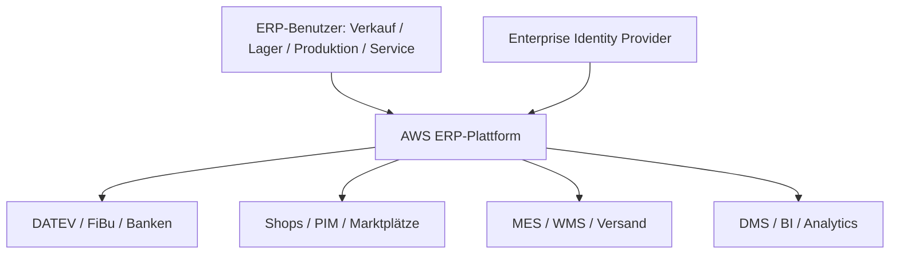
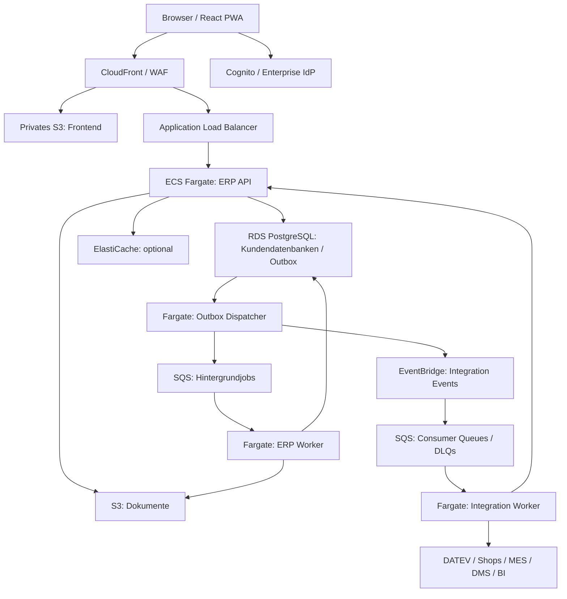

Stand: 12. Oktober 2026 — überarbeitet für AWS Cloud-first

**Verbindliche Entscheidung:** Die ERP-Plattform wird nativ Cloud-first auf AWS entwickelt und betrieben. Eine hybride Cloud-/On-Premises-ERP-Lösung, eine lokal installierbare Produktvariante und Multi-Cloud-Parität sind nicht Bestandteil der Zielarchitektur. AWS-Managed-Services dürfen bewusst genutzt werden.

Kundenseitige MES-, Druck-, Scanner- oder Bestandssysteme können angebunden werden. Ein optionaler lokaler Connector vermittelt ausschließlich Integrationen; er betreibt weder ERP-Kern noch führende ERP-Datenbank. Begrenzte Offline-Erfassung in der PWA ist ebenfalls keine lokale ERP-Installation.

# 1. Executive Summary

**Modularer Monolith + API First + eventbasierte Integration + AWS-Managed-Services.**

Der ERP-Kern bleibt ein modularer Monolith. API, Worker und Integrationen werden unabhängig auf ECS/Fargate betrieben. Cloud-first erfordert keine flächendeckende Microservice-Architektur.

| Baustein | Festgelegter Zielstack |
| --- | --- |
| Frontend | React + TypeScript, responsive PWA |
| Backend | ASP.NET Core / .NET, modularer Monolith |
| API | REST + OpenAPI |
| Laufzeit | Amazon ECS auf AWS Fargate, Linux-OCI-Container |
| Edge | Route 53, CloudFront, AWS WAF, Application Load Balancer, ACM |
| Datenbank | Amazon RDS for PostgreSQL, produktiv Multi-AZ |
| Cache | Optional Amazon ElastiCache for Valkey |
| Events / Jobs | Amazon EventBridge / Amazon SQS mit Dead-Letter Queues |
| Dokumente | Amazon S3, Verschlüsselung mit AWS KMS |
| Identity | Amazon Cognito User Pools mit Enterprise-IdP-Föderation |
| Secrets / Zugriffe | Secrets Manager, IAM Task Roles, KMS |
| Telemetrie | OpenTelemetry, CloudWatch und AWS X-Ray |
| Infrastruktur / Releases | AWS CDK, CloudFormation, ECR und Git-basierte CI/CD |
| Suche / Analytics | Zunächst PostgreSQL; OpenSearch Service und separate Analytics nur bei Bedarf |

# 2. Architekturziele

Die Lösung soll folgende Szenarien gleichermaßen unterstützen.

## Typischer Kunde

• 30--50 Benutzer

• 1--10 Gesellschaften/Mandanten

• 100.000--1.000.000 Artikel

• mehrere hunderttausend Adressen

• Millionen Belege

• zweistellige bis dreistellige Millionenanzahl historischer Bewegungs-
und Positionsdatensätze möglich

• 5--30 angebundene Systeme

• Nativer SaaS-Betrieb auf AWS

## Architekturziele

• P95-Antwortzeiten normaler Benutzeraktionen \< 500 ms

• horizontale Skalierung der Application Nodes

• vertikale und später horizontale Skalierung datenintensiver
Komponenten

• Updatefähigkeit ohne kundenspezifische Forks

• AWS-Managed-Services als verbindliche Betriebsbasis

• Automatisierte Kundenbereitstellung, Updates, Datenexporte und Restore auf AWS

• einfache Anbindung externer Systeme

• langfristige Wartbarkeit über 10+ Jahre

# 3. C4 Level 1 — System Context

Die ERP-Plattform läuft vollständig auf AWS. Externe Systeme nutzen REST, Events, Webhooks, EDI, SFTP oder Connectoren. Kundenseitige Systeme liegen außerhalb der ERP-Betriebsgrenze; direkte schreibende Datenbankzugriffe werden nicht unterstützt.

# 4. Mandantenmodell

**Database per Customer** bleibt die Standardstrategie: Jeder SaaS-Kunde erhält eine eigene logische PostgreSQL-Datenbank und eine eigene Datenbankrolle. Darin werden Gesellschaften über tenant_id getrennt. customer_id bezeichnet den SaaS-Kunden, tenant_id die Gesellschaft.

Eine serverseitige Kundenregistrierung ordnet die verifizierte customer_id ihrer Datenbank, Zugangsdaten und Deployment-Zelle zu. Clients dürfen keine Datenbankverbindung auswählen. RLS schützt zusätzlich Gesellschaftsgrenzen; Task-/DB-Rollen dürfen sie nicht umgehen, und bei Connection Pooling muss der Tenant-Kontext transaktionsgebunden gesetzt und zurückgesetzt werden.

**Gesellschaft anlegen (ADR-005, angenommen 2026-10-16).** Auf der Anmeldeseite kann ein neuer Mandant angefordert werden. Pflichtfelder sind Firmenname und E-Mail. Der erste Benutzer heißt `kunde` und bleibt gesperrt, bis `ckrause@cvs.de` den Link in der Freigabe-Mail bestätigt. Erst danach geht das Passwort an die angegebene Adresse. Jede Anmeldung verlangt Mandantennummer, Benutzer und Passwort; die E-Mail ist kein Anmeldename. Dieselbe Adresse kann später mehreren Benutzern gehören, auch mehr als einem Benutzer in einem Mandanten (Buchhalter und Administrator sind getrennte Anmeldungen). Rollen folgen später. Dieser Schritt legt eine Gesellschaft in der aktuellen Zelle an und ersetzt nicht Database per Customer.

Mehrere Kundendatenbanken können eine RDS-Instanz teilen. Das ist **logische Isolation**, keine eigene Infrastruktur- oder Ausfallgrenze. CPU, IOPS, Verbindungen, Wartung und instanzweite Wiederherstellung bleiben geteilt. Dedizierte RDS-Instanzen beziehungsweise separate AWS-Deployment-Zellen sind eine Premium-/Regulierungsoption.

Kundenspezifische Restore-Prozesse werden explizit implementiert: RDS-Snapshot und Point-in-Time Restore stellen eine neue Instanz wieder her. Für einen einzelnen Kunden auf einer geteilten Instanz wird anschließend dessen Datenbank kontrolliert exportiert und importiert, mit geprüften S3-Referenzen, Job-/Eventzuständen und fachlicher Konsistenz. Eigene logische Datenbanken garantieren daher keine unabhängigen Wartungsfenster oder sofortigen Einzelkunden-Restores.

# 5. AWS-Mandantenarchitektur

Kunden werden serverseitig einer Deployment-Zelle und eigenen logischen RDS-Datenbank zugeordnet. Eine Zelle kann mehrere Kunden bedienen. Größere oder besonders schutzbedürftige Kunden erhalten dedizierte Ressourcen.

S3-Zugriff, Cache-Schlüssel, Events, Jobs, Reports und Telemetrie übernehmen dieselbe Kunden-/Gesellschaftsgrenze. Worker dürfen customer_id und tenant_id aus Nachrichten nur nach Prüfung ihres Auftragskontexts verwenden.

# 6. Warum Database per Customer?

Eigene logische Datenbanken vereinfachen Schemaorganisation, Datenexport und Löschung. Gegenüber einer gemeinsamen Mega-Datenbank reduzieren sie versehentliche kundenübergreifende Abfragen.

Auf einer geteilten RDS-Instanz bleiben physische Ressourcen und Restore-Grenzen gemeinsam. Die Wahl zwischen logischer Kundendatenbank und dedizierter RDS-Instanz wird nach Kosten, Isolation und Wiederherstellungsanforderungen getroffen.

# 7. C4 Level 2 — Container Architecture

Dies ist ein logisches Deploymentbild. Kundenverwaltung, IAM, KMS, Secrets Manager und Telemetrie wirken übergreifend; sie sind zugunsten der Lesbarkeit nicht als Datenpfade eingezeichnet.

C4-Container bezeichnen Laufzeitanwendungen und Datenspeicher; Managed Services sind keine selbst betriebenen Docker-Container.

# 8. ERP API und Frontend

Die React-PWA wird statisch über CloudFront aus S3 ausgeliefert. Die ASP.NET-Core-API auf ECS/Fargate verantwortet Geschäftslogik, Berechtigungen, Validierung, Transaktionen und Domain Events. Sie ist stateless und läuft produktiv mit mindestens zwei Tasks über mehrere Availability Zones.

WAF/ALB ersetzen den selbst betriebenen Reverse Proxy. Frontend und API besitzen getrennte Release-Artefakte.

# 9. ERP Worker

Langlaufende MRP-, PDF-, Import-, Export-, Reporting- und Migrationsprozesse laufen in eigenen ECS/Fargate-Worker-Services beziehungsweise einmaligen Tasks. SQS vermittelt Jobs; EventBridge Scheduler löst geplante Prozesse aus. Jobstatus, Fortschritt, Abbruch und Idempotenz liegen persistent in RDS.

API-Antworten liefern Job-ID und Status-URL. Worker autoskalieren nach Queue-Alter und Rückstau innerhalb der Datenbank- und Kundenbudgets.

# 10. Integration Service

**Amazon EventBridge** routet versionierte Integration Events an **SQS-Queues pro Consumer beziehungsweise Workload**. Direkte Hintergrundjobs werden durch einen Outbox-Dispatcher an SQS übergeben. Unterschiedliche Consumer erhalten eigene Queues, damit sie Ereignisse unabhängig verarbeiten können.

Standard-Queues und Eventverarbeitung werden als **At-least-once** modelliert: Duplikate und fehlende globale Reihenfolge sind zu erwarten. Consumer speichern eine Inbox/Deduplizierung mit customer_id + event_id und bestätigen erst nach erfolgreicher Verarbeitung. Reihenfolgekritische Jobs können SQS FIFO mit bewusstem Message-Group-Konzept nutzen; EventBridge erzeugt keine garantierte End-to-End-Reihenfolge. Aggregate-Versionen erlauben Erkennung überholter oder fehlender Events.

Visibility Timeout, Retry mit Backoff, maximale Versuche, Dead-Letter Queues, Redrive und Queue-Alter-Alarme sind Pflicht. EventBridge-Zielzustellung erhält ebenfalls Retry-/DLQ-Regeln. Fehlgeschlagene Einträge einer PutEvents-Batchantwort werden einzeln behandelt. Größere Nutzdaten liegen in S3; Nachrichten enthalten berechtigte Referenzen statt ganzer Dokumente.

RabbitMQ, NATS und Kafka gehören nicht zum Standarddeployment.

Integration Worker auf Fargate implementieren DATEV, Shops, EDI, Versand, Banken, DMS und MES. Sie verändern ERP-Daten ausschließlich über die ERP-API. Optional vermittelt ein kundenseitiger Connector ausgehend über TLS lokale Systeme; Netzwerkunterbrechungen werden gepuffert und gemeldet.

# 11. C4 Level 3 -- ERP Application

    ERP Application
    │
    ├── Platform
    │   ├── Identity
    │   ├── Authorization
    │   ├── Tenancy
    │   ├── Configuration
    │   ├── Audit
    │   ├── Workflow
    │   ├── Notifications
    │   └── Custom Fields
    │
    ├── Master Data
    │   ├── Address
    │   ├── Customer
    │   ├── Supplier
    │   ├── Article
    │   └── Contact
    │
    ├── Sales
    │   ├── Quotation
    │   ├── Sales Order
    │   ├── Delivery
    │   ├── Invoice
    │   └── Return
    │
    ├── Purchasing
    ├── Inventory
    ├── Manufacturing
    ├── Service
    ├── Pricing
    ├── Finance Integration
    ├── Reporting
    └── Integration

# 12. Architektur innerhalb eines Moduls

Beispiel Sales:

    Sales
    │
    ├── API
    ├── Application
    │   ├── Commands
    │   ├── Queries
    │   └── Use Cases
    ├── Domain
    │   ├── SalesOrder
    │   ├── SalesOrderLine
    │   ├── Rules
    │   ├── Services
    │   └── Domain Events
    ├── Infrastructure
    │   ├── Database
    │   ├── Messaging
    │   └── External Adapters
    └── Contracts

Das wichtigste Prinzip lautet: **Ein Modul darf nicht beliebig auf
interne Tabellen eines anderen Moduls zugreifen.**

# 13. Kommunikation zwischen Modulen

Innerhalb des Monolithen dürfen direkte, typisierte Aufrufe verwendet
werden, beispielsweise Sales → Pricing → CalculatePrice().

Lose gekoppelte Aktionen werden dagegen über Domain Events ausgeführt:

    SalesOrderReleased
           │
           ├── Inventory → Reserve Stock
           ├── Workflow  → Notify Sales Manager
           └── Integration → publish externally

# 14. Domain Events vs. Integration Events

Diese beiden Eventtypen sollten getrennt werden.

## Domain Event

Intern, beispielsweise SalesOrderReleased.

## Integration Event

Extern stabiler Vertrag, beispielsweise:

    erp.sales-order.released.v1
    {
      "eventId": "...",
      "eventType": "erp.sales-order.released.v1",
      "timestamp": "...",
      "customerId": "...",
      "tenantId": "...",
      "salesOrderId": "...",
      "salesOrderNumber": "1004711"
    }

Interne Datenstrukturen dürfen niemals ungefiltert als externe Events
veröffentlicht werden.

# 15. Transactional Outbox

Jede externe Eventpublikation erfolgt über eine Outbox.

    BEGIN
    UPDATE sales_order ...
    INSERT INTO outbox_event ...
    COMMIT

Danach:

    Outbox Worker
         │
         ▼
    EventBridge / SQS

Damit gilt: **Geschäftsdaten gespeichert = Outbox-Eintrag atomar gespeichert.** Die Publikation wird bestätigt und wiederholt; Zielverarbeitung erfordert Idempotenz, Retry, DLQ und Monitoring. Eine End-to-End-Exactly-once-Garantie entsteht daraus nicht.

# 16. Idempotenz

Alle extern erreichbaren schreibenden Schnittstellen sollten Idempotenz
unterstützen.

    POST /api/v1/sales-orders
    Idempotency-Key: ABC-123

Wird derselbe Request mehrfach gesendet, darf kein zweiter Auftrag
entstehen. Das ist wichtig bei E-Commerce, EDI, mobilen Clients,
instabilen Netzwerken und Wiederholungsversuchen externer Middleware.

# 17. Datenbankarchitektur

**Amazon RDS for PostgreSQL** ist die führende transaktionale Datenhaltung. PostgreSQL bleibt aufgrund von ACID, SQL, Indizes, JSONB und guter Integrität geeignet; Cloudneutralität und lokale Installierbarkeit sind keine Auswahlkriterien mehr.

Produktiv wird eine Multi-AZ-Konfiguration vorgesehen. Ein Standby einer klassischen Multi-AZ-DB-Instance dient der Verfügbarkeit, nicht als Reporting-Read-Replica. Read Replicas sind separate, optionale Ressourcen; verbindliche Buchungs- und Bestandsentscheidungen lesen vom Writer.

Aurora PostgreSQL-Compatible wird erst nach einem belegten Verfügbarkeits-, Skalierungs- oder Kostenvorteil geprüft. RDS Proxy ist optional und muss mit dem Kundendatenbankmodell sowie Session-/RLS-Verhalten getestet werden. Connection-Pool-Budgets gelten pro Kunde und für die gesamte RDS-Instanz.

Pro Kundendatenbank können die Schemas platform, masterdata, sales, purchasing, inventory, manufacturing, service, integration und reporting die Moduleigentümerschaft abbilden.

# 18. IDs

Es werden zwei IDs verwendet.

Intern:

    id BIGINT

Extern:

    public_id UUID

Beispiel:

    sales_order
    id             BIGINT
    public_id      UUID
    tenant_id      BIGINT
    order_number   VARCHAR(...)
    ...

BIGINT ist kompakt und datenbankfreundlich. UUID eignet sich dagegen gut
für APIs, Events, Synchronisation, Offline-Szenarien und
Systemintegration.

# 19. Belegmodell

Ein Fehler vieler ERP-Systeme ist eine einzige universelle Tabelle für
alle Belegarten. Besser:

    SalesOrder
    SalesOrderLine
    Delivery
    DeliveryLine
    Invoice
    InvoiceLine

Gemeinsame technische Strukturen können intern abstrahiert werden. Die
fachlichen Aggregate bleiben jedoch getrennt. Dadurch werden
Datenmodell, Validierung, Performance, Berechtigungen und
Weiterentwicklung deutlich übersichtlicher.

# 20. Datenmengen

Das System sollte mindestens gegen folgendes Referenzprofil getestet
werden:

    Artikel:                 1.000.000
    Adressen:                2.000.000
    Belege:                 10.000.000
    Belegpositionen:        50.000.000
    Lagerbewegungen:       100.000.000
    Audit Events:          100.000.000+

Nicht weil jeder Kunde diese Mengen erreicht, sondern damit die
Architektur nicht bei wachsendem Kundenbestand neu entwickelt werden
muss.

# 21. Partitionierung -- differenzierte Strategie

Partitionierung sollte technisch vorbereitet, aber **nicht blind überall
aktiviert** werden.

PostgreSQL kann auch Tabellen mit vielen Millionen Datensätzen sehr
effizient verarbeiten.

Partitionierung lohnt sich insbesondere bei:

    stock_movement
    audit_event
    integration_event
    change_history
    event_log

und gegebenenfalls sehr großen document_line-Tabellen. Partitionierung
beispielsweise nach Monat, Quartal oder Jahr -- und nicht nach tausenden
einzelnen Mandanten.

# 22. Indexstrategie

Indizes müssen aus den konkreten Zugriffsmustern entstehen.

    (tenant_id, article_number)
    (tenant_id, customer_number)
    (tenant_id, document_number)
    (tenant_id, document_date)
    (tenant_id, customer_id, document_date)
    (tenant_id, article_id, document_date)

Wichtig: Nicht automatisch tenant_id an die erste Stelle jedes Index
setzen. Bei einer dedizierten Kundendatenbank und nur wenigen
ERP-Mandanten kann ein anderer Indexaufbau performanter sein.

Die Indexstrategie muss anhand realer Queries und Query Plans entwickelt
werden.

# 23. Keyset Pagination

Klassische Pagination:

    OFFSET 1000000
    LIMIT 50

sollte bei großen Datenmengen vermieden werden.

Stattdessen:

    WHERE id > :last_id
    ORDER BY id
    LIMIT 50

beziehungsweise nach fachlichen Sortierkriterien. Das ist bei Millionen
Datensätzen wesentlich effizienter.

# 24. Artikel- und Adresssuche

Für die erste Version würde ich **keine externe Search Engine zwingend
voraussetzen**.

PostgreSQL bietet B-Tree, Full Text Search, GIN und Trigram Search.
Damit können Suchfälle wie 1004711, 4711, Müller, Mueller, Müller
Maschinenbau, HB-100 oder Hydraulikpumpe performant umgesetzt werden.

# 25. Optionaler Search Service

PostgreSQL bleibt führend. Nur bei belegtem Bedarf wird Amazon OpenSearch Service ergänzt. Ein idempotenter Indexer verarbeitet Events aus einer eigenen SQS-Queue. Indizes sind rekonstruierbar; Kunden-/Gesellschaftsfilter werden serverseitig erzwungen. Kosten und Zugriffsgrenzen müssen vor Einführung nachgewiesen werden.

# 26. CQRS -- aber pragmatisch

Keine vollständige CQRS/Event-Sourcing-Architektur. Stattdessen:

    Commands
       │
       ▼
    Transactional Domain Model
       │
     PostgreSQL

und für komplexe Lesefälle:

    Events
      │
      ▼
    Read Model
      │
      ▼
    Query API

Beispiel für eine Auftragsübersicht:

    sales_order_overview
    order_id
    order_number
    customer_number
    customer_name
    order_date
    value
    delivery_status
    invoice_status
    payment_status

Dadurch muss nicht für jede Tabellenzeile eine komplexe Join-Kette
ausgeführt werden.

# 27. Datenkonsistenz

Innerhalb eines fachlichen Aggregats: **ACID-Transaktion**.

Zwischen unabhängigen Prozessen: **Eventual Consistency**.

    Auftrag freigeben
    Sales Order
         │
       COMMIT
         │
         ▼
    SalesOrderReleased
         │
         ├── Lagerreservierung
         ├── Workflow
         └── externe Systeme

Der Auftrag muss nicht fünf externe Systeme innerhalb derselben
Datenbanktransaktion aufrufen.

# 28. Frontend-Architektur

Empfohlen: React + TypeScript + PWA.

    UI
    │
    ├── Shell
    ├── Navigation
    ├── Authentication
    ├── Sales
    ├── Purchasing
    ├── Inventory
    ├── Manufacturing
    ├── Service
    └── Administration

Die Frontendmodule sollten möglichst dieselben fachlichen Grenzen wie
das Backend verwenden.

# 29. UI für ERP-Arbeitsplätze

Eine ERP-Anwendung darf nicht wie eine gewöhnliche Consumer-Webseite
gestaltet werden. Sachbearbeiter benötigen schnelle Tastaturbedienung,
Shortcuts, Tabellen, Mehrfachauswahl, Copy & Paste, konfigurierbare
Spalten, gespeicherte Filter, schnelle Suche, Massenoperationen und
mehrere Arbeitskontexte.

# 30. Mobile Nutzung

Für mobile Prozesse werden separate UI-Flows angeboten.

    Login
     ↓
    Lager wählen
     ↓
    Wareneingang
     ↓
    Barcode scannen
     ↓
    Menge erfassen
     ↓
    Lagerplatz scannen
     ↓
    Buchen

Nicht: Desktop-Wareneingangsmaske auf 6 Zoll verkleinern.

# 31. Begrenzte Offline-Erfassung

Die ERP-Plattform benötigt eine AWS-Verbindung. Einzelne PWA-Prozesse wie Inventur oder Serviceberichte können begrenzt lokal erfasst und später synchronisiert werden. Lokale Daten werden minimiert und geschützt; Konflikte, Ablauf, erneute Berechtigungsprüfung und idempotente Übertragung sind definiert.

Verbindliche Rechnungsbuchungen, Bestandsentscheidungen und Kerntransaktionen werden erst online auf dem Server ausgeführt. Ein vollständiges Offline-ERP ist nicht vorgesehen.

# 32. Public API

Die REST API sollte ein eigenständiges Produkt der Plattform sein.

    GET /api/v1/articles
    GET /api/v1/articles/{id}
    POST /api/v1/customers
    GET /api/v1/stock
    POST /api/v1/sales-orders

Dazu gehören OpenAPI, Versionierung, Pagination, Filtering, Sorting,
Bulk APIs, Idempotency, Rate Limiting und Webhooks.

# 33. Bulk APIs

Für Integrationen ist eine Einzelobjekt-API alleine nicht ausreichend.

    POST /api/v1/articles/bulk

Große Datenübertragungen werden als Importjob behandelt:

    Upload
       │
       ▼
    Import Job
       │
       ▼
    Worker
       │
       ▼
    Status API

# 34. Webhooks

Externe Systeme können sich beispielsweise auf InvoicePosted,
CustomerChanged, StockChanged oder ArticleChanged registrieren.

    ERP
     │
     ▼
    Webhook Queue
     │
     ▼
    Customer Endpoint

Mit Retry, exponential backoff, Signatur, Dead Letter Queue und Delivery
History.

# 35. Erweiterungsarchitektur

Kundenanpassungen dürfen nicht den ERP-Kern verändern.

## Level 1 -- Konfiguration

Custom Fields, Custom Views, Custom Lists, Custom Reports, Number Ranges
und Workflows.

## Level 2 -- Regeln

Business Rules, Validation Rules und Workflow Actions.

## Level 3 -- Extensions

    ERP
     │ Event
     ▼
    Custom Extension
     │ REST API
     ▼
    ERP

Kundenspezifischer Programmcode sollte möglichst **out-of-process**
laufen. Das verbessert Sicherheit, Stabilität, Updatefähigkeit und
Fehlerisolation.

# 36. Datenhoheit im Cloud-first-Modell

## Verfügbarkeit und Wiederherstellung

Multi-AZ schützt vor einem AZ-Ausfall, ersetzt aber kein Disaster-Recovery-Konzept für einen Regionsausfall. RDS-Backups/PITR, S3-Versionierung und geschützte Backup-Kopien in einem separaten Account werden eingerichtet. Restore-Tests umfassen DB, Dokumente, Schlüsselzugriff, Kundenrouting und noch offene Jobs/Events.

Vorläufige Planungsziele sind **RPO ≤ 15 Minuten** und **RTO ≤ 4 Stunden** für das definierte Wiederherstellungsszenario. Sie sind keine Zusage und müssen mit realistischen Datenmengen gemessen sowie vertraglich abgestimmt werden. Regionenübergreifende Kopien und Wiederanlauf werden nur in einer freigegebenen Region implementiert; der DR-Modus wird vor Produktivstart entschieden.

## Datenhoheit und Exit

Datenhoheit bedeutet hier dokumentierte Datenregionen, Zugriffskontrolle, Export-/Löschprozesse, Aufbewahrungsregeln und nachvollziehbare Schlüsselverwaltung. Kunden erhalten strukturierte Datenexporte samt Dokumenten und Schemainformationen. Das ist kein Versprechen, das ERP anschließend lokal betreiben zu können.

Regionale Speicherung allein garantiert keine DSGVO- oder Archivkonformität. Auch Backups, Logs, Supportzugriffe und externe Integrationen werden im Datenfluss erfasst. CloudFront ist ein globaler Dienst; dynamische ERP-Daten werden nicht am Edge gecacht. Strikte regionale Verarbeitungsanforderungen erfordern eine gesonderte Prüfung des Edge-Pfads.

# 37. Bewusste AWS-Serviceintegration

AWS-SDKs werden in Infrastructure-Adaptern eingesetzt. Fachliche Domain- und Application-Schichten bleiben davon getrennt. Interfaces für Messaging, Storage und Identity ermöglichen Tests und klare Verträge; sie verlangen keine alternativen Azure-, MinIO- oder lokalen Betriebsimplementierungen.

AWS-Abhängigkeit wird akzeptiert. Strukturierte Exporte und offene API-/Datenformate begrenzen fachlichen Lock-in, garantieren aber keinen unveränderten Betrieb auf anderen Plattformen.

# 38. AWS-Accounts und Netzwerk

Die produktive Referenzumgebung liegt in **eu-central-1 (Frankfurt)**. AWS Organizations trennt Produktion, Nichtproduktion, Security und zentrale Logs in eigene Accounts. Die Workload-VPC umfasst mindestens zwei Availability Zones.

- CloudFront liefert die PWA aus einem privaten S3-Bucket über Origin Access Control. API-Aufrufe werden zum ALB weitergeleitet; API-Antworten werden standardmäßig nicht gecacht.
- AWS WAF schützt den Zugang, ACM verwaltet TLS-Zertifikate. ALB-Origin-Zugriff wird gegen Umgehung des CloudFront-/WAF-Pfads abgesichert.
- ERP-API und Worker laufen als getrennte ECS-Services auf Fargate in privaten Subnetzen, ohne öffentliche Task-IP. Der API-Service betreibt mindestens zwei Tasks über mehrere AZs.
- RDS und optional ElastiCache sind nicht öffentlich erreichbar. Security Groups erlauben ausschließlich erforderliche Verbindungen.
- AWS-Dienste werden über geeignete VPC Endpoints angebunden; externe Connectoren erhalten kontrollierten Egress. NAT-, Endpoint- und Transferkosten werden mit eingeplant.
- Autoscaling orientiert sich bei APIs an Last und Latenz, bei Workern an Queue-Alter und Rückstau. Datenbankverbindungen, Kundenquoten und Downstream-Limits begrenzen die Skalierung.

API Gateway ist eine spätere Option für ein gesondertes Partner-API-Produkt; es ist keine zusätzliche Pflichtschicht vor dem ALB.

# 39. ECS/Fargate statt Kubernetes als Standard

ECS/Fargate reduziert die Verantwortung für Containerhosts und Clusterbetrieb. Amazon EKS wird erst eingeführt, wenn konkrete Kubernetes-Anforderungen den zusätzlichen Aufwand rechtfertigen. Lambda ist eine Option für kurze, klar begrenzte Integrationsschritte; es ersetzt nicht pauschal den transaktionalen ERP-Kern.

# 40. Cloud Deployment und CI/CD

AWS CDK definiert versionierte CloudFormation-Stacks für Accounts/Umgebungen, Netzwerk, IAM, Datenhaltung, ECS, Queues und Alarme. OCI-Images liegen in Amazon ECR, werden auf Schwachstellen geprüft und über unveränderliche Digests ausgerollt.

CI/CD nutzt kurzlebige föderierte AWS-Zugänge, automatisierte Checks und eine kontrollierte Produktionsfreigabe. Datenbankmigrationen laufen als einmalige, koordinierte Tasks pro Kundendatenbank, nicht beim Start jeder API-Replik. Expand → Migrate → Contract ermöglicht rollende Releases; inkompatible Schemaänderungen schließen einen simplen Image-Rollback aus. Vorwärtskorrektur und Restore werden in Runbooks beschrieben.

Die Entwicklung kann lokale Container und Test-Doubles verwenden; das AWS-Referenzdeployment bleibt die Integrations- und Betriebsreferenz. Lokale Entwicklung ist keine unterstützte On-Premises-Produktvariante.

# 41. Datenbank-Skalierung

Die Skalierungsstrategie lautet:

1 -- Eine PostgreSQL-Datenbank

2 -- Optimierung: Indizes, Query Tuning, Connection Pooling, Caching,
Read Models

3 -- Vertikale Skalierung: mehr RAM, CPU und IOPS

4 -- Read Replica für Reporting

5 -- Partitionierung sehr großer Tabellen

6 -- Auslagerung spezieller Workloads

7 -- Erst sehr spät: Sharding

# 42. Kein voreiliges Sharding

Für die beschriebene Zielgruppe wird ausdrücklich **kein
Datenbank-Sharding in der ersten Architektur** vorgesehen.

50 Millionen Belegpositionen sind für eine gut dimensionierte
PostgreSQL-Installation kein außergewöhnliches Problem. Sharding erzeugt
dagegen erhebliche zusätzliche Komplexität bei Joins, Transaktionen,
Reporting, Backups, Migration und Entwicklung.

# 43. Reporting

## Operational Reporting

Direkt aus ERP DB oder Read Models, beispielsweise Auftragsbestand,
Lagerbestand, offene Lieferungen und Produktionsstatus.

## Analytical Reporting

    ERP
     │
     ▼
    CDC / Events
     │
     ▼
    Reporting Database
     │
     ▼
    Power BI / Qlik / etc.

Analytische Abfragen dürfen nicht die Produktion verlangsamen.

# 44. Identity

Amazon Cognito User Pools übernimmt Benutzeranmeldung und föderiert bei Bedarf mit Microsoft Entra ID oder anderen Enterprise-IdPs über OIDC/SAML. Die PWA verwendet Authorization Code Flow mit PKCE, ohne Client Secret. MFA, kurze Token-Laufzeiten und sichere Token-Verwaltung gehören zum Sicherheitskonzept.

Das Backend prüft Signatur, Issuer, Token-Typ und zum verwendeten Flow passende Audience-/Client- und Scope-Claims. **customer_id** und zulässige **tenant_id** werden serverseitig aus verifizierter Identität und Mitgliedschaft abgeleitet, niemals aus frei gewählten Request-Feldern. Fachliche Permissions bleiben Aufgabe des ERP.

Service-Integrationen erhalten eigene, begrenzte OAuth2-Identitäten. AWS-Ressourcen werden über IAM Task Roles und Least Privilege angesprochen; keine statischen AWS-Schlüssel im Anwendungscode. Secrets liegen in Secrets Manager, Datenverschlüsselung erfolgt über KMS. Administration nutzt IAM Identity Center; privilegierte Zugriffe werden protokolliert.

# 45. Authorization

Nicht nur Rollen, sondern Benutzerzuordnung zu Rollen, Mandanten,
Standorten, Lagern und Permissions.

Beispiele:

    Sales.Order.Read
    Sales.Order.Create
    Sales.Order.Release
    Sales.Price.Change
    Purchasing.Order.Create
    Purchasing.Order.Release
    Inventory.Stock.Read
    Manufacturing.Order.Release

# 46. Security Defense in Depth

    Browser
     ↓
    TLS
     ↓
    Reverse Proxy
     ↓
    Authentication
     ↓
    Authorization
     ↓
    Application Tenant Filter
     ↓
    optional PostgreSQL RLS
     ↓
    Database

PostgreSQL Row Level Security kann als zusätzliche Barriere eingesetzt
werden. Die fachliche Mandantenprüfung bleibt dennoch Aufgabe der
Anwendung.

# 47. Audit

Geschäftskritische Vorgänge erhalten append-only Audit-Einträge mit
timestamp, user, tenant, action, entity_type, entity_id, old_value,
new_value, request_id, correlation_id und source.

Beispiele: Invoice.Posted, Price.Changed, BankAccount.Changed,
Permission.Granted, SalesOrder.Released.

Audit-Einträge werden atomar mit der Geschäftsänderung gespeichert und über begrenzte Schreibrechte geschützt. S3 Object Lock kann eine festgelegte unveränderbare Aufbewahrung ergänzen; eine gewöhnliche RDS-Tabelle ist gegenüber privilegierten Administratoren nicht automatisch unveränderbar.

# 48. Observability auf AWS

OpenTelemetry liefert Traces und Metriken; strukturierte Logs und Alarme laufen in CloudWatch, Traces werden in AWS X-Ray ausgewertet. CloudTrail erfasst AWS-Verwaltungsaktionen und ersetzt nicht das fachliche ERP-Audit.

Request-/Correlation-ID sowie geprüfte customer_id und tenant_id begleiten API, Outbox, Jobs und Integration. Alarme umfassen API-P95, Fehlerraten, RDS-Verbindungen/IOPS, älteste Queue-Nachricht, Outbox-Rückstau und DLQs. Personenbezogene Inhalte, Secrets und komplette Belegpayloads werden nicht standardmäßig geloggt; Aufbewahrung und Kostenlimits sind festgelegt.

# 49. Performance Budget

**API Stammdaten Lookup:** \< 150 ms

**Artikelsuche:** \< 300 ms

**Kunden-/Adresssuche:** \< 300 ms

**Standardlisten:** \< 500 ms

**Auftrag öffnen:** \< 500 ms

**Auftrag speichern:** \< 500 ms

**Beleg buchen:** \< 1 s

**komplexe Auswertung:** \< 2 s

**sehr große Reports:** asynchron

Diese Werte müssen Bestandteil automatisierter Performance-Tests werden.

# 50. Lasttests

Vor Releases sollte ein synthetischer Referenzmandant existieren:

    1.000.000 Artikel
    2.000.000 Adressen
    10.000.000 Belege
    50.000.000 Belegpositionen
    100.000.000 Lagerbewegungen

Tests beispielsweise mit 50 parallelen Anwendern und realistischen
Vorgängen wie Artikelsuche, Auftrag erfassen, Auftrag öffnen,
Auftragsliste, Bestandsabfrage, Wareneingang, Lagerbuchung und Rechnung.

Performance wird damit zu einer messbaren Produktanforderung und nicht
zu einer späteren Optimierungsaufgabe.

# 51. Backendentscheidung .NET vs. Java

Beide Plattformen eignen sich für AWS. Für das Zielbild bleibt **ASP.NET Core / .NET** gesetzt, aufgrund von Teamproduktivität, Integrationsökosystem und Wartbarkeit. Lokaler ERP-Betrieb ist kein Bewertungskriterium mehr.

Ein überwiegend Java-erfahrenes Team kann eine Neubewertung begründen; die Cloudentscheidung erfordert keinen Sprachwechsel.

# 52. Backend-Empfehlung

Damit: **ASP.NET Core** mit REST, OpenAPI, PostgreSQL und OpenTelemetry.

Wichtig ist, keine übermäßige Framework-Magie einzubauen. Bevorzugt
werden klare Module, klare Interfaces, explizite Businesslogik, gut
lesbare SQL-Zugriffe und messbare Datenbankoperationen.

# 53. ORM-Strategie

Ein ERP sollte nicht dogmatisch ausschließlich ORM oder ausschließlich
SQL verwenden.

• Standard CRUD: ORM

• Performancekritische Queries: explizites SQL

Beispielsweise für Bestandsauskunft, Disposition, große Beleglisten,
Umsatzanalysen und Massendatenverarbeitung.

Entscheidend ist das erzeugte SQL, nicht die Eleganz des C#-Codes.

# 54. PostgreSQL auf AWS

**RDS for PostgreSQL** ist aufgrund von Datenintegrität, SQL-Performance, JSONB, Erweiterbarkeit und dem PostgreSQL-Ökosystem gesetzt. SQL Server oder Aurora werden nur anhand konkreter Anforderungen neu bewertet. Cloudneutralität und On-Premises-Parität sind keine Zielkriterien.

# 55. Bewertung der Kundenisolation

| Modell | Isolation und Betrieb | Entscheidung |
| --- | --- | --- |
| Gemeinsame Tabellen für alle Kunden | Hohe Anforderungen an kundensichere Queries und Einzelkunden-Restore | Kein Standard |
| Schema pro Kunde | Gemeinsame Datenbankgrenze und stärkere Betriebsverflechtung | Kein Standard |
| Logische DB pro Kunde auf geteilter RDS-Instanz | Eigene Rollen/DB; Ressourcen, Wartung und Restore instanzweit geteilt | Standard mit getesteten Runbooks |
| Eigene RDS-Instanz / Deployment-Zelle pro Kunde | Stärkere Ressourcen- und Ausfallisolation, höhere Kosten | Premium-/Spezialfall |
| DB pro Gesellschaft | Hoher Aufwand für gesellschaftsübergreifende Prozesse | Nur bei fachlicher Notwendigkeit |

# 56. AWS-Deployment-Matrix

| Baustein | Entwicklung / Test | Produktion |
| --- | --- | --- |
| ERP-Laufzeit | ECS/Fargate; lokale Container ergänzend | ECS/Fargate, API mindestens zwei Tasks über mehrere AZs |
| PostgreSQL | RDS, dimensioniert nach Testziel | RDS PostgreSQL Multi-AZ |
| Cache | Optional | ElastiCache for Valkey bei messbarem Bedarf |
| Events / Jobs | Getrennte EventBridge-Busse / SQS-Queues | EventBridge / SQS, Retry, DLQ und Alarme |
| Dateien | Eigene private S3-Buckets | Private S3-Buckets, KMS, Versionierung und Lifecycle |
| Identity | Getrennter Cognito User Pool | Cognito mit optionaler Enterprise-Föderation |
| Sicherheit | Eigener Nichtproduktionsaccount | Getrennte Accounts, IAM, KMS, Secrets Manager |
| Provisionierung | AWS CDK / CloudFormation | Dieselben versionierten IaC-Module |

Produktivdaten werden nicht unkontrolliert in Testumgebungen kopiert.

# 57. Updates

Auch der Updateprozess sollte Bestandteil der Architektur sein.

    Version N
       │
       ▼
    Backup prüfen
       │
       ▼
    DB Migration
       │
       ▼
    Application Update
       │
       ▼
    Health Checks
       │
       ▼
    Version N+1

Datenbankmigrationen müssen automatisierbar, versioniert, soweit möglich
rückwärtskompatibel und wiederholbar testbar sein.

# 58. Zero-/Low-Downtime-Migrationen

Schemaänderungen nach **Expand → Migrate → Contract**.

Nicht direkt alte Spalte löschen und neue Spalte hinzufügen, sondern:

1 -- neue Spalte hinzufügen

2 -- Software unterstützt beide

3 -- Daten migrieren

4 -- Software nutzt neue Spalte

5 -- alte Spalte später entfernen

Damit werden Cloudupdates ohne lange Wartungsfenster möglich.

# 59. DACH-spezifische Architekturmodule

Länderspezifische Anforderungen sollten nicht quer über das Gesamtsystem
verteilt werden. Stattdessen:

    Localization
    │
    ├── DE
    ├── AT
    └── CH

Dort liegen beispielsweise landesspezifische Steuerregeln,
Nummern-/Dokumentanforderungen, Zahlungsformate, E-Rechnungsformate,
Finanzbuchhaltungsexporte und Bankformate. Damit bleibt der Kern
internationalisierbar.

# 60. Architektur für E-Rechnung

Das Datenmodell sollte Rechnungsdaten nicht nur als PDF betrachten.

    Invoice
       │
       ├── strukturierte Daten
       ├── PDF Representation
       └── Electronic Invoice Representation

Dadurch können unterschiedliche Formate erzeugt werden, beispielsweise
landes- oder kundenspezifische elektronische Rechnungsformate.

# 61. Keine PDF-zentrierte Belegarchitektur

Der ERP-Beleg ist immer **strukturierte Daten** und nicht PDF. PDF, XML
oder andere Formate sind lediglich Repräsentationen desselben
Geschäftsobjekts. Das wird für zukünftige Integrationen zunehmend
wichtig.

# 62. Was sollte später Microservice werden?

Nicht Customer Service, Article Service, Invoice Service oder SalesOrder
Service nur um Microservices zu haben.

Gute Kandidaten sind dagegen:

• Integration Service -- viele externe Abhängigkeiten

• Document Service -- CPU- und speicherintensive
PDF-/Dokumentenverarbeitung

• Search Service -- falls OpenSearch eingesetzt wird

• Reporting Service -- separater Workload

• MRP / Planning -- kann sehr rechenintensiv werden

• E-Commerce Integration -- sehr unterschiedliche
Skalierungscharakteristik

# 63. Was sollte im Monolith bleiben?

Insbesondere die eng zusammenhängenden transaktionalen ERP-Domänen:

    Sales
    Purchasing
    Inventory
    Manufacturing
    Service
    Master Data
    Pricing

Damit können komplexe Geschäftsprozesse weiterhin atomar und performant
verarbeitet werden.

# 64. Architektur-Repository

Die Architektur sollte selbst versioniert werden.

    /docs/architecture
        /adr
        /c4
        /database
        /api
        /security

# 65. Architecture Decision Records

Die Entscheidungen werden mit Context, Decision, Alternatives und Consequences versioniert:

- ADR-001 Modularer Monolith
- ADR-002 Amazon RDS for PostgreSQL
- ADR-003 Database per Customer und Deployment-Zellen
- ADR-004 REST / OpenAPI
- ADR-005 Transactional Outbox und idempotente Consumer
- ADR-006 React PWA mit begrenzter Offline-Erfassung
- ADR-007 ASP.NET Core / .NET
- ADR-008 Amazon S3 / KMS
- ADR-009 Cognito und Enterprise-Föderation
- ADR-010 AWS Cloud-first; hybride und On-Premises-ERP-Variante verworfen
- ADR-011 ECS/Fargate als Standardlaufzeit
- ADR-012 EventBridge / SQS / DLQ
- ADR-013 AWS-Accounts, Regionen und Wiederherstellung
- ADR-014 AWS CDK und kontrollierte CI/CD

ADR-010 ersetzt die bisherige Entscheidung „No Mandatory Cloud Dependency“.

# 66. Empfohlenes Zielbild

Dies ist ein logisches Deploymentbild. Kundenverwaltung, IAM, KMS, Secrets Manager und Telemetrie wirken übergreifend; sie sind zugunsten der Lesbarkeit nicht als Datenpfade eingezeichnet.

# 67. Konkrete Architekturentscheidung

| Baustein | Festgelegter Zielstack |
| --- | --- |
| Frontend | React + TypeScript, responsive PWA |
| Backend | ASP.NET Core / .NET, modularer Monolith |
| API | REST + OpenAPI |
| Laufzeit | Amazon ECS auf AWS Fargate, Linux-OCI-Container |
| Edge | Route 53, CloudFront, AWS WAF, Application Load Balancer, ACM |
| Datenbank | Amazon RDS for PostgreSQL, produktiv Multi-AZ |
| Cache | Optional Amazon ElastiCache for Valkey |
| Events / Jobs | Amazon EventBridge / Amazon SQS mit Dead-Letter Queues |
| Dokumente | Amazon S3, Verschlüsselung mit AWS KMS |
| Identity | Amazon Cognito User Pools mit Enterprise-IdP-Föderation |
| Secrets / Zugriffe | Secrets Manager, IAM Task Roles, KMS |
| Telemetrie | OpenTelemetry, CloudWatch und AWS X-Ray |
| Infrastruktur / Releases | AWS CDK, CloudFormation, ECR und Git-basierte CI/CD |
| Suche / Analytics | Zunächst PostgreSQL; OpenSearch Service und separate Analytics nur bei Bedarf |

**Kundenmodell:** Logische Datenbank pro SaaS-Kunde, tenant_id pro Gesellschaft, dedizierte Ressourcen nach Bedarf.

**Kommunikation:** Interne Modulinterfaces und Domain Events; extern REST, Webhooks und versionierte Integration Events.

**Zuverlässigkeit:** Transactional Outbox, Inbox/Deduplizierung, Retry und DLQ; keine pauschale Exactly-once-Zusage.

**Cloudstrategie:** Nativer AWS-Betrieb ohne hybride oder lokal installierbare ERP-Variante.

**Datenhoheit:** Definierte Regionen, Zugriffe, Exporte, Löschung und geprüfte Restore-Prozesse.

**Skalierung:** SQL/Indizes → Read Models → Dimensionierung → Read Replicas/Partitionierung → gezielte Serviceauslagerung; Sharding erst bei nachgewiesenem Bedarf.

# 68. Wichtigste Architekturregel

Komplexität wird nur eingeführt, wenn ein nachweisbares Problem gelöst
wird.

Deshalb zunächst kein Microservice Zoo, Kafka Cluster, EKS ohne belegten Bedarf, Event Sourcing für alle Daten, verteilte Datenbanken,
Sharding oder OpenSearch Cluster nur weil die Technologien verfügbar
sind.

Der Kern sollte technisch eher unspektakulär sein:

    React
       +
    .NET
       +
    PostgreSQL

umgeben von sauber definierten APIs, Events und Erweiterungspunkten.

Die Qualität des ERP wird langfristig wesentlich stärker durch
**Domänenmodell, Datenmodell, SQL-Performance, Erweiterbarkeit und
Updatefähigkeit** bestimmt als durch die Anzahl eingesetzter
Infrastrukturtechnologien.

# 69. Empfohlene nächste Architekturphase

## A. Fachliches Domain Model

Geschäftspartner, Artikel, Preise, Aufträge, Lieferungen, Rechnungen, Bestand und Produktion; atomare Buchungsgrenzen und zulässige Eventual Consistency festlegen.

## B. Physisches PostgreSQL-Datenmodell

Kundendatenbanken, tenant_id, RLS, Schlüssel, Indizes, Partitionierung, Audit, Outbox und Inbox. Restore eines Einzelkunden einschließlich S3-Dokumentreferenzen prototypisch nachweisen.

## C. API- und Eventkonzept

OpenAPI, Versionierung, Filter, Pagination, Bulk, Idempotenz, Eventverträge, Autorisierung und Kundenquoten spezifizieren.

## D. Ausführbares AWS-Referenzdeployment

AWS-CDK-Stacks für Frankfurt: VPC, ECS/Fargate, ALB/WAF, CloudFront/S3, RDS Multi-AZ, Cognito, EventBridge/SQS/DLQ, IAM/KMS und CloudWatch. CI/CD und Kundenprovisionierung automatisieren. AZ-Ausfall, Queue-Retry, Duplikate, kundenübergreifende Zugriffstests und Restore messen.

## E. Betriebs- und Kostenmodell

SLOs, RPO/RTO, Datenregionen und DR-Modus vor Produktivstart bestätigen. Kosten pro Kunde und Zelle inklusive RDS-Mindestgröße, Fargate, NAT, VPC Endpoints, Logs, Backups und Transfer kalkulieren. Budgets, Tags, Quoten und Skalierungsgrenzen als FinOps-Regeln implementieren.

# Anhang: AWS-Betriebsregeln und Quellen

**Kosten und Kapazität:** Kosten werden pro Kunde und Deployment-Zelle ausgewiesen. Tags, AWS Budgets, Aufbewahrungsfristen, Worker-Quoten und begrenztes Autoscaling sind Teil des Betriebs. Lasttests umfassen auch mehrere gleichzeitig aktive SaaS-Kunden und Noisy-Neighbour-Szenarien.

**Fachliche Konsistenz:** Bestandsreservierungen, Nummernvergabe und Buchungen mit atomaren Invarianten werden in einer Datenbanktransaktion abgesichert. Eventual Consistency gilt nur für fachlich dafür freigegebene Folgeprozesse; fehlgeschlagene Verarbeitung muss sichtbar und wiederaufnehmbar sein.

**Referenzmessung:** Performanceziele sind P95-Ziele unter definierter Last und Datenmenge. API-Serverzeit und vom Arbeitsplatz gemessene End-to-End-Zeit einschließlich WAN-Latenz werden getrennt erhoben. Die Zielwerte sind keine bereits gemessenen Garantien.

Technische AWS-Referenzen (geprüft am 12. Oktober 2026; konkrete Region, Engine-Version, Quoten und Funktionen beim Implementierungsstart erneut prüfen):

- [ECS-Verteilung über Availability Zones](https://docs.aws.amazon.com/AmazonECS/latest/developerguide/service-rebalancing.html)
- [RDS-Snapshot-Restore: gesamte Instanz, neue Zielinstanz](https://docs.aws.amazon.com/AmazonRDS/latest/UserGuide/USER_RestoreFromSnapshot.html)
- [SQS Standard: At-least-once und Idempotenz](https://docs.aws.amazon.com/AWSSimpleQueueService/latest/SQSDeveloperGuide/standard-queues-at-least-once-delivery.html)
- [AWS-Entscheidungshilfe für SQS, SNS und EventBridge](https://docs.aws.amazon.com/decision-guides/latest/decision-guides/sns-or-sqs-or-eventbridge.html)
