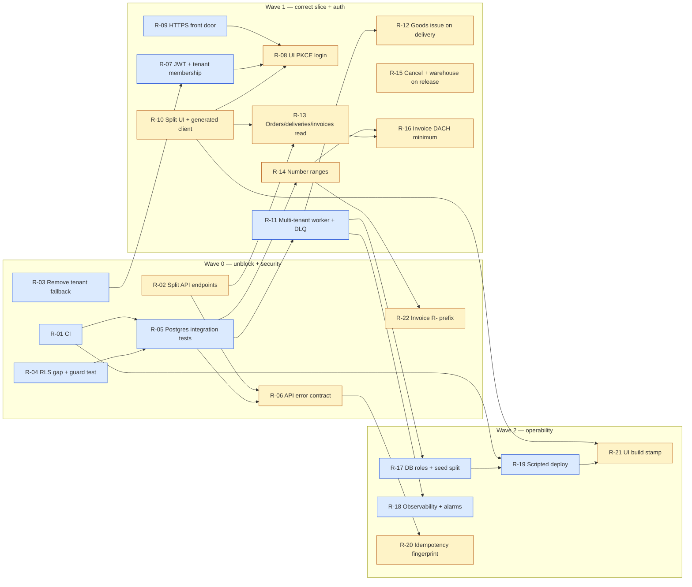

# Roadmap — next work items

## Purpose

This document is the source of truth for the next GitHub issues. Each `R-xx` block becomes one issue, and each `E-x` row becomes one epic issue that gets broken down later. The workflow `Create roadmap issues` (`.github/workflows/create-roadmap-issues.yml`) creates them from this file. See the last section.

## Baseline (main @ `d0d9807`)

Delivered: Milestone 1 trading slice (customer → article → sales order → release/reservation → worker-created delivery + invoice), Stamm master data (articles, addresses, ship-to), Lager slice A (Bestand, Wareneingang, movement ledger), and the cost-limited AWS dev cell.

Verified on this baseline:

| Check | Result |
| --- | --- |
| `dotnet build Erp.slnx -c Release` | 0 warnings, 0 errors |
| `dotnet test Erp.slnx` | 12 domain + 5 architecture tests pass |
| `npm test` / `npm run build` (`src/erp-web`) | 5 tests pass, build OK |
| `npm run lint` (`src/erp-web`) | 2 `set-state-in-effect` warnings in `App.tsx` |

## Findings that drive the ordering

Urgent (security or correctness):

1. **No CI.** The repo has no `.github/workflows`. Nothing runs the verification contract from the milestone plan on PRs.
2. **Missing row-level security on two tenant tables.** `addresses` and `customer_addresses` (migration `20261014094003_ArticleAddressManagement`) have no `ENABLE/FORCE ROW LEVEL SECURITY` or `tenant_isolation` policy. Every other tenant table has one. ADR-002 requires RLS as defense in depth. `initial.sql` has also drifted: it doesn't cover these tables and isn't used by the migrator.
3. **Silent tenant fallback.** `ParseTenant` in `src/Erp.Api/Program.cs` falls back to `DevelopmentIdentity:TenantId` whenever a JWT has no tenant claim. That value sits in the base `appsettings.json` (not just Development) and in the ECS task environment. ADR-002 requires the tenant to come from verified membership.
4. **The AWS cell API is unauthenticated.** `Authentication__Authority` isn't set in `infra/lib/erp-dev-stack.ts`, so the public HTTP ALB accepts anonymous writes. Cognito is provisioned but not wired.
5. **The worker only serves one tenant.** `Worker:TenantId` is fixed, and EF filters plus RLS hide every other tenant's outbox rows. Released orders of a second tenant never get a delivery or invoice, which breaks the M1 "one database, two tenants" scope. Failed messages also retry every 5 s forever: there's no max-attempts limit or dead-letter state, and no `SKIP LOCKED` claiming.
6. **The verification contract is unmet.** There are no integration tests for cross-tenant access, duplicate API requests, or duplicate messages. ADR-002 calls cross-tenant leakage tests release-blocking.
7. **Stock never leaves the warehouse.** Delivery doesn't consume the reservation: `Reserved` grows forever and `OnHand` never drops.
8. **Domain errors return HTTP 500.** Domain errors, concurrency conflicts on `StockBalance`, duplicate customer number or SKU, a second release with a new key, and racing idempotency keys all surface as 500. There's no ProblemDetails contract.

Structural (blocks two people working in parallel):

9. All endpoints sit in one 690-line `Program.cs`, and the whole UI in one 778-line `App.tsx`. Both are merge-conflict hotspots for two developers. ADR-001 also says each module owns its API surface.
10. The UI API types are handwritten in `api.ts`. The M1 plan promised generated or contract-derived types.

Domain gaps (needed before any real DACH invoicing):

11. The invoice number is `INV-{orderNumber}`. That isn't a gapless sequential number per tenant, which GoBD and UStG §14 require.
12. Invoices have no lines, VAT, gross amount, invoice date, or buyer address. There are no read APIs or UI for deliveries and invoices, so steps 3 and 4 in the order UI can't show results.
13. Release hardcodes warehouse `MAIN`, and orders can't be cancelled, so reservations can never be freed.

## Conventions for the issue drafts

- **Size.** S = one component, no schema change. M = 2–3 layers or one migration. L = cross-module, needs a migration, UI, and an open decision.
- **Priority.** P0 = security or blocks parallel work. P1 = correctness of the existing slice. P2 = operability. P3 = next business scope.
- **Labels.** `priority:P0..P3`, `size:S|M|L`, `area:api|worker|web|infra|persistence|domain|ci`, `type:security|bug|feature|tech-debt`, `lane:A|B`, and `epic`.
- **Milestones.** `M2a Hardening` (Wave 0–1), `M2b Operability` (Wave 2), and `M3 Einkauf + E-Rechnung` (Wave 3, per D5).

## Lanes and order



| Order | Dev A — platform / backend | Dev B — domain / fullstack |
| --- | --- | --- |
| 1 | R-01 CI | R-02 Split API endpoints *(merge first; freezes `Program.cs` briefly)* |
| 2 | R-03 Remove tenant fallback | R-06 API error contract *(unit-level first, integration tests once R-05 lands)* |
| 3 | R-04 RLS gap + guard test | R-10 Split UI + generated client |
| 4 | R-05 Postgres integration tests | R-13 Orders/deliveries/invoices read |
| 5 | R-11 Multi-tenant worker + DLQ | R-15 Cancel + warehouse on release |
| 6 | R-09 HTTPS front door | R-12 Goods issue on delivery *(after R-11 merges; both touch `Worker.cs`)* |
| 7 | R-07 JWT + tenant membership | R-14 Number ranges |
| 8 | R-17 DB roles + seed split | R-08 UI PKCE login *(after R-07 + R-09)* |
| 9 | R-18 Observability + alarms | R-16 Invoice DACH minimum |
| 10 | R-19 Scripted deploy | R-20 Idempotency fingerprint |
| 11 | R-23 Mandant registration *(sub-issues R-23a to R-23d, in that order)* | R-21 UI build stamp *(can ship early; soft depends on R-10 shell)* |
| 12 | R-24 SES production access *(after R-23c)* | R-22 Prefix invoice numbers with `R-` *(Wave 0; after R-14)* |

Sync points: R-02 merges before any other `Program.cs` change. R-11 merges before R-12. R-07, R-08, and R-09 ship together to the AWS cell, with a cost-gate update for R-09.

---

## Wave 0 — unblock parallel work and close security holes

### R-01 — Add a CI workflow for build, tests, lint, and CDK synth

`lane:A` `priority:P0` `size:S` `area:ci` `type:tech-debt` — depends on: none

**Context.** There's no `.github/workflows`. The verification contract in `docs/plans/2026-10-13-erp-trading-foundation.md` is run by hand.

**Scope.**
- A GitHub Actions workflow on PR and push to `main` that runs: .NET 10.0.401 per `global.json`, `dotnet build -c Release`, `dotnet test`, `npm ci && npm run lint && npm test && npm run build` in `src/erp-web`, and `npm ci && npx cdk synth` in `infra` (no AWS credentials needed for synth).
- Cache NuGet and npm packages.
- Turn on branch protection for `main` with required checks. This is a manual repo setting, so document it.

**Acceptance.**
- A PR shows the green checks `backend`, `web`, and `infra-synth`.
- A deliberately failing test blocks the merge.

**Out of scope.** Deploying to AWS (R-19).

### R-02 — Move API endpoints into per-module endpoint groups

`lane:B` `priority:P0` `size:M` `area:api` `type:tech-debt` — depends on: none

**Context.** All endpoints live in `src/Erp.Api/Program.cs` (690 lines). With two developers, every feature conflicts there. ADR-001 says each module owns its API surface.

**Scope.**
- Extract `MapMasterDataEndpoints`, `MapInventoryEndpoints`, and `MapSalesEndpoints` (an extension method or static class per area), along with the request/response records.
- `Program.cs` keeps only hosting, middleware, auth, and tenant wiring.
- Pure move: no behavior change, and the OpenAPI document stays identical.

**Acceptance.**
- `openapi/v1.json` before and after is identical (diff in the PR).
- All tests are green.
- `Program.cs` is under 150 lines.

**Out of scope.** Moving endpoints into the module assemblies themselves. That needs an application-contract layer, so decide it later in an ADR.

### R-03 — Remove the development-tenant fallback outside Development

`lane:A` `priority:P0` `size:S` `area:api` `type:security` — depends on: none

**Context.** `ParseTenant` (`src/Erp.Api/Program.cs`) uses `DevelopmentIdentity:TenantId` whenever a token has no tenant claim. The setting is in the base `appsettings.json` and in the ECS environment (`infra/lib/erp-dev-stack.ts`). The user-ID fallback `local-developer` has the same problem.

**Scope.**
- Move `DevelopmentIdentity` to `appsettings.Development.json` only.
- Add a `DevelopmentIdentity:Enabled` switch that may only be true when the environment is Development or authentication is disabled. Fail at startup otherwise.
- When authentication is enabled, a missing or invalid tenant claim returns 403, never the fallback tenant.
- Keep the AWS cell working until R-07 lands, either through an explicit `DevelopmentIdentity__Enabled=true` that logs a startup warning, or by gating on the cell's no-auth mode.

**Acceptance.**
- Integration or unit test: auth on plus a token without a tenant claim returns 403.
- Auth on with a valid claim uses the claim's tenant.
- In Development without auth, the dev tenant still works.

### R-04 — Close the RLS gap on `addresses` and `customer_addresses`, and guard all tenant tables

`lane:A` `priority:P0` `size:S` `area:persistence` `type:security` — depends on: none; decision D6

**Context.** Migration `20261014094003_ArticleAddressManagement` creates both tables without `ENABLE/FORCE ROW LEVEL SECURITY` or `tenant_isolation`. All other `ITenantEntity` tables have them. `src/Erp.Persistence/Migrations/initial.sql` is stale: it lacks both tables and no code uses it.

**Scope.**
- A new EF migration that adds the policies to both tables, with a `Down` that drops them.
- A guard test that reflects over the EF model for every entity implementing `ITenantEntity` and asserts that its table has an enabled, forced `tenant_isolation` policy in `pg_policies`. This runs in the R-05 harness; until then, ship it as a model-level test over a migration-SQL snapshot.
- Delete the stale `initial.sql` (decision D6).

**Acceptance.**
- With `app.tenant_id` set to tenant B, `SELECT * FROM erp.addresses` returns no tenant-A rows. Test this in R-05.
- Adding a new tenant entity without a policy fails the guard test.

### R-05 — Add a PostgreSQL integration test harness with cross-tenant and idempotency tests

`lane:A` `priority:P0` `size:M` `area:api` `type:tech-debt` — depends on: R-01, R-04

**Context.** The M1 verification contract lists cross-tenant access tests and duplicate request/message tests. None exist. Only domain and architecture unit tests do. ADR-002 calls leakage tests release-blocking.

**Scope.**
- New project `tests/Erp.Integration.Tests` with Testcontainers PostgreSQL, `WebApplicationFactory<Program>`, and a test identity handler that issues tenant A or B.
- Tests:
  - Each list and detail endpoint, called as tenant B, never returns tenant-A data.
  - Raw SQL under tenant B's `app.tenant_id` sees zero tenant-A rows on every tenant table (the RLS guard).
  - The same `Idempotency-Key` on create order, release, and goods receipt produces no duplicate effects.
  - The worker processes a duplicate outbox or inbox message once.
- Runs in CI, which needs Docker on the GitHub runner (the default on `ubuntu-latest`).

**Acceptance.**
- CI runs the suite.
- Reverting R-04's migration makes at least one test fail.

### R-06 — Return ProblemDetails with explicit 400/404/409 mapping instead of 500

`lane:B` `priority:P1` `size:M` `area:api` `type:bug` — depends on: R-02 (integration tests after R-05)

**Context.** These cases currently surface as HTTP 500:
- Domain `ArgumentException` and `InvalidOperationException` (for example, releasing an already-released order with a new key).
- `DbUpdateConcurrencyException` on `StockBalance`, whose `OnHand` and `Reserved` are concurrency tokens.
- Unique violations: duplicate customer number, duplicate SKU, and two concurrent requests with the same `Idempotency-Key`.

**Scope.**
- `AddProblemDetails` plus an exception handler.
- Map validation to 400, not-found to 404, state and business conflicts to 409, and concurrency to 409 with a retry hint.
- On a Postgres unique violation of `idempotency_records`, return the replay response.
- The UI shows the `detail` field.

**Acceptance.**
- Tests for duplicate SKU (409), second release (409), concurrent same-key create (one 201, one replay), and concurrent receipts on the same balance (no lost update).

### R-22 — Number invoices with an R- prefix

`lane:B` `priority:P1` `size:S` `area:domain,worker` `type:feature` — depends on: R-14

**Context.** R-14 allocates a gapless invoice sequence with an empty prefix, so the stored number is `1`, `2`, `3`. A Rechnung in this product should read `R-1`, `R-2`, `R-3`.

**Scope.**
- The invoice number-range default prefix is `R-`.
- A range that already exists with an empty invoice prefix is updated so the next allocation uses `R-` and continues the same sequence. Numbers already stored on invoices stay as they were issued.
- Delivery numbers stay `LS-n`. Order numbers stay `AU-n`, or a manual override.
- The invoice step in the UI shows the prefixed number.

**Acceptance.**
- A fresh tenant's invoices are `R-1`, `R-2`, … with no gaps or duplicates.
- Fifty parallel releases produce `R-1`..`R-50`.
- An existing empty-prefix range continues at `R-{next}` without a duplicate or a gap.

**Out of scope.** Yearly reset, zero-padding, and changing the delivery or order prefixes.

---

## Wave 1 — make the slice correct end-to-end and authenticated

### R-07 — Enforce Cognito JWT in the AWS cell and derive tenants from server-side membership

`lane:A` `priority:P0` `size:M` `area:api,infra` `type:security` — depends on: R-03; decisions D1, D2

**Context.**
- The ECS task never sets `Authentication__Authority`, so the public ALB accepts anonymous writes.
- The API trusts any `custom:tenant_id` or `tenant_id` claim. ADR-002 requires verified memberships, and the architecture doc (section 26) requires checks on issuer, audience/client, and token use.

**Scope.**
- Pass the authority and client ID from the stack.
- Validate issuer, the `client_id` claim (Cognito access tokens carry no `aud`), and `token_use=access`.
- Add a `tenant_memberships` table (user `sub` → allowed `tenant_id`s, default tenant), plus an `X-Tenant-Id` header that is validated against memberships.
- Seed memberships for the synthetic users via the migrator.

**Acceptance.**
- An anonymous request to `/api/v1/*` returns 401.
- A valid user with a non-member tenant header gets 403.
- A member gets data for that tenant only.

### R-08 — Add Cognito PKCE login to the web UI

`lane:B` `priority:P0` `size:M` `area:web` `type:security` — depends on: R-07, R-09, R-10

**Scope.**
- Authorization code flow with PKCE (no client secret), with in-memory tokens and silent refresh.
- Logout, plus a tenant switcher when a user has more than one membership.
- The local development adapter stays the default for `npm run dev`.

**Acceptance.**
- Log in, create an order, release it, and log out against the AWS cell.
- A Vitest test covers the auth adapter selection.

### R-09 — Put HTTPS in front of the dev cell for PKCE callbacks

`lane:A` `priority:P0` `size:S` `area:infra` `type:security` — depends on: decision D1

**Context.** The ALB is HTTP only. Cognito callback URLs must be HTTPS except for localhost.

**Scope.**
- Preferred: CloudFront in front of the ALB, using the default `*.cloudfront.net` certificate and no caching for `/api/*`.
- Restrict the ALB security group to the CloudFront origin-facing prefix list.
- Update the cost table in `docs/operations/aws-dev-cell.md` and ADR-004, then re-run the cost gate.

**Acceptance.**
- `https://<distribution>/` serves the UI and `/api/v1` works.
- A direct request to the ALB from the internet is refused.

### R-10 — Split `App.tsx` into workspace components and generate API types from OpenAPI

`lane:B` `priority:P1` `size:M` `area:web` `type:tech-debt` — depends on: none (best after R-02)

**Context.**
- `App.tsx` is 778 lines and holds all three workspaces.
- `api.ts` holds handwritten types; M1 promised contract-derived ones.
- There are 2 lint warnings (`set-state-in-effect`).

**Scope.**
- Split into `SalesWorkspace`, `StammWorkspace`, `LagerWorkspace`, and a shell.
- The browser URL names the open workspace and, when a document is open, that document, so a copied link opens the same view. Accepted 2026-10-15.
- Generate types from `openapi/v1.json` (for example with `openapi-typescript`) in an `npm run gen:api` script.
- A CI check fails if the generated file is stale.
- Fix the lint warnings.

**Acceptance.**
- Behavior is unchanged and all Vitest tests pass.
- A copied URL opens the same workspace and the same open document.
- Lint is clean.
- Changing an API record without regenerating the types fails CI.

**Out of scope.** Article long text, how many lines a grid shows, and movable columns. Those wait until this shell exists (see the 2026-10-15 parking lot).

### R-11 — Make the worker multi-tenant, with safe claiming, bounded retries, and a dead-letter state

`lane:A` `priority:P1` `size:M` `area:worker` `type:bug` — depends on: R-05; decision D3

**Context.** In `src/Erp.Worker/Program.cs` and `Worker.cs`:
- The worker runs under one fixed `Worker:TenantId`, so other tenants' outbox rows are invisible to it.
- `MarkFailed` increments `AttemptCount` but the row is retried every 5 s forever.
- There's no row locking, so two worker tasks would race.
- ADR-003 requires retry, DLQ, and replay semantics.

**Scope.**
- Claim pending messages across tenants through the D3 mechanism, using `FOR UPDATE SKIP LOCKED` and a lease timestamp.
- Process each message under its own tenant context. RLS stays on for the business writes.
- Exponential backoff via a `NextAttemptAt` column.
- After N attempts, set `DeadLetteredAt`.
- Add a replay endpoint or CLI command for dead-lettered messages.

**Acceptance.**
- An integration test releases orders in tenants A and B and gets both deliveries and invoices.
- A poison message is dead-lettered after N attempts and replays after a fix.
- Two concurrent workers produce exactly one delivery.

**Out of scope.** Publishing to EventBridge and SQS. The infrastructure exists but has no consumer yet, so do it with the first external integration.

### R-12 — Book a goods issue on delivery that consumes the reservation

`lane:B` `priority:P1` `size:M` `area:domain,worker` `type:bug` — depends on: R-11

**Context.** Release reserves stock, but nothing ever lowers `Reserved` or `OnHand`. `StockMovementType` only knows `GoodsReceipt`.

**Scope.**
- `StockBalance.Issue(quantity)` reduces both `Reserved` and `OnHand` and rejects issuing more than is reserved.
- Add `StockMovementType.GoodsIssue` with a reference to the delivery number.
- Apply both in the delivery handler, in the same transaction as the delivery row.
- Show the movements in Lager.

**Acceptance.**
- Domain tests cover the new methods.
- Integration test: receive 10, release 3, worker runs. Result: on-hand 7, reserved 0, and one issue movement.

### R-13 — Add read APIs and UI for the sales-order list, deliveries, and invoices

`lane:B` `priority:P1` `size:M` `area:api,web` `type:feature` — depends on: R-02, R-10

**Context.**
- There's no `GET /sales-orders` list.
- There's no read access to `deliveries` or `invoices`.
- UI steps 3 and 4 (Liefern, Rechnen) only say "the worker creates them".

**Scope.**
- `GET /api/v1/sales-orders` with keyset pagination and status filter.
- `GET /api/v1/sales-orders/{id}/deliveries` and `/invoices`.
- `GET /api/v1/invoices/{id}`.
- The UI order list, plus steps 3 and 4 showing real documents, with polling until the worker has created them. The list is how an operator finds an order, including one just created. The status filter is the search in this issue. Accepted 2026-10-15.

**Acceptance.**
- Releasing an order in the UI shows the delivery and invoice numbers without a manual reload.
- A newly created order appears in the list and can be opened from it.
- Tenant isolation is covered by R-05-style tests.

**Out of scope.** Search across articles, stock, and other documents.

### R-14 — Add per-tenant number ranges with gapless invoice numbers

`lane:B` `priority:P1` `size:M` `area:domain,persistence` `type:feature` — depends on: R-05; decision D4

**Context.**
- Order numbers are typed in by the client.
- Delivery and invoice numbers are derived as `DEL-`/`INV-{orderNumber}`.
- German invoices need a unique, sequential number (UStG §14, GoBD).

**Scope.**
- A `number_ranges` table (tenant, document type, prefix, next value, optional yearly reset).
- Allocate inside the business transaction with a row lock, so numbers stay gapless for invoices. A sequence would leave gaps on rollback.
- Orders get server-assigned numbers, with an optional manual override per decision D4.

**Acceptance.**
- 50 parallel releases produce invoice numbers 1..50 with no gaps or duplicates.

### R-15 — Add order cancellation and choose the warehouse on release

`lane:B` `priority:P1` `size:M` `area:domain,api,web` `type:feature` — depends on: R-06

**Context.**
- Release hardcodes `"MAIN"`.
- There's no way to cancel an order and free its reservations.

**Scope.**
- `SalesOrder.Cancel()` with a `Cancelled` status.
- Cancelling a released, not yet delivered order releases its reservations and writes audit and outbox events (`erp.sales-order.cancelled.v1`).
- The worker ignores already-cancelled orders.
- Store a warehouse code per order (default `MAIN`) and use it on release.
- UI: Stornieren button and a warehouse field.

**Acceptance.**
- Domain tests cover cancel.
- Integration test: release then cancel brings reserved back to its prior value.

### R-16 — Bring invoices to the DACH minimum content (lines, VAT, totals, addresses)

`lane:B` `priority:P1` `size:L` `area:domain,worker,api` `type:feature` — depends on: R-13, R-14; decision D4

**Context.** `Invoice` currently holds only a number and `NetAmount`. It's the prerequisite for any e-invoice work (E-2).

**Scope.**
- Invoice lines copied from the order.
- A tax code on the article (DE 19 %, 7 %, 0 % / reverse charge per D4) and net, tax, and gross totals per rate.
- Invoice date and delivery date.
- Seller and buyer address snapshots, with a billing address from the customer's Billing role.
- Invoices can't be changed after creation; corrections go through a credit note, later in E-3.

**Acceptance.**
- Domain tests for rounding per line and per rate (commercial rounding to 2 decimals).
- The invoice API returns the full content, and the UI shows it.

---

## Wave 2 — operability

### R-17 — Separate database roles, split seeding from migration, and remove the baseline workaround

`lane:A` `priority:P2` `size:M` `area:persistence,infra` `type:security` — depends on: R-11; decision D3

**Context.**
- API, worker, and migrator all connect as the RDS master user `erp`, which owns the tables. FORCE RLS applies to owners, but table ownership also grants DDL rights, and a superuser or `BYPASSRLS` role would skip RLS entirely.
- The migrator always seeds demo data.
- `BaselineExistingSchemaAsync` patches EF history for one historical AWS state.
- ADR-002 says tenant context is transaction-scoped. The interceptor actually uses `set_config(..., false)`, which is session-scoped and relies on the Npgsql pool reset.

**Scope.**
- Roles `erp_owner` (migrator), `erp_app` (API, DML only), and `erp_worker` (DML plus the D3 outbox claim mechanism), with credentials in Secrets Manager.
- Seed only behind `--seed-demo`.
- Delete the baseline workaround once the cell has been recreated.
- Either switch tenant context to `SET LOCAL` per transaction or document the pool-reset dependency in ADR-002.

**Acceptance.**
- An integration test proves `erp_app` can't run DDL and can't read rows of another tenant.

### R-18 — Add observability: structured logs, traces, and outbox/DLQ alarms

`lane:A` `priority:P2` `size:M` `area:api,worker,infra` `type:feature` — depends on: R-11

**Scope.**
- JSON logs with correlation ID, tenant, and user.
- OpenTelemetry traces and metrics for API and worker.
- Metrics for outbox backlog, oldest pending age, and dead-letter count.
- CloudWatch alarms in CDK for the dev cell.

**Acceptance.**
- A dead-lettered message raises an alarm.
- A request's correlation ID shows up in both API and worker logs.

### R-19 — Script the AWS deploy: image build, deploy, migration, smoke test

`lane:A` `priority:P2` `size:M` `area:infra,ci` `type:tech-debt` — depends on: R-01, R-17

**Context.** `docs/operations/aws-dev-cell.md` is a manual runbook: CodeBuild, then `cdk deploy`, then `aws ecs run-task` for the migrator, then a manual smoke test.

**Scope.**
- A manually triggered workflow using GitHub OIDC with a deploy role (no static keys) and immutable image digests.
- It runs the migrator task and waits for it, then runs the smoke steps as a script.
- A matching destroy workflow.
- The cost gate stays a required manual approval through a GitHub environment.

**Acceptance.**
- One workflow run takes an empty account to a passing smoke test.
- Destroy leaves only the documented retained resources.

### R-20 — Bind idempotency keys to a request fingerprint and expire old records

`lane:B` `priority:P2` `size:S` `area:api` `type:bug` — depends on: R-06

**Context.**
- Replaying the same key with a different body returns the first result silently.
- `idempotency_records` grows forever.

**Scope.**
- Store a SHA-256 of the canonical request body. The same key with a different fingerprint returns 422.
- A retention job (for example, 30 days) in the worker.

**Acceptance.**
- Test: the same key with a different quantity returns 422.
- Expired records get deleted.

### R-21 — Show a build stamp (version, built-at, git SHA) in the UI

`lane:B` `priority:P2` `size:S` `area:web,infra` `type:feature` — depends on: none (best with R-10 shell; include in R-19 smoke)

**Context.** The UI is baked into the API image and served from the ALB. After an ECS roll it is hard to tell which commit or build is online. Local Vite and the AWS cell can silently diverge.

**Scope.**
- At the Vite production build inside `src/Erp.Api/Dockerfile`, inject `VITE_APP_VERSION` (from `src/erp-web/package.json`), `VITE_APP_BUILD_TIME` (UTC ISO), and `VITE_APP_GIT_SHA` (short commit, build-arg).
- Show a muted stamp in the shell status bar, e.g. `v0.1.0 · 2026-10-15 13:42 UTC · a1b2c3d`.
- Local `npm run dev` falls back to `dev` / `local` / `unknown` so the stamp never crashes the shell.
- Document the stamp in `docs/operations/aws-dev-cell.md` smoke step 1 (confirm it is present and changes after a redeploy).

**Acceptance.**
- After an API image rebuild and ECS roll, the ALB UI shows a non-empty version, UTC built-at, and short SHA that match the build that was pushed.
- A Vitest test asserts the stamp renders from the injected env values (or documented fallbacks).

**Out of scope.** Semver release process, `GET /version` API (optional follow-up), CloudFront cache busting beyond a normal image roll.

### R-23 — Register a Mandant from the login page

`lane:A` `priority:P3` `size:L` `area:api,web,persistence,infra` `type:feature` — depends on: none

**Context.** A visitor must be able to request a new Mandant without an existing session. Decisions are accepted in [ADR-005](../architecture/adr/ADR-005-mandant-registration.md). Do not start this ahead of the current Dev A order (R-17, R-18, R-19) unless Christian pulls it forward.

**Scope.**
- Login page: button `Neuen Mandanten erstellen`, form with required Firmenname and email. Create a pending Mandant and user `kunde`. Mail `ckrause@cvs.de` an approval link. Do not create the Cognito user and do not send the password yet.
- Approval link: create Cognito user `{mandantennummer}.kunde`, set a permanent password that meets the pool policy, mail Mandantennummer, user, and password to the registrant, then mark the Mandant active.
- Every later login asks for Mandantennummer, User, and Passwort, with nothing prefilled. Email is contact data, not the login name.
- Status bar shows `Mandant {number} · {Firmenname}`.

**Acceptance.**
- A registration does not produce a Cognito user and does not mail the customer. It does mail the approver.
- Using the approval link once enables `kunde`. A second use does not rotate the password.
- Login with the pending Mandant fails. After approval, login requires the three fields and the status bar shows the Firmenname entered at registration.

**Out of scope.** Roles (Buchhalter, Administrator), more than the user `kunde`, and provisioning a new customer database (ADR-002).

**Split (accepted 2026-10-16).** Login calls Cognito `InitiateAuth` with `USER_PASSWORD_AUTH` from the in-app form. Mail goes through SES in sandbox mode, with production access deferred to R-24.

| Sub-issue | Scope | Depends on |
| --- | --- | --- |
| [R-23a #83](https://github.com/cvsckrause/cvsTest/issues/83) | Mandant registry, `GET /api/v1/session`, status bar `Mandant {number} · {Firmenname}` | none |
| [R-23b #84](https://github.com/cvsckrause/cvsTest/issues/84) | Anonymous registration and approval API, approval token, mail and Cognito ports with fakes | R-23a |
| [R-23c #85](https://github.com/cvsckrause/cvsTest/issues/85) | AWS SDK adapters, CDK (`USER_PASSWORD_AUTH`, IAM, SES identity, environment), smoke check | R-23b |
| [R-23d #86](https://github.com/cvsckrause/cvsTest/issues/86) | Three-field login, `/registrieren`, `/freigabe` | R-23a, R-23b, R-23c |

### R-24 — Request SES production access for registration mail

`lane:A` `priority:P3` `size:S` `area:infra` `type:tech-debt` — depends on: R-23c — [#87](https://github.com/cvsckrause/cvsTest/issues/87)

**Context.** In the SES sandbox, mail only reaches verified addresses, so a real registrant does not receive their credentials.

**Scope.** Request production access, verify a sending domain with DKIM, record bounces and complaints, and update `docs/operations/aws-dev-cell.md` and the stack.

**Acceptance.** An approval for an unverified registrant mailbox delivers the credentials mail. Bounces and complaints are recorded.

---

## Wave 3 — next business milestone (epics)

These are deliberately not broken down yet. Each becomes an epic issue and gets its own `docs/plans/` unified plan before work starts.

| Epic | Why | Builds on |
| --- | --- | --- |
| **E-1 Einkauf basic:** supplier, purchase order, goods receipt against a purchase order | Closes the trading cycle. Scope accepted 2026-10-15: supplier, purchase order with positions from the article master, goods receipt transferred by hand from that order, optional batch and cost price per base unit, and sales-line margin from the chosen batch. Email sending waits until a document exists. | R-12, R-14 |
| **E-2 E-Rechnung output:** XRechnung / ZUGFeRD (EN 16931) | German B2B e-invoice obligation. Receiving has been required since 01.01.2025. Issuing becomes required from 01.01.2027 for businesses with prior-year turnover above EUR 800k, and for everyone from 01.01.2028. That makes it a gating requirement for DACH sales. | R-16 |
| **E-3 Gutschriften / Retouren** | Corrections to immutable invoices; customer returns rebooking stock | R-12, R-16 |
| **E-4 Inventur** (stocktaking) | Year-end count is required for trading companies; uses the movement ledger | R-12 |
| **E-5 DATEV export** | Hands bookings to the tax advisor; typical DACH mid-market expectation | R-16 |

Accepted (D5): E-2 is the most time-critical because of the regulation, but it can only start after R-14 and R-16. E-1 and E-2 run as the two lanes of milestone `M3 Einkauf + E-Rechnung`: Dev A on E-2 (format, validation, document storage in S3), Dev B on E-1 (domain and UI). E-3 to E-5 stay in the backlog without a milestone.

### Accepted 2026-10-15 (strategy meeting)

The current wave order stays. These notes record where the meeting feedback landed.

| Feedback | Where it lands |
| --- | --- |
| Shareable URL for the current view | R-10 |
| Find an order that was just created | R-13 (the order list and its status filter) |
| Visible UI build identity on the AWS cell (version / built-at / git SHA) | R-21 |
| Supplier, purchase order from the article master, hand-transferred goods receipt, optional batch and cost price, sales-line margin from the chosen batch | E-1 |
| ZUGFeRD / XRechnung invoice | E-2, unchanged |
| Email a purchase order | After a document exists; not part of the first E-1 cut |

Parked until someone names the first three items: data visualization, interfaces, document chain, and personalization (Torben, 2026-10-15).

Parked until the R-10 shell exists: article long text, how many lines a grid shows, and movable columns.

## Decisions

All six were accepted as recommended on 2026-10-14.

| ID | Question | Accepted outcome |
| --- | --- | --- |
| D1 | HTTPS for the dev cell: CloudFront in front of the ALB, or a Route 53 domain with ACM on the ALB? | CloudFront: no domain needed, near-zero cost, and matches the target architecture |
| D2 | Tenant membership source: Cognito custom attribute or a server-side membership table? | Server-side table, as ADR-002 implies; Cognito stays authentication only |
| D3 | How the worker reads the outbox across tenants under RLS | Dedicated `erp_worker` role with a narrow `SECURITY DEFINER` function `claim_outbox(batch)`; business writes still run under per-tenant `app.tenant_id` |
| D4 | VAT scope for R-16 (DE only, or also AT/CH, reverse charge, intra-EU) and manual order numbers | DE 19/7/0 % plus reverse-charge flag now; AT/CH rates as data later |
| D5 | M3 business scope | E-1 plus E-2 in parallel (see Wave 3) |
| D6 | `initial.sql`: regenerate from EF on each migration, or delete? | Delete; EF migrations are the single source, and `dotnet ef migrations script` produces SQL on demand |

## Creating the GitHub issues

`.github/scripts/create-roadmap-issues.mjs` parses this file. The `R-xx` headings and tag lines and the Wave 3 table are its input, so keep their format when editing. It creates:

1. The labels from the conventions section, plus `epic`.
2. The milestones `M2a Hardening` (Wave 0–1), `M2b Operability` (Wave 2), and `M3 Einkauf + E-Rechnung` (E-1, E-2).
3. One issue per `R-xx` block. The title is the heading, the body is Context / Scope / Acceptance, the labels come from the tag line, and "depends on" becomes a task list linking the dependency issues.
4. One epic issue per Wave 3 row, labelled `epic` and `priority:P3`.

Lanes are expressed as `lane:A` / `lane:B` labels; assign people when the developers are known.

The run is idempotent. An issue whose title already starts with its key (for example `R-01 — `) is not recreated. A re-run adds plan labels the issue is missing, including `lane:A` or `lane:B`, and sets the milestone when the issue has none. Labels already on the issue stay.

Run it from GitHub: Actions → **Create roadmap issues** → Run workflow. `dry_run` is checked by default and only prints the plan to the job summary. Uncheck it to create missing issues and fill those gaps. The workflow must be on `main` to appear in the Actions list.

Local preview (no writes; `GITHUB_TOKEN` is optional and is used only to read existing labels, milestones, and issues):

```bash
GITHUB_REPOSITORY=cvsckrause/cvsTest DRY_RUN=true node .github/scripts/create-roadmap-issues.mjs
```
