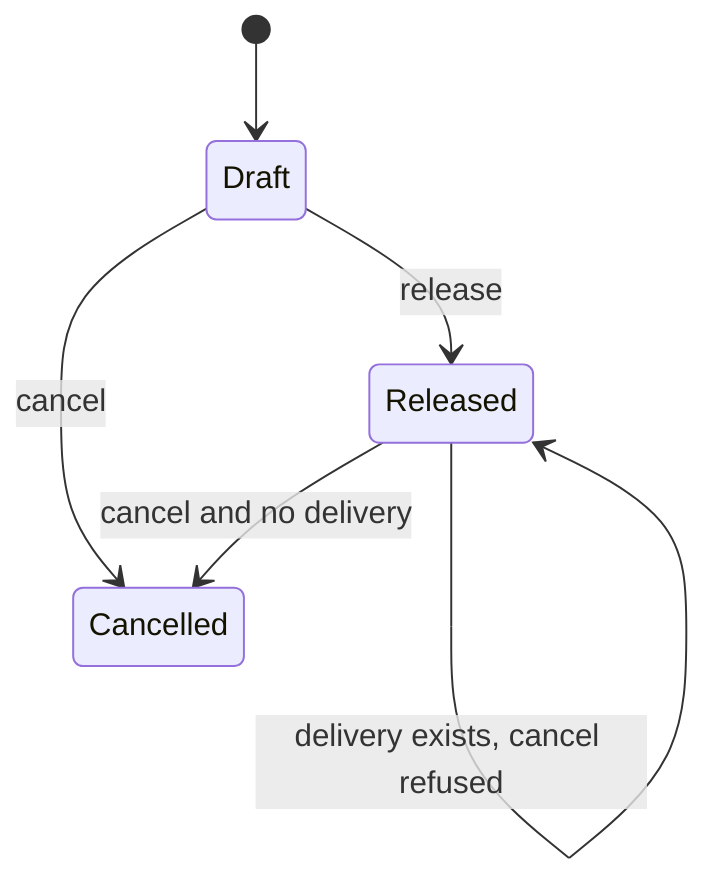
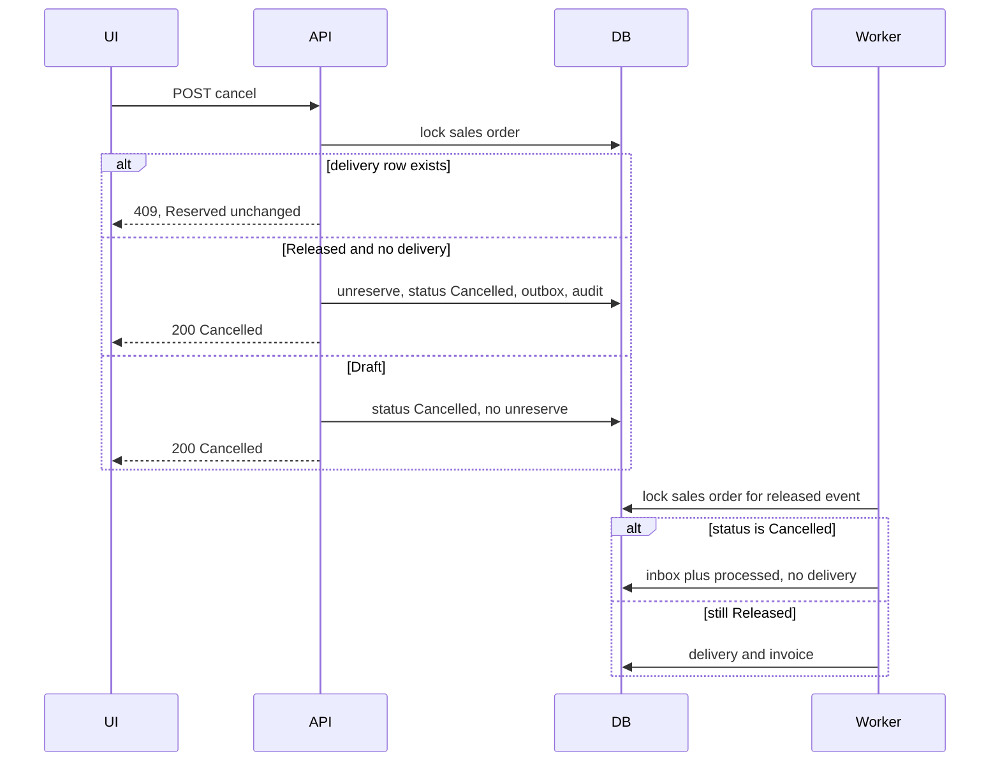

# Order cancellation and warehouse on release - Plan

## Goal Capsule

- **Objective:** An operator can cancel a released sales order that has not been delivered and see the reserved quantity return to what it was before release, and can name the warehouse that release reserves against.
- **Means:** A `Cancelled` status and a warehouse code on the sales order, applied in the same transaction style release already uses for stock, audit, and the outbox (KTD1, KTD2, KTD3, KTD4).
- **Authority:** Product behavior in the Requirements wins. Implementation mechanism in the Key Technical Decisions wins inside those requirements. Assumptions are unconfirmed bets this run is proceeding with; a later correction replaces the bet, not the requirement.
- **Execution profile:** One vertical slice across domain, persistence, API, worker, and the sales UI. Issue [#27](https://github.com/cvsckrause/cvstest/issues/27) (roadmap R-15).
- **Stop conditions:** Do not reduce `OnHand` or write a goods issue (R-12). Do not cancel an order that already has a delivery (E-3). Do not add a sales-order list (open pull request for R-13).
- **Ships as:** One pull request against `main`.

## Product Contract

### Summary

Release today always reserves warehouse `MAIN`, and nothing can free that reservation. This slice stores a warehouse code on the order, uses it at release, and lets an operator cancel an order that has not been delivered so `Reserved` returns to its prior value.

### Problem Frame

Reservations only grow. A released order that should not ship keeps stock unavailable, and the operator cannot pick a warehouse other than the hardcoded main warehouse.

### Requirements

**Cancellation**

- R1. A sales order can move to status `Cancelled`.
- R2. Cancelling a released order that has not been delivered reduces `Reserved` by that order's line quantities and leaves `OnHand` unchanged.
- R3. That cancel writes an audit entry and an outbox message whose type is `erp.sales-order.cancelled.v1`.
- R4. When the worker handles `erp.sales-order.released.v1` for an order that is already `Cancelled`, it does not create a delivery or an invoice.

**Warehouse**

- R5. Each sales order stores a warehouse code. The default is `MAIN`. Release reserves stock in that warehouse.
- R6. The sales UI has a warehouse field and a Stornieren action.

**Proof**

- R7. Domain tests cover cancel. An integration test releases an order and then cancels it, and `Reserved` is back at its prior value.

### Scope Boundaries

- Goods issue, lowering `OnHand`, and a `GoodsIssue` movement stay in R-12.
- Cancelling or crediting an order that already has a delivery stays in E-3. This slice refuses that cancel.
- A sales-order list, status filter, and delivery/invoice read APIs stay in R-13.
- No warehouse master. Codes stay free-form strings, as Lager already does.
- No stock movement for reserve or unreserve. Release does not write one today, and cancel stays symmetric (A4).
- No worker handler whose only job is the cancel event. The released-event status check is R4 (A8).
- A recovery job for a lost race is not built. A5 serializes cancel, release, and the worker on the order row. After the lock, each one acts on the fresh row: the worker that sees `Cancelled` processes the released message without documents, and cancel that sees a delivery returns 409 and leaves `Reserved` unchanged. Build a recovery job only if a test shows both a delivery and a freed reservation after that lock.

### Deferred to Follow-Up Work

- Rebase the open R-13 pull request onto this slice. It also edits `src/Erp.Api/Endpoints/SalesEndpoints.cs` and `src/erp-web/src/workspaces/SalesWorkspace.tsx`.
- Showing `Cancelled` in an order list, once R-13 is on `main`.

### Sources

- Roadmap R-15 in `docs/plans/2026-10-14-roadmap-next-work-items.md`.
- Aggregate and release: `src/Modules/Erp.Sales/Domain/SalesOrder.cs`, `src/Erp.Api/Endpoints/SalesEndpoints.cs`.
- Stock: `src/Modules/Erp.Inventory/Domain/StockBalance.cs`. `Reserved` is a concurrency token in `src/Erp.Persistence/Class1.cs`.
- Worker: `src/Erp.Worker/Worker.cs` creates `Delivery` and `Invoice` from `erp.sales-order.released.v1` and does not read order status.
- Delivery identity: `src/Modules/Erp.Billing/Domain/BillingEntities.cs` (`SalesOrderId`).
- Errors: `src/Erp.Api/ApiProblems.cs` maps `InvalidOperationException` to HTTP 409.
- UI: `src/erp-web/src/workspaces/sales-model.ts`, `src/erp-web/src/workspaces/SalesWorkspace.tsx`.
- Domain examples: `tests/Erp.Domain.Tests/UnitTest1.cs`. Integration session helpers: `tests/Erp.Integration.Tests/PostgresFixture.cs`.

## Planning Contract

### Key Technical Decisions

- KTD1. **Warehouse column on the order.** Persist the code on `sales_orders`, required, max length 40, default `MAIN`, mapped the same way as `StockBalance.WarehouseCode`. Release looks up the balance with the order's code. The literal `"MAIN"` in `SalesEndpoints` goes away.
- KTD2. **Cancel mirrors release.** `SalesOrder` owns the status change and returns a domain event. The API, inside one transaction, unreserves stock, writes the outbox message and the audit entry, and saves. Stock stays outside the sales aggregate, which is where `Reserve` already runs.
- KTD3. **Unreserve only touches `Reserved`.** `StockBalance` rejects a non-positive quantity and a quantity greater than `Reserved`. `OnHand` does not change.
- KTD4. **The worker checks status before it inserts documents.** Inside the released-event transaction it loads the sales order. When the status is `Cancelled`, it writes the inbox row and marks the outbox message processed, and it does not insert a delivery or an invoice. A missing order fails the message the same way an invalid payload does today.

### High-Level Technical Design

### Assumptions

These are unconfirmed. Proceed with them. A correction replaces the bet.

- A1. A `Draft` order can be cancelled. `Reserved` does not change, because release has not run. Cancelling an order that is already `Cancelled` is rejected. Cancelling when a `Delivery` row exists for that sales order is rejected, and `Reserved` stays as it is.
- A2. "Not yet delivered" means no `Delivery` row for the sales order. There is no `Delivered` order status.
- A3. The warehouse is set while the order is `Draft`, on create, and can be changed only while the order stays `Draft`. A blank or omitted code becomes `MAIN`. The stored code is trimmed and uppercased. Release does not take a separate warehouse.
- A4. Unreserve does not append a `StockMovement`.
- A5. Cancel, release, and the worker each select the sales order `FOR UPDATE` in their transaction and re-read status and deliveries only after that lock is held. The waiter continues on the fresh row. Cancel that sees a delivery returns 409 and does not unreserve. The worker that sees `Cancelled` marks the released message processed and inserts nothing. Release that sees `Cancelled` reserves nothing and returns 409.
- A6. Cancel requires an `Idempotency-Key`, same as release. Repeating the same key returns the first result and does not unreserve twice.
- A7. Existing `sales_orders` rows receive warehouse `MAIN`. That matches every release written before this column existed.
- A8. The worker stores `erp.sales-order.cancelled.v1` and marks it processed. It does not grow a handler for that type.
- A9. A domain rejection from cancel is HTTP 409 ProblemDetails via the existing `InvalidOperationException` mapping. An unknown order is 404. A missing idempotency key is 400 with the same error shape release uses today.

### Sequencing

U1 and U2 first, in either order. U3 after both. U4 after U1. U5 after U3. U6 after U3 and U4.

## Implementation Units

### U1. Domain cancel and unreserve

- **Goal:** The order can become `Cancelled`, and reserved quantity can be given back without touching on-hand.
- **Requirements:** R1, R2, R7
- **Dependencies:** none
- **Files:** `src/Modules/Erp.Sales/Domain/SalesOrder.cs`, `src/Modules/Erp.Inventory/Domain/StockBalance.cs`, `tests/Erp.Domain.Tests/SalesOrderCancellationTests.cs`
- **Approach:** Add `Cancelled` after the existing `Released` value so stored integers stay stable. Cancel returns an event with the same identity fields release already carries, plus the warehouse code and the lines to unreserve. Apply A1 for which prior statuses succeed. Apply KTD3 and A4 on the balance. Warehouse capture on create is A3; existing `Create` callers keep compiling by defaulting the code to `MAIN`.
- **Execution note:** Write the domain tests first. They do not need Postgres.
- **Patterns to follow:** `SalesOrder.Release` and `StockBalance.Reserve` in the files above. Test style in `tests/Erp.Domain.Tests/UnitTest1.cs`.
- **Test scenarios:**
  - A released order with one line of quantity 2 cancels, status is `Cancelled`, and a second cancel throws.
  - A draft order with one line cancels, and `ReleasedAt` stays unset.
  - Cancelling a released order does not change line quantity or net amount.
  - A balance with on-hand 10 and reserved 4 unreserves 4. On-hand stays 10 and reserved is 0.
  - Unreserving 0, a negative quantity, or more than reserved throws, and reserved is unchanged.
- **Verification:** The new domain tests pass, and the existing trading-flow tests still pass.

### U2. Persist the warehouse code

- **Goal:** Every sales order has a warehouse code, including rows already in the database.
- **Requirements:** R5
- **Dependencies:** none
- **Files:** `src/Erp.Persistence/Class1.cs`, a new migration under `src/Erp.Persistence/Migrations/`
- **Approach:** Map the property per KTD1 and A7. The migration adds the column with default `MAIN` and a `Down` that drops it. Do not edit historical migrations.
- **Patterns to follow:** `StockBalance.WarehouseCode` mapping in `src/Erp.Persistence/Class1.cs`. The latest migration pair in `src/Erp.Persistence/Migrations/`.
- **Test scenarios:**
  - Test expectation: none for a new test class. U6 reads the column back after create. The migration's `Down` is the usual EF pair, not a separate executed test.
- **Verification:** The model snapshot includes the column, and the persistence project builds.

### U3. API warehouse, release lookup, and cancel

- **Goal:** Create stores the warehouse, release reserves that warehouse, and cancel frees it when A1 allows.
- **Requirements:** R2, R3, R5
- **Dependencies:** U1, U2
- **Files:** `src/Erp.Api/Endpoints/SalesEndpoints.cs`, `src/Erp.Api/Endpoints/Idempotency.cs`, `tests/Erp.Integration.Tests/SalesOrderCancellationTests.cs`
- **Approach:** Add the code to the create request and the order response. Normalize per A3. Release and cancel both lock the order per A5 before they read it. Release uses the stored code for every line, and reserves only when the locked status is still `Draft`. Cancel is `POST /api/v1/sales-orders/{id}/cancel` with idempotency per A6 and A9. Refuse when a delivery exists per A1. Unreserve each line only when the locked status is `Released`. A `Draft` cancel changes status and writes the event, and does not call unreserve. Audit action name `SalesOrder.Cancelled`. If a line's balance is missing or reserved is short, the transaction does not commit.
- **Patterns to follow:** The release action in `SalesEndpoints` and `Idempotency.OperationFor`.
- **Test scenarios:** The cases live in U6. The behaviors this unit owns are: create with `neben` stores `NEBEN`; release of quantity 3 against `NEBEN` increases that balance's reserved by 3 and leaves `MAIN` reserved unchanged; cancel of that order returns status `Cancelled` and reserved 0; cancel with no idempotency key returns 400; cancel of an unknown id returns 404.
- **Verification:** Create, get, release, and cancel return the warehouse code and status. A release against a non-MAIN warehouse does not touch the MAIN balance.

### U4. Worker ignores a cancelled order

- **Goal:** A release message that arrives after cancel does not create documents.
- **Requirements:** R4
- **Dependencies:** U1
- **Files:** `src/Erp.Worker/Worker.cs`, `tests/Erp.Integration.Tests/SalesOrderCancellationTests.cs`
- **Approach:** Apply KTD4 and A5. Apply A8 for the cancel event type: the existing fall-through that marks unknown types processed stays. Do not insert documents for a cancelled order, and do not dead-letter that message.
- **Patterns to follow:** The released-event branch in `src/Erp.Worker/Worker.cs`.
- **Test scenarios:** The case lives in U6. Release an order, cancel it, then process `erp.sales-order.released.v1`. Delivery count and invoice count for that order stay 0, and the message is processed rather than dead-lettered.
- **Verification:** After cancel, running the outbox processor leaves delivery and invoice counts unchanged for that order, and the released message is processed.

### U5. Sales UI warehouse field and Stornieren

- **Goal:** The operator sets the warehouse before release and can cancel from the sales workspace.
- **Requirements:** R6
- **Dependencies:** U3
- **Files:** `src/erp-web/src/api.ts`, `src/erp-web/src/api.generated.ts`, `openapi/v1.json`, `src/erp-web/src/workspaces/sales-model.ts`, `src/erp-web/src/workspaces/SalesWorkspace.tsx`, `src/erp-web/src/App.test.tsx`
- **Approach:** Regenerate the client from the exported OpenAPI document. The capture form sends the warehouse and shows the stored code. Stornieren is available for `Draft` and `Released`, and disabled while busy. Hide it only when status is `Cancelled`. Do not read deliveries in this slice. When cancel returns 409, leave the order as it is and show the problem detail in the existing notice. After a successful cancel, and when a cancelled order is loaded, show badge `Storniert`, hide Stornieren and Freigeben, set the step to Erfassen, show `Neuen Auftrag erfassen`, and show the note `Der Auftrag ist storniert. Eine Lieferung wird nicht erzeugt.` Keep `App.tsx` as the shell.
- **Patterns to follow:** `releaseOrder` in `sales-model.ts` and the release button in `SalesWorkspace.tsx`.
- **Test scenarios:**
  - Submitting the sales form with warehouse `neben` sends `NEBEN` on create.
  - With a released order, Stornieren calls `POST /sales-orders/{id}/cancel` with an idempotency key, the status becomes `Storniert`, Freigeben is not shown, and `Neuen Auftrag erfassen` is shown.
  - A cancel response of 409 leaves the status at `Released` and puts the problem detail in the notice.
  - With status `Cancelled`, the release button and Stornieren are not shown.
- **Verification:** `npm test`, `npm run lint`, and `npm run build` in `src/erp-web` succeed. `openapi/v1.json` and `src/erp-web/src/api.generated.ts` match a fresh export and `npm run gen:api`.

### U6. Integration proof of stock and the worker

- **Goal:** Release then cancel restores `Reserved`, and a late worker does not deliver a cancelled order.
- **Requirements:** R2, R4, R7
- **Dependencies:** U3, U4
- **Files:** `tests/Erp.Integration.Tests/SalesOrderCancellationTests.cs`
- **Approach:** Use `PostgresFixture` and the existing session helpers. Seed or receive stock in a named warehouse, create the order with that code, release, record `Reserved`, cancel, and read `Reserved` again.
- **Patterns to follow:** `tests/Erp.Integration.Tests/IdempotencyTests.cs` and `PostgresFixture`.
- **Test scenarios:**
  - On-hand 10, reserved 0, warehouse `NEBEN`. Create quantity 3, release, cancel. On-hand is 10 and reserved is 0. Status is `Cancelled`. One outbox message of type `erp.sales-order.cancelled.v1` exists. The MAIN balance is unchanged.
  - Repeating cancel with the same idempotency key does not drive reserved negative.
  - A second cancel with a new key returns 409 and reserved stays 0.
  - After the worker has created a delivery, cancel returns 409 and reserved stays at the released quantity.
  - Release, cancel, then process the released outbox message. Delivery count and invoice count for that order stay 0, and the message is processed.
  - Cancelling a draft order returns `Cancelled` and does not change reserved. A following release of that order returns 409 and reserved stays unchanged.
  - Create with warehouse `neben` and read the order back with stored code `NEBEN`.
  - Cancel with no idempotency key returns 400.
  - Cancel of an unknown id returns 404.
- **Verification:** `dotnet test Erp.slnx -c Release` passes, including the existing cross-tenant and idempotency tests.

## Verification Contract

| Check | Command | Proves |
| --- | --- | --- |
| Backend | `dotnet test Erp.slnx -c Release` | R1, R2, R4, R7, and existing suites |
| OpenAPI | `node scripts/export-openapi.mjs` then no diff in `openapi/v1.json` | The cancel route and warehouse fields are in the contract |
| Generated types | In `src/erp-web`, `npm run gen:api` then no diff in `src/api.generated.ts` | CI's stale-client check |
| Web | In `src/erp-web`, `npm test`, `npm run lint`, `npm run build` | R6 |

`infra-synth` is unchanged by this slice. Run it only if a workflow file changes.

## Definition of Done

- R1 through R7 hold, and A1 through A9 are implemented as written.
- U1 through U6 are present in the branch.
- The verification table is green.
- `App.tsx` is still the shell. No goods-issue code and no order-list API landed in this branch.
- Experimental code from abandoned approaches is not in the diff.
