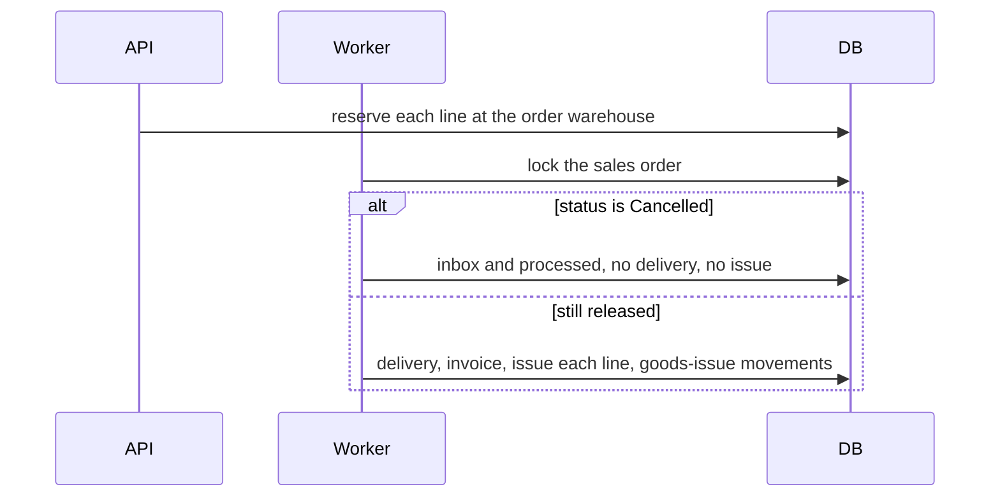

# Goods issue on delivery - Plan

## Goal Capsule

- **Objective:** After a released order is delivered, on-hand and reserved stock both drop by the delivered quantities, and Lager shows that issue.
- **Means:** `StockBalance` issues the reserved quantity in the same worker transaction that inserts the delivery, and writes a goods-issue movement referenced by the delivery number (KTD1, KTD2).
- **Authority:** Product behavior in the Requirements wins. Implementation mechanism in the Key Technical Decisions wins inside those requirements. Assumptions are unconfirmed bets this run is proceeding with; a later correction replaces the bet, not the requirement.
- **Execution profile:** One vertical slice across inventory domain, the worker, one integration test, and the Lager movement label. Issue [#24](https://github.com/cvsckrause/cvstest/issues/24) (roadmap R-12).
- **Stop conditions:** Do not add a public goods-issue endpoint. Do not change how release reserves or how cancel frees a reservation before delivery. Do not ship a partial quantity. Do not add a schema migration for the movement type.
- **Ships as:** One pull request against `main`.

## Product Contract

### Summary

Release reserves stock and the worker creates a delivery, but on-hand never falls and reserved never comes back. This slice consumes that reservation when the delivery is created and shows the issue in Lager.

### Problem Frame

Stock that has been sold stays in the warehouse forever. `Reserved` grows with every release, and `OnHand` only moves on goods receipt. An operator looking at Lager cannot see that a delivery took goods out.

### Requirements

- R1. Issuing a quantity reduces both `OnHand` and `Reserved` by that quantity.
- R2. Issuing a non-positive quantity, or more than `Reserved`, is rejected and leaves the balance unchanged.
- R3. When the worker creates a delivery, it issues each order line's quantity from that order's warehouse and records one goods-issue movement per line. The movement's reference is the delivery number. The balance change and the movement commit in the same transaction as the delivery row.
- R4. When the worker handles a released order that is already `Cancelled`, it creates no delivery and issues no stock.
- R5. Lager lists goods-issue movements with the receipts it already shows.
- R6. Domain tests cover issue. An integration test that starts at on-hand 10, releases 3, and runs the worker ends at on-hand 7, reserved 0, and one goods-issue movement for that delivery.

### Scope Boundaries

- Partial deliveries and short shipments stay out. The issued quantity is the line quantity that was reserved.
- Putting stock back for a return or credit note stays in E-3.
- A manual goods-issue API stays out. Receipts remain the only stock write an operator posts.
- No stock movement is added for reserve or unreserve. Those paths stay as they are.
- No new database column and no EF migration. `MovementType` is already stored as a string (`src/Erp.Persistence/Class1.cs`).
- A recovery job for a delivery without an issue is not built. KTD2 keeps both in one transaction, and the inbox already stops a second successful process of the same message. Build one only if a test shows a committed delivery whose reservation is still outstanding.
- Gapless document numbers stay in R-14. The delivery number remains `DEL-{orderNumber}`.

### Deferred to Follow-Up Work

None. Returns that put stock back are E-3, which is outside this milestone's issue list rather than follow-up work from this slice.

### Sources

- Roadmap R-12 in `docs/plans/2026-10-14-roadmap-next-work-items.md`.
- Balance and movement: `src/Modules/Erp.Inventory/Domain/StockBalance.cs`, `src/Modules/Erp.Inventory/Domain/StockMovement.cs`.
- Release reserves per line at `SalesOrder.WarehouseCode` in `src/Erp.Api/Endpoints/SalesEndpoints.cs`.
- Worker delivery insert: `src/Erp.Worker/Worker.cs`. The released payload record has no lines. `MutableTenantContext.UserId` defaults to `erp-worker` in `src/Erp.Worker/WorkerOptions.cs`.
- Cancel-after-delivery currently expects on-hand 10 and reserved 3: `tests/Erp.Integration.Tests/SalesOrderCancellationTests.cs`.
- Movement list label: `src/erp-web/src/workspaces/LagerWorkspace.tsx`.
- Domain examples: `tests/Erp.Domain.Tests/UnitTest1.cs`.

## Planning Contract

### Key Technical Decisions

- KTD1. **Issue mirrors the existing balance methods.** `StockBalance` gains an issue operation that subtracts the quantity from both `OnHand` and `Reserved`. It rejects a non-positive quantity and a quantity greater than `Reserved`, and it does not touch `Available` as a stored field. `StockMovement` gains a goods-issue factory beside `GoodsReceipt`. The new enum value is stored by the existing string conversion, so there is no migration.
- KTD2. **The worker issues only on the branch that inserts the delivery.** After the sales-order row lock, load the order's lines and warehouse from the order row (A1). If the status is `Cancelled`, leave stock alone. Otherwise insert the delivery and invoice, then for each line issue that line's quantity at the order's warehouse and append a goods-issue movement whose reference is the delivery number (A2). Use the worker tenant's user id as the actor (A4). A missing balance or a rejected issue throws out of the transaction. The existing failure path rolls the transaction back, so no delivery remains, and marks the outbox message failed. Do not catch that failure inside the transaction.
- KTD3. **Lager keeps the current movement query.** `GET /stock/movements` already returns the type name. The grid labels goods issue the way it labels goods receipt (A3). No OpenAPI change and no generated-client change.

### High-Level Technical Design

### Assumptions

These are unconfirmed. Proceed with them. A correction replaces the bet.

- A1. Line quantities and the warehouse come from the locked sales order, not from an extended outbox payload. The payload can omit lines; the locked row is the same source cancel already trusts.
- A2. One goods-issue movement is written per order line. Every movement for that delivery shares the delivery number as its reference. The R6 case is one line, so it produces one movement.
- A3. Lager renders `GoodsIssue` as Warenausgang, next to Wareneingang for `GoodsReceipt`. An unknown type still falls through to the raw name.
- A4. The movement actor is `MutableTenantContext.UserId`, which the worker already sets to `erp-worker`.

### Sequencing

U1 first. U2 after U1. U3 after U1, and it can land with U2 or after it.

## Implementation Units

### U1. Domain issue and goods-issue movement

- **Goal:** The balance can consume a reservation, and a movement can record that issue.
- **Requirements:** R1, R2, R6
- **Dependencies:** none
- **Files:** `src/Modules/Erp.Inventory/Domain/StockBalance.cs`, `src/Modules/Erp.Inventory/Domain/StockMovement.cs`, `tests/Erp.Domain.Tests/UnitTest1.cs`
- **Approach:** Follow `Receive`, `Reserve`, and `StockMovement.GoodsReceipt`. Issue subtracts from both quantities. The movement quantity stays positive; the type distinguishes the issue. Apply KTD1.
- **Execution note:** Add the domain tests before wiring the worker.
- **Patterns to follow:** `Goods_receipt_increases_on_hand_without_changing_reserved` and `Goods_receipt_movement_records_immutable_trail_fields` in `tests/Erp.Domain.Tests/UnitTest1.cs`.
- **Test scenarios:**
  - On-hand 10 and reserved 3, issue 3, then on-hand is 7 and reserved is 0.
  - On-hand 10 and reserved 3, issue 1, then on-hand is 9 and reserved is 2.
  - Issue 0, a negative quantity, or more than reserved throws, and on-hand and reserved stay at the starting values.
  - A goods-issue movement stores a positive quantity, type goods issue, the given reference, actor, and timestamp, and uppercases the warehouse.
- **Verification:** The new domain tests pass. No persistence project change is required for the enum.

### U2. Worker consumes the reservation with the delivery

- **Goal:** A delivered order no longer holds reserved stock, and a cancelled order still does not move stock when its released message is processed.
- **Requirements:** R3, R4, R6
- **Dependencies:** U1
- **Files:** `src/Erp.Worker/Worker.cs`, `tests/Erp.Integration.Tests/SalesOrderCancellationTests.cs`, and a new test class in `tests/Erp.Integration.Tests/` if the goods-issue case does not fit the cancellation file cleanly
- **Approach:** Apply KTD2 and A1, A2, A4 inside the existing released-event transaction in `Worker.cs`. Do not issue when the status check skips the delivery. Update `Cancel_after_delivery_is_rejected`: after the worker runs, on-hand is 7 and reserved is 0, the cancel response stays 409, and the delivery still exists. The graph's opening stock of 10 is the starting balance in R6. Do not post a second receipt on top of it.
- **Patterns to follow:** The delivery insert and cancel check in `src/Erp.Worker/Worker.cs`. `ProcessUntilAsync`, `CreateGraphAsync`, and `StockAsync` in `tests/Erp.Integration.Tests/SalesOrderCancellationTests.cs`. `DatabaseProbe.CountMovementsAsync` for the movement count.
- **Test scenarios:**
  - Create the existing tenant graph (opening stock leaves on-hand at 10), order one line of quantity 3, release, run the worker. On-hand is 7, reserved is 0, exactly one delivery exists, and exactly one goods-issue movement references `DEL-{orderNumber}`.
  - Two lines, quantities 2 and 1, on the same article and warehouse, released and processed. On-hand is 7, reserved is 0, and two goods-issue movements share that delivery number.
  - Release then cancel, then process the released message. Delivery count stays 0, on-hand stays 10, reserved stays 0, and no goods-issue movement exists for `DEL-{orderNumber}`.
  - `Cancel_after_delivery_is_rejected` still returns 409 with the delivered-order message, and its stock assertion is on-hand 7 and reserved 0.
- **Verification:** The scenarios above pass under the integration suite. A cancelled order still produces no invoice.

### U3. Label goods issue in Lager

- **Goal:** An operator can tell an issue from a receipt in the movement list.
- **Requirements:** R5
- **Dependencies:** U1
- **Files:** `src/erp-web/src/workspaces/LagerWorkspace.tsx`, `src/erp-web/src/App.test.tsx`
- **Approach:** Apply A3 on the movement type label. Leave the receipt form and the stock query alone. The shared movement fixture can carry a second row; the existing Wareneingang assertion must still pass.
- **Patterns to follow:** The `GoodsReceipt` label branch in `LagerWorkspace.tsx` and the movement table assertion in `App.test.tsx`.
- **Test scenarios:**
  - A movement whose type is `GoodsIssue` renders as Warenausgang in the movement table.
  - A movement whose type is `GoodsReceipt` still renders as Wareneingang.
- **Verification:** `npm test` and `npm run lint` in `src/erp-web` pass. `openapi/v1.json` is unchanged.

## Verification Contract

| Check | Command | Proves |
| --- | --- | --- |
| Backend | `dotnet test Erp.slnx -c Release` | R1, R2, R3, R4, R6, and the updated cancel-after-delivery assertion |
| Web | In `src/erp-web`, `npm test` and `npm run lint` | R5 |
| Contract | `openapi/v1.json` has no diff | KTD3 |

Integration tests need Docker for Testcontainers. `infra-synth` is unchanged. Run it only if a workflow file changes.

## Definition of Done

- R1 through R6 hold, and A1 through A4 are implemented as written.
- U1 through U3 are present in the branch.
- The verification table is green.
- No EF migration was added for the movement type, and no goods-issue HTTP route was added.
- Experimental code from abandoned approaches is not in the diff.
