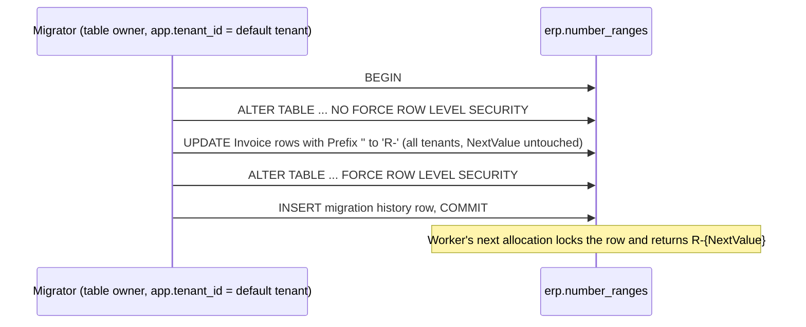

# R-22 invoice numbers with an R- prefix - Plan

## Goal Capsule

- **Objective:** Every new Rechnung a tenant issues reads `R-n`, continuing that tenant's gapless invoice sequence, while numbers already printed on earlier invoices stay as issued.
- **Means:** Change the invoice range default prefix to `R-` (KTD1), and move existing empty-prefix invoice ranges to `R-` in an EF migration that works under forced row-level security (KTD2).
- **Authority:** Issue [#60](https://github.com/cvsckrause/cvsTest/issues/60) and the R-22 block in `docs/plans/2026-10-14-roadmap-next-work-items.md`. Requirements win on product behavior. Key Technical Decisions win on mechanism inside those requirements.
- **Execution profile:** Lane B, Wave 0, `priority:P1`, `size:S`. Depends on R-14 ([#26](https://github.com/cvsckrause/cvsTest/issues/26)), which merged in [PR #59](https://github.com/cvsckrause/cvsTest/pull/59).
- **Stop conditions:** Stop if the migration cannot update every tenant's range when run by a role that is neither superuser nor `BYPASSRLS`. Do not rewrite `erp.invoices.Number`. Do not change delivery or order prefixes.
- **Ships as:** One pull request against `main`.

---

## Product Contract

### Summary

The invoice number range defaults to prefix `R-`, so a fresh tenant's invoices are `R-1`, `R-2`, and so on. A migration gives tenants that already have an invoice range the `R-` prefix without touching the counter, so the next invoice is `R-{next}`. The sales UI already shows the stored invoice number, so it shows `R-n` with no UI code change.

### Problem Frame

R-14 made invoice numbers a gapless per-tenant sequence, but stored them as bare integers (`1`, `2`, `3`). A Rechnung in this product should read `R-1`, `R-2`, `R-3`. The prefix is stored on each `erp.number_ranges` row the first time a tenant allocates, so changing the code default alone would leave every existing tenant on bare numbers.

### Requirements

Numbering

- R1. A tenant with no invoice range gets one with prefix `R-` on its first invoice, so its invoices are `R-1`, `R-2`, … with no gaps or duplicates.
- R2. An existing invoice range with an empty prefix is changed to prefix `R-` and keeps its next value. Its next invoice is `R-{next}`, with no gap and no duplicate.
- R3. Numbers already stored on invoices stay exactly as they were issued.
- R4. Delivery numbers stay `LS-n`. Order numbers stay `AU-n`, or the operator's manual override.

Presentation

- R5. The invoice step and the release notice in the sales UI show the prefixed number.

Isolation

- R6. After the migration, `erp.number_ranges` still has enabled and forced row-level security with the `tenant_isolation` policy.

### Acceptance Examples

- AE1. Covers R1. A tenant that has never invoiced allocates two invoice numbers in committed transactions and gets `R-1`, then `R-2`.
- AE2. Covers R2, R3. Tenant X has an invoice range with prefix `''` and next value 4, and invoices `1`, `2`, `3`. After the migration, tenant X's next invoice is `R-4`, and invoices `1`, `2`, `3` are unchanged.
- AE3. Covers R1. Fifty parallel releases produce fifty contiguous invoice numbers `R-k` … `R-(k+49)`, and the tenant's invoices taken together are exactly `R-1` … `R-N`.

### Scope Boundaries

- Yearly reset, zero-padding, and changing the delivery or order prefixes stay out (origin: R-22 out of scope).
- An admin screen or API for editing prefixes stays out, as in R-14.
- Invoices issued before this change are not renumbered. A tenant's invoice list can hold both `3` and `R-4`. That is the requested behavior (R3).
- The UI does not reformat or prefix numbers itself. It shows what the API returns.
- Not built: a guard that refuses a deliberately empty invoice prefix. No path can set a prefix today; revisit when an admin screen for prefixes exists.

### Sources

- Roadmap R-22 and the lane table in `docs/plans/2026-10-14-roadmap-next-work-items.md`. Issue [#60](https://github.com/cvsckrause/cvsTest/issues/60).
- R-14 plan: `docs/plans/2026-10-16-r14-number-ranges.md` (KTD2 there set the invoice prefix to empty).
- Defaults and formatting: `NumberRangePolicy` in `src/Modules/Erp.Platform/Domain/NumberRange.cs`.
- Allocation reads the stored prefix from the tenant's earliest range row and copies it into new rows: `ReadPolicyAsync` and the insert in `src/Erp.Persistence/NumberRangeAllocator.cs`.
- Table, unique key `(TenantId, DocumentType, Year)`, and forced RLS: `src/Erp.Persistence/Migrations/20261016063016_AddNumberRanges.cs`.
- The migrator runs `MigrateAsync` through `TenantConnectionInterceptor` with one default tenant set: `src/Erp.Migrator/Program.cs`, `src/Erp.Persistence/TenantConnectionInterceptor.cs`.
- The test fixture migrates as the `postgres` superuser, which bypasses RLS: `MigrateAsync` in `tests/Erp.Integration.Tests/PostgresFixture.cs`.
- UI renders `invoices[0].number` directly: `src/erp-web/src/workspaces/SalesWorkspace.tsx`, `src/erp-web/src/workspaces/sales-model.ts`.

---

## Planning Contract

### Key Technical Decisions

- KTD1. **The default lives in `NumberRangePolicy.Defaults`.** The invoice default becomes `("R-", false)`. The allocator already inserts a new range with the default prefix and formats `prefix + value`, so no allocator change is needed for R1. Delivery and order defaults stay as they are (R4).
- KTD2. **The migration drops forced RLS only inside its own transaction.** The migration's `Up` runs, in one transaction:
  1. Switch `erp.number_ranges` to `NO FORCE ROW LEVEL SECURITY`.
  2. Set `"Prefix" = 'R-'` where `"DocumentType" = 'Invoice'` and `"Prefix" = ''`, across every year row.
  3. Switch back to `FORCE ROW LEVEL SECURITY`.

  Reason: forced RLS also applies to the table owner. The migrator sets `app.tenant_id` to its default tenant. On a role that is not superuser and has no `BYPASSRLS`, a plain `UPDATE` would change only that tenant's rows and still succeed. Without `FORCE`, the owner is exempt from the policy, so the update reaches every tenant. PostgreSQL DDL is transactional, so a failed migration leaves `FORCE` in place. A role that does not own the table fails loudly on the `ALTER TABLE`, and nothing changes.
- KTD3. **`Down` reverses the prefix.** It sets invoice ranges with prefix `R-` back to `''`, using the same toggle. Issued invoices keep their `R-n` numbers. Rolling back only changes what the next allocation looks like.
- KTD4. **Prove the upgrade path with a non-bypass owner.** The fixture migrates as `postgres`, which bypasses RLS, so the existing suite would pass even with a plain `UPDATE`. The upgrade test therefore applies the new migration as a role that owns `erp.number_ranges` but is `NOSUPERUSER NOBYPASSRLS`, with `app.tenant_id` set to an unrelated tenant, as the migrator does.
- KTD5. **The migration changes no model.** No entity or column changes, so `ErpDbContextModelSnapshot.cs` stays the same. `openapi/v1.json` and `src/erp-web/src/api.generated.ts` stay the same, because `number` is already a string.
- KTD6. **For this release, roll the services before running the migrator.** The cell's task definitions pin the ECR `latest` tag (`infra/lib/erp-dev-stack.ts`), and the runbook runs the migrator right after `cdk deploy`, which does not restart services whose task definition is unchanged. An R-14 worker still running after the migration would give a tenant's first invoice a new range with prefix `''`. Nothing would ever fix that range, and it would break R1. Rolling the API and worker first is safe because KTD5 leaves the schema unchanged. Until the migrator runs, new code only continues existing bare ranges, and the migration then moves them to `R-`.

Alternatives set aside:

- Rewriting an empty invoice prefix to `R-` inside the allocator at allocation time. Rejected: it keeps a legacy rule on the hot path forever, and it would quietly overrule any prefix an admin sets to empty later.
- Ignoring the stored prefix and always using the code default. Rejected: it undoes R-14's stored per-tenant prefix.
- A temporary `SECURITY DEFINER` function owned by `erp_outbox_definer`, as in `20261015134040_AddOutboxClaimAndDeadLetter.cs`. Rejected: it needs extra grants and cleanup for a one-off update that the table owner can already run.

### High-Level Technical Design

### Assumptions

These are unconfirmed. Work proceeds on them. If one is corrected, the correction replaces the assumption, not the requirement.

- A1. The account that runs migrations (`erp` today, and `erp_owner` once R-17 lands) owns `erp.number_ranges`, because it created the table.
- A2. The `ALTER TABLE` takes an `ACCESS EXCLUSIVE` lock for milliseconds on a table with a few rows per tenant. A worker allocation that runs at the same time waits instead of failing.
- A3. The AWS cell may or may not already have invoice ranges from R-14. The migration handles both cases, and an empty table is a no-op. Deploy order is covered by KTD6.

### Sequencing

U1 first, because the default change breaks the existing `^\d+$` assertions and fixes them in the same unit. U2 after U1. U3 can land with U1 or after it. U4 lands with U2.

---

## Implementation Units

### U1. Default invoice prefix `R-`

- **Goal:** New invoice ranges start with `R-`, and the existing suites assert the prefixed format.
- **Requirements:** R1, R4
- **Dependencies:** none
- **Files:** `src/Modules/Erp.Platform/Domain/NumberRange.cs`, `tests/Erp.Domain.Tests/NumberRangePolicyTests.cs`, `tests/Erp.Integration.Tests/NumberRangeTests.cs`, `tests/Erp.Integration.Tests/SalesOrderReadTests.cs`, `tests/Erp.Integration.Tests/DatabaseProbe.cs`
- **Approach:**
  1. Apply KTD1.
  2. In `DatabaseProbe`, make `InvoiceSequenceAsync` and `InvoiceSequenceForOrdersAsync` parse `R-<digits>` into the integer. A number that does not match should fail the probe, not be skipped. This keeps the existing gap checks meaningful.
  3. Update the format assertions in `NumberRangeTests` (rolled-back allocation and yearly reset) and in `SalesOrderReadTests` from `^\d+$` to `^R-\d+$`.
- **Patterns to follow:** The `AU-` assertions in `Blank_order_number_is_assigned_and_a_manual_number_is_kept`. The `AllocateAsync` helper in `NumberRangeTests`.
- **Test scenarios:**
  - Domain: the invoice default prefix is `R-`. `Format("R-", 1)` is `R-1` and `Format("R-", 50)` is `R-50`. Delivery stays `LS-` and order stays `AU-`. Rename `Invoice_numbers_are_the_bare_sequence` to match.
  - Covers AE1. For a new random tenant with no range, two committed allocations return `R-1`, then `R-2`.
  - A rolled-back allocation followed by a second allocation returns the same `R-n` both times.
  - Yearly reset: June and July allocations are `R-n` and `R-(n+1)`, and the first allocation in the next year is `R-1`. The new year row inherits `R-` from the earliest row.
  - Covers AE3. `Fifty_parallel_releases_produce_a_gapless_invoice_sequence` still passes with the prefixed parser. Every number matches `^R-\d+$`, the fifty are contiguous, and tenant A's invoices are `R-1` … `R-N`.
  - The read API returns an invoice number matching `^R-\d+$` and a delivery number matching `^LS-\d+$`.
- **Verification:** Domain and integration suites pass. No integration test still asserts a bare integer invoice number.

### U2. Move existing empty invoice prefixes to `R-`

- **Goal:** Tenants that invoiced under R-14 continue at `R-{next}` after the deploy.
- **Requirements:** R2, R3, R6
- **Dependencies:** U1
- **Files:** a new migration under `src/Erp.Persistence/Migrations/` (for example `PrefixInvoiceNumbers`, with its generated `.Designer.cs`), `tests/Erp.Integration.Tests/PostgresFixture.cs`, new `tests/Erp.Integration.Tests/InvoicePrefixUpgradeTests.cs`
- **Approach:**
  1. Generate the migration with the repo's `dotnet-ef` tool so that EF records it in migration history. Write `Up` per KTD2 and `Down` per KTD3 as raw SQL inside the default migration transaction. Do not use `suppressTransaction`.
  2. Expose the fixture's admin connection string so a test can create a scratch database in the same container.
  3. Follow KTD4 in the upgrade test:
     1. Create a scratch database.
     2. As `postgres`, migrate it to `20261016063016_AddNumberRanges` and seed the rows in the scenarios.
     3. Make a `NOSUPERUSER NOBYPASSRLS` role the owner of `erp.number_ranges`, with the rights it needs to apply a migration.
     4. Apply the remaining migrations as that role, with `TenantConnectionInterceptor` set to an unrelated tenant.
- **Execution note:** Write the upgrade test first and confirm that it fails against a plain `UPDATE` with no RLS toggle. That failure is the evidence for KTD2.
- **Patterns to follow:** Raw SQL migrations in `20261015104501_EnableAddressRowLevelSecurity.cs` and `20261016063016_AddNumberRanges.cs`. Role creation in `CreateAppRoleAsync` in `PostgresFixture.cs`. The `IsolationAsync` and `RoleAsync` probes in `DatabaseProbe.cs`.
- **Test scenarios:**
  - Covers AE2. Tenant X has an invoice range with prefix `''`, `Year` 0, and next value 4, and invoice rows `1`, `2`, `3`. After the upgrade, the range prefix is `R-` with next value 4, the next allocation is `R-4`, and the three invoice rows still read `1`, `2`, `3`.
  - A second tenant Y with an empty-prefix invoice range at next value 2 is also updated, although the migration ran with a third tenant's `app.tenant_id`. This scenario proves KTD2.
  - A yearly invoice row (`ResetYearly` true, `Year` 2026, prefix `''`) is updated too.
  - Tenant X's delivery range (`LS-`) and order range (`AU-`) are unchanged.
  - After the upgrade, `erp.number_ranges` has row-level security enabled and forced, with `tenant_isolation`, and the migrating role is still neither superuser nor `BYPASSRLS`.
  - Migrating back to `20261016063016_AddNumberRanges` sets tenant X's invoice prefix back to `''` and leaves its next value alone.
- **Verification:** The upgrade test passes. It fails when the RLS toggle is removed from `Up`. `RowLevelSecurityTests` and `TenantRowLevelSecurityTests` still pass. `ErpDbContextModelSnapshot.cs` has no diff (KTD5).

### U3. UI shows the prefixed invoice number

- **Goal:** The sales workflow test shows that an `R-` number reaches the invoice step and the release notice unchanged.
- **Requirements:** R5
- **Dependencies:** none
- **Files:** `src/erp-web/src/App.test.tsx`
- **Approach:** Change the invoice fixture's `number` from `INV-SO-1001` to an `R-` number such as `R-1`. Update the invoice-number assertion and add one for the released note. Do not change `SalesWorkspace.tsx` or `sales-model.ts`. They render the API value as is.
- **Patterns to follow:** `opens an order from the list and shows delivery and invoice numbers` in `App.test.tsx`.
- **Test scenarios:**
  - Opening a released order from the list shows `R-1` in the Rechnung field next to the delivery number.
  - The released note on the same order reads `Lieferung DEL-SO-1001, Rechnung R-1.`
- **Verification:** `npm test` and `npm run lint` pass in `src/erp-web`. `api.generated.ts` has no diff.

### U4. Release order and smoke check

- **Goal:** The person deploying this release rolls the services before running the migrator, and the smoke test catches an invoice without the `R-` prefix.
- **Requirements:** R1, R2
- **Dependencies:** U2
- **Files:** `docs/operations/aws-dev-cell.md`
- **Approach:**
  1. Change smoke step 6 so it also confirms that the invoice number reads `R-n`.
  2. State the KTD6 order in the pull request description: force a new deployment of the API and worker services, wait until they are stable, then run the migrator task. Keep the runbook's general migrator-after-deploy order. Later releases with schema changes still need it.
- **Test expectation:** none -- documentation and release instructions only.
- **Verification:** The runbook's smoke step 6 names the `R-n` format. The pull request description gives the KTD6 deploy order.

---

## Verification Contract

| Check | Command | Proves |
| --- | --- | --- |
| Backend | `dotnet test Erp.slnx -c Release` | R1–R4, R6, AE1–AE3 (integration tests need Docker for Testcontainers) |
| Web | `npm test`, `npm run lint`, `npm run build` in `src/erp-web` | R5 |
| Contract | `node scripts/export-openapi.mjs` and `npm run gen:api` leave no diff | KTD5 |
| Model | `ErpDbContextModelSnapshot.cs` has no diff | KTD5 |

`infra-synth` is unaffected. U4 is reviewed by reading the runbook diff and the pull request description.

## Definition of Done

- R1 through R6 hold, and AE1 through AE3 pass as tests.
- U1 through U4 are on the branch, and the pull request description gives the KTD6 deploy order.
- The upgrade test fails when the RLS toggle is removed from the migration's `Up`.
- No change to `erp.invoices` data, delivery or order prefixes, OpenAPI, or generated client types.
- Code from abandoned approaches is not left in the diff.
