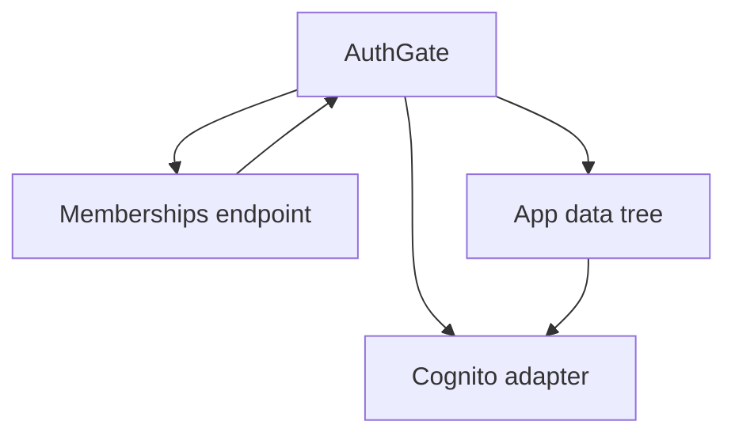
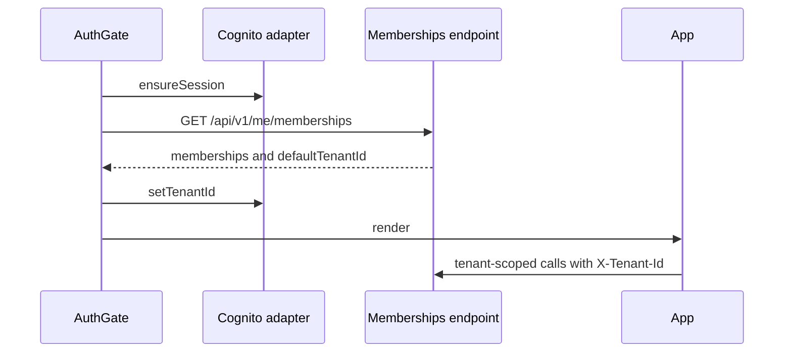
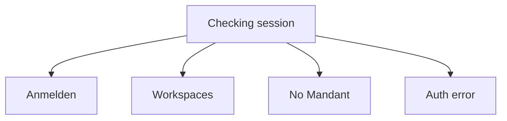

# R-08 Cognito login and tenant switcher - Plan

## Goal Capsule

- Objective: A person signed in through Cognito works in one Mandant they belong to, and can move to another, without the screen mixing the two.
- Means: The browser asks the API which Mandanten the token may use, then sends that choice on later calls (KTD1, KTD2).
- Authority: GitHub issue #20 and the R-08 section of `docs/plans/2026-10-14-roadmap-next-work-items.md`. The existing PKCE adapter stays. ADR-005's three-field login is a later issue.
- Execution: code. The implementing agent finishes the units, verifies them, and ships the change.
- Stop if the membership list cannot be read before a Mandant is chosen, or if changing Mandant requires a full page load. A page load drops the in-memory tokens.

## Product Contract

### Summary

Finish the open lane B login item. Hosted-UI PKCE, in-memory tokens, silent refresh, logout, and the local development adapter are already in the web app. What is missing is the Mandant choice: after login the shell waits for the user's memberships, shows a switcher when there is more than one, and reloads the lists for the Mandant they pick.

### Problem Frame

The AWS cell already rejects anonymous API calls. The web app can complete the Cognito redirect and keep tokens in memory, but it never tells the API which Mandant to use. The API then falls back to the user's default membership, and the status bar still says `Mandant 100 · Hauptlager MAIN`. Someone who belongs to two Mandanten cannot choose the other one, so the lists stay on the default. A reload would not help: the tokens are not stored, so a reload returns the person to the login screen. The status bar shows the tenant id, not a company name.

### Requirements

- R1. An authenticated caller can read their own memberships before any Mandant is chosen, including when they have none.
- R2. The list names each membership's tenant id and whether it is the default. It also names the tenant id the API would use when `X-Tenant-Id` is omitted.
- R3. In Cognito mode the workspaces stay hidden until that list has loaded and, when it is non-empty, the adapter's tenant is set to the tenant id from R2.
- R4. A user with more than one membership gets a switcher. Choosing another Mandant updates the tenant, drops the open document from the URL, and loads that Mandant's lists. The browser document does not reload.
- R5. A user with one membership sees that tenant id and no switcher.
- R6. A user with no membership sees a German explanation and can log out. The workspaces do not call the API.
- R7. `npm run dev` keeps the local adapter. The status bar stays `Mandant 100 · Hauptlager MAIN`, and the shell does not wait on the membership list.
- R8. Logout still clears the Cognito session. PKCE, in-memory tokens, and silent refresh stay as they are. The Vitest adapter-selection tests still pass.

### Key Decisions

- Hosted UI login stays for this issue. Governs R7, R8. The three-field Mandantennummer / User / Passwort form in `docs/architecture/adr/ADR-005-mandant-registration.md` belongs to registration (issue #65, R-23).
- The status bar in Cognito mode shows the tenant id. Governs R4, R5. There is no company-name column on a membership.

### Key Flows

- F1. Cognito sign-in
  - Trigger: the app loads with Cognito auth config, or returns from the hosted UI with a code.
  - Steps: the adapter establishes the session, the shell requests the membership list, then either sets the tenant and shows the workspaces, shows the empty-membership message, or shows the existing auth error.
  - Outcome: the first tenant-scoped API call includes `X-Tenant-Id`.
  - Covered by: R1, R3, R6
- F2. Switch Mandant
  - Trigger: the user picks a different tenant in the status bar.
  - Steps: the adapter stores the new tenant, the URL keeps the workspace and loses the document id, the data-owning shell remounts.
  - Outcome: lists belong to the new tenant. Tokens are still in memory.
  - Covered by: R4

### Acceptance Examples

- AE1. Covers R3, R4. Given two memberships and a default on the second tenant, when login finishes, the status bar shows that default tenant id and the first customer request sends it as `X-Tenant-Id`.
- AE2. Covers R4. Given an open sales document, when the user picks the other tenant, the URL no longer contains that document id and the customer list is requested again with the new `X-Tenant-Id`.
- AE3. Covers R6. Given an authenticated user with no memberships, the shell shows the empty-membership message and does not request customers.
- AE4. Covers R7. Given local auth config, the shell renders immediately and the status bar text is unchanged.

### Success Criteria

- The existing adapter-selection tests still pass, and new tests cover the membership payload, the default tenant, the empty-membership gate, and a switch that changes `X-Tenant-Id` without reloading the page.
- Against the AWS cell, a provisioned Cognito user can log in, create an order, release it, and log out. That walkthrough needs a pool user whose `sub` is the membership user id. This change does not create that user.

### Scope Boundaries

- The PKCE redirect, token exchange, refresh, and hosted logout in `src/erp-web/src/auth/cognitoAdapter.ts` are not redesigned.
- No OIDC client library.
- No company name, Mandantennummer, or warehouse name on the Cognito status bar.
- No confirmation dialog before a switch clears an in-progress form. The operator chose the switch and the form is on screen until they do. A dialog would be warranted if operators start losing orders they meant to keep.
- No abort of a request already in flight when the Mandant changes. That request keeps the `X-Tenant-Id` it was sent with, which is the Mandant the operator was editing. Aborting it would drop a save they had already started.
- No persistence of refresh tokens across a reload. Issue #20 requires in-memory tokens.
- No Cognito user provisioning and no change to the `synthetic-a` / `synthetic-b` membership seed. Those user ids are not Cognito `sub` values, so a real pool login still 403s until an operator inserts a matching row.

#### Deferred to Follow-Up Work

- R-23 / ADR-005: registration and the three-field login. This plan leaves the hosted UI in place so that work can replace the login screen later.
- A scripted cell smoke that creates a Cognito user, writes their `sub` into `tenant_memberships`, and walks login through release.

<!-- ce-section: work-relationships -->

### Work relationships

This plan is the R-08 login slice. R-16 (invoice lines, VAT, and addresses, issue #28) is a separate domain slice and does not depend on the switcher. R-20 (idempotency fingerprints, issue #32) is later operability. R-23 (Mandant registration) is the slice that replaces this login form.

### Sources

- Issue #20 and `docs/plans/2026-10-14-roadmap-next-work-items.md` (R-08).
- `src/erp-web/src/auth/cognitoAdapter.ts`, `src/erp-web/src/AuthGate.tsx`, `src/Erp.Api/TenantMembershipSelection.cs`, `src/Erp.Api/Program.cs`.
- `docs/architecture/adr/ADR-005-mandant-registration.md` for the login form this issue does not build.

## Planning Contract

### Key Technical Decisions

- KTD1. `GET /api/v1/me/memberships` is the only `/api` path that skips tenant denial. The skip sits after the existing 401 check. Anonymous callers still get 401. The handler reads `ITenantMemberships` for the token's user id and does not use the request `ErpDbContext`. The JSON body is the membership list plus `defaultTenantId`, computed with `TenantMembershipSelection.Choose` and an empty header. An empty list returns 200 and a null `defaultTenantId`.
- KTD2. The browser does not reimplement Guid ordering. It stores `defaultTenantId` from KTD1. .NET `Guid` order is not lexicographic on the canonical string, so a client-side sort would pick a different Mandant than the API.
- KTD3. `AuthGate` owns an auth context. In Cognito mode it fetches memberships before rendering `App`. A switch calls `setTenantId`, then `navigate` from `src/erp-web/src/route.ts` to the same workspace with a null document id (`replace`), then remounts the data-owning tree with the tenant id as the key. `useMasterData` lives in that tree. `window.location.reload` is not used.
- KTD4. Regenerate `openapi/v1.json` with `scripts/export-openapi.mjs` and `src/erp-web/src/api.generated.ts` with `npm run gen:api` in the same change as the endpoint. CI rejects a stale document or stale types.

### High-Level Technical Design

### Assumptions

- The cell acceptance in the issue is an operator walkthrough. Automated proof is the API and Vitest coverage in the Verification Contract.
- Cognito mode status text is the tenant id alone. `Hauptlager MAIN` stays only on the local status line.
- A switch may discard an unsaved form without asking.
- Local mode never calls the membership endpoint. If it is called while authentication is disabled, the existing development-tenant middleware still runs and the handler lists memberships for the development user id. The UI does not depend on that result.

### Sequencing

U1 before U2. U2 before U3. U4 can land with either, and it does not change behavior.

## Implementation Units

### U1. Membership list before a tenant is chosen

- Goal: An authenticated caller can read their memberships and the server's default tenant even when they have no membership.
- Requirements: R1, R2
- Dependencies: none
- Files: `src/Erp.Api/Endpoints/MembershipEndpoints.cs`, `src/Erp.Api/Program.cs`, `tests/Erp.Api.Tests/DevelopmentIdentityTests.cs`, `openapi/v1.json`, `src/erp-web/src/api.generated.ts`
- Approach: Add `MapMembershipEndpoints` beside the other endpoint groups. In the `/api` middleware, after the unauthenticated 401, let the exact path `GET /api/v1/me/memberships` continue without `TenantMembershipSelection`. Do not skip on a prefix. Follow `tests/Erp.Api.Tests/DevelopmentIdentityTests.cs` (`ApiFixture.Create`, `FakeTenantMemberships`, `TestAuthHandler`).
- Patterns to follow: `src/Erp.Api/Endpoints/SalesEndpoints.cs` for the endpoint group, and `TenantMembershipSelection.Choose` for the default.
- Test scenarios:
  - An authenticated user with memberships A (not default) and B (default) gets 200, both rows, and `defaultTenantId` B. The observed request tenant is unset because this path skips tenant selection.
  - An authenticated user with no memberships gets 200, an empty list, and a null `defaultTenantId`.
  - An anonymous request to the path gets 401.
  - A non-member `X-Tenant-Id` on this path does not turn the response into 403.
  - User A and user B each have a membership. Calling as A returns only A's row. Calling as B returns only B's row.
- Verification: The four scenarios pass, and a fresh OpenAPI export matches `openapi/v1.json`. `npm run gen:api` matches `src/erp-web/src/api.generated.ts`.

### U2. Hold the shell until the default tenant is set

- Goal: Cognito mode does not mount the workspaces until the membership list has chosen a tenant, or has shown that there is none.
- Requirements: R3, R5, R6, R7, R8
- Dependencies: U1
- Files: `src/erp-web/src/api.ts`, `src/erp-web/src/AuthGate.tsx`, `src/erp-web/src/AuthGate.test.tsx`, `src/erp-web/src/auth/selectAdapter.test.ts`
- Approach: After a Cognito session exists, keep the auth-gate chrome visible with the copy `Mandant wird ermittelt …`, request the membership payload with the bearer token, and call `setTenantId` with `defaultTenantId` before rendering children. Publish the list and the active tenant through context. Local mode renders children immediately and does not fetch. Empty list: German copy `Diesem Benutzer ist kein Mandant zugeordnet.` and the existing logout action. A failed fetch uses the existing auth error state.
- Patterns to follow: `src/erp-web/src/AuthGate.test.tsx` injects `bootstrap` instead of calling `/auth-config.json`.
- Test scenarios:
  - Covers AE1. Cognito bootstrap resolves, the membership payload's `defaultTenantId` is `22222222-2222-2222-2222-222222222222`, and the child renders only after `setTenantId` was called with that id.
  - Covers AE3. The payload list is empty. The child does not render. The empty-membership text is visible.
  - Covers AE4. Local bootstrap renders the child and does not request `/api/v1/me/memberships`.
  - A failed membership response shows the auth error and does not render the child.
  - `src/erp-web/src/auth/selectAdapter.test.ts` still selects local vs Cognito from auth config.
- Verification: AuthGate tests and the adapter-selection tests pass.

### U3. Switch Mandant and reload that Mandant's lists

- Goal: More than one membership can be chosen from the status bar, and the lists follow that choice without a page reload.
- Requirements: R4, R5, R7
- Dependencies: U2
- Files: `src/erp-web/src/App.tsx`, `src/erp-web/src/App.test.tsx`, `src/erp-web/src/App.css`
- Approach: In Cognito mode, replace the static status span with the active tenant id. Render a native select only when the context list length is greater than one, with accessible name `Mandant wechseln`. On change, `setTenantId`, `navigate` to the current workspace with `documentId: null` and `replace`, and remount the tree that calls `useMasterData` and the workspace hooks. Local mode keeps the static span. Do not call `window.location.reload` or `window.location.assign` from the switch path.
- Patterns to follow: `useRoute` in `src/erp-web/src/route.ts`, and the fetch stub router in `src/erp-web/src/App.test.tsx`.
- Test scenarios:
  - Covers AE2. Two memberships, route `/sales/order-1`. Choosing the other tenant sets `X-Tenant-Id` to that id on the next customer request, and the URL is `/sales`.
  - Covers R5. One membership shows its tenant id and no switcher.
  - Covers AE4. Local mode still shows `Mandant 100 · Hauptlager MAIN`.
  - The switch handler does not assign `window.location`.
- Verification: App tests pass, and `npm run lint` reports no new warnings.

### U4. Correct the dev-cell login note

- Goal: Operators reading the cell doc are not told that the API still uses the development tenant.
- Requirements: R8
- Dependencies: none
- Files: `docs/operations/aws-dev-cell.md`
- Approach: Replace the sentence that says the API uses the development tenant until PKCE is wired. State that the UI uses hosted-UI PKCE when the API has an authority, and that a pool user's `sub` must equal `tenant_memberships.user_id` or the API returns 403.
- Test expectation: none. This is a documentation sentence.
- Verification: The old "until PKCE is wired" claim is gone, and the `sub` requirement is present.

## Verification Contract

- `dotnet test Erp.slnx -c Release` passes, including the membership endpoint scenarios.
- In `src/erp-web`: `npm test`, `npm run lint`, and `npm run build` pass.
- `node scripts/export-openapi.mjs` leaves `openapi/v1.json` unchanged, and `npm run gen:api` in `src/erp-web` leaves `src/erp-web/src/api.generated.ts` unchanged.
- The AWS cell walkthrough in Success Criteria is manual and depends on a provisioned user. It is not a CI gate.

## Definition of Done

- U1 through U4 meet their verification bullets.
- A Cognito session with two memberships shows only the active Mandant's data after a switch, and a reload was not used to get there.
- Local `npm run dev` behavior and the adapter-selection tests are unchanged.
- Abandoned experiments are not left in the diff.

## Risks & Dependencies

- Issue #20's cell walkthrough still fails for the seeded `synthetic-a` and `synthetic-b` user ids, because Cognito `sub` values are different. The code path is covered by tests. The cell needs an operator to insert the real `sub`.
- `GET /api/v1/me/memberships` must not touch tenant-filtered tables. Those queries would run without `app.tenant_id` on this path.
