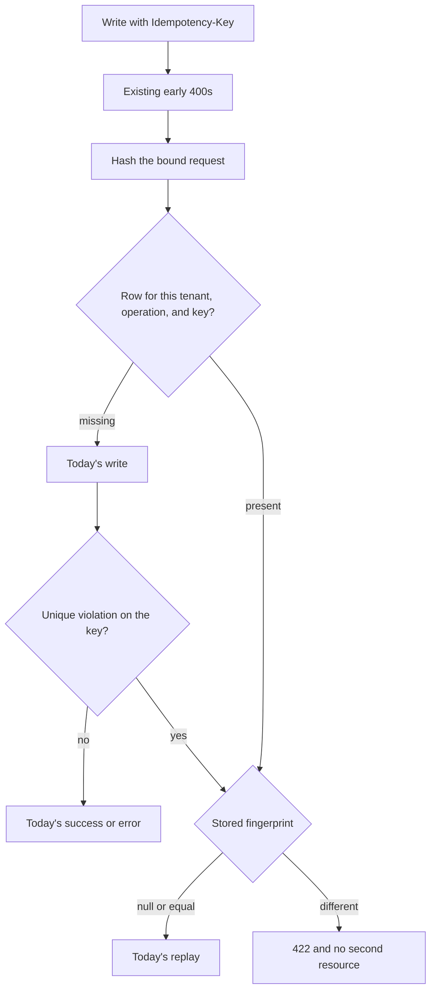

# Idempotency fingerprint and retention - Plan

## Goal Capsule

- **Objective:** A client that resends a write with the same key and a different body is refused, and a key older than 30 days can be used again as a new write.
- **Means:** Compare a stored fingerprint of the bound request before replay, and delete aged rows with a database function the worker calls (KTD1, KTD5).
- **Authority:** Issue [#32](https://github.com/cvsckrause/cvsTest/issues/32) and the R-20 block in `docs/plans/2026-10-14-roadmap-next-work-items.md`. Requirements win on product behavior. Key Technical Decisions win on mechanism inside those requirements.
- **Execution profile:** Lane B, `priority:P2`, `area:api`. The issue is labeled `size:S`. This plan adds one nullable column and one database function.
- **Stop conditions:** Stop if the worker role can delete another tenant's idempotency rows without the definer function. Stop if a different positive quantity produces the same fingerprint as the original request. Do not change the missing-key response. Do not change `src/erp-web`.
- **Ships as:** One pull request against `main` that closes issue #32.

---

## Product Contract

### Summary

Each stored idempotency key remembers the request that created it. A later call with that key and a different request is refused with 422. Keys older than 30 days are deleted, and a key that has no fingerprint keeps returning the first result until then.

### Problem Frame

A client that retries a write with the same key and a changed body is handed the first result, so the changed write never happens. The acceptance case is a different quantity. The table of those keys also grows with no end.

### Key Decisions

- **Legacy keys keep today's replay.** (session-settled: user-approved — chosen over treating a missing fingerprint as a mismatch: those keys were stored before a body was recorded.) Governs R3.
- **Retention is 30 days.** (session-settled: user-approved — chosen over leaving the issue's "for example" unset: 30 days is the window that ships.) Governs R4.
- **The fingerprint is stored on the record.** (session-settled: user-approved — chosen over the issue's no-schema label: the comparison needs a stored value.) Governs R1, R2, R3.

### Requirements

Replay

- R1. When the stored fingerprint equals this request's fingerprint, the API returns the replay body that endpoint returns today.
- R2. When a stored fingerprint is present and differs from this request, the API returns 422 ProblemDetails with title `The idempotency key was reused with a different request.` and detail `This Idempotency-Key was already used for a different request.` It creates no second resource and leaves the stored fingerprint unchanged.
- R3. When the stored fingerprint is null, the API returns the replay body that endpoint returns today, for any body, on the first check and on a concurrent insert.

Retention

- R4. The worker deletes idempotency records older than 30 days in every tenant.
- R5. After a record is deleted, sending that key again is a new write.

Existing errors

- R6. A missing or blank `Idempotency-Key` still returns 400 with `{ error: "Idempotency-Key header is required." }`. A goods receipt whose quantity is less than or equal to zero still returns 400 with `{ error: "Quantity must be positive." }` and does not look up the key.

### Acceptance Examples

- AE1. Covers R2. Create a sales order or post a goods receipt with a key, then send the same key with a different positive quantity. The response is the R2 problem, and there is no second order or movement.
- AE2. Covers R1. Send the same key and the same body again. The response is today's replay, including release posted as `{}`.
- AE3. Covers R3. A row whose fingerprint is null, sent again with a different quantity, returns today's replay.
- AE4. Covers R4, R5. Rows older than 30 days in two tenants are gone after one worker batch. A row created now remains. Posting a deleted key creates a new resource.

### Scope Boundaries

- Which calls require an idempotency key stays as it is. The four writes are create, release, and cancel of a sales order, and goods receipt.
- The UI, the generated client, and OpenAPI stay unchanged. A failed receipt still retries the same key from the Lager form.
- Missing-key, domain, not-found, and stock errors stay on their current statuses. R6 is the only early-400 rule this work depends on.
- Same-body replay payloads stay as they are. Create and release and cancel keep `{ id, replayed: true }`. Receipt keeps the re-read of the movement.
- Not built: normalizing decimal scale. `1` and `1.0` are different fingerprints. Revisit if a real client retry differs only by scale and is refused.
- Not built: an index on `CreatedAt`. Revisit if the purge shows up in batch time.
- Not built: running the purge less often than every batch. An empty delete is the current batch loop. Revisit if that delete dominates the batch.
- Not built: storing the original response so a replay can return the first status and body. Revisit if a client depends on the first response's status.
- Not built: putting the order id, or the unread body, into the release or cancel fingerprint. KTD1 hashes `{}` only. Revisit if one key must release two orders.

### Sources

- Issue [#32](https://github.com/cvsckrause/cvsTest/issues/32) and R-20 in `docs/plans/2026-10-14-roadmap-next-work-items.md`. R-06 (issue #18) is already in the tree: `AddProblemDetails` and `ApiExceptionHandler`.
- Idempotency rules: `docs/architecture/adr/ADR-003-outbox-and-idempotency.md`. Tenancy and forced RLS: `docs/architecture/adr/ADR-002-customer-database-tenancy.md`.
- Key read and operation names: `src/Erp.Api/Endpoints/Idempotency.cs`. Hit checks: `src/Erp.Api/Endpoints/SalesEndpoints.cs`, `src/Erp.Api/Endpoints/InventoryEndpoints.cs`.
- Unique-violation replay: `ApiProblemDecision` in `src/Erp.Api/ApiProblems.cs`, `TryWriteReplayAsync` in `src/Erp.Api/ApiExceptionHandler.cs`.
- Record and mapping: `IdempotencyRecord` in `src/Modules/Erp.Platform/Domain/OperationalRecords.cs`, `ErpDbContext` in `src/Erp.Persistence/Class1.cs`. Unique index on tenant, operation, and key. Columns are Pascal case.
- Worker seam and claim: `ProcessBatch` and `erp.claim_outbox` in `src/Erp.Worker/Worker.cs`. Function ceremony: `src/Erp.Persistence/Migrations/20261015134040_AddOutboxClaimAndDeadLetter.cs` and `src/Erp.Persistence/Migrations/20261016111137_AddOutboxRequestContext.cs`.
- Tests to extend: `tests/Erp.Integration.Tests/IdempotencyTests.cs`, `tests/Erp.Api.Tests/ProblemDetailsTests.cs`, `tests/Erp.Integration.Tests/OutboxProcessor.cs`, `tests/Erp.Integration.Tests/DatabaseProbe.cs`.

---

## Planning Contract

### Key Technical Decisions

- KTD1. **The fingerprint is a hash of the bound request, not the raw body.** Minimal APIs have already read the body when the hit check runs, and there is no buffered raw stream. Serialize the bound DTO with `JsonSerializerDefaults.Web`, hash the UTF-8 bytes with SHA-256, and store lowercase hex. Release and cancel bind no body, so they hash `{}`. The route id is not an input. Unknown JSON fields are already dropped by the binder. Do not normalize decimal scale, warehouse case, or reference whitespace. Those are applied only after a miss, so `main` and `MAIN` differ. The issue's "canonical request body" cannot be the raw bytes. This is the form that makes a different quantity a different digest and lets the same logical JSON match.
- KTD2. **The column is nullable, with no default and no backfill.** (session-settled: user-approved — chosen over backfilling fingerprints or treating a missing one as a mismatch: existing keys were stored before a body was recorded.) Add `Fingerprint` as `character varying(64)` on `erp.idempotency_records`, quoted Pascal case, like the columns already there. Leave it out of `IX_idempotency_records_TenantId_Operation_Key`. Null stays null on existing rows. A new release or cancel row writes the hash of `{}`. Empty string is a real fingerprint. Null replays on the pre-check and on the unique-violation path, including when an old instance won the race during a rolling deploy. Governs R3.
- KTD3. **Mismatch is 422 written by the endpoint and by the replay handler.** Compare at the existing hit, after `RequireKey` and after the receipt quantity guard (R6). A miss keeps today's validation and writes the row only on the success path, in the same transaction as the business change. Stash the one hex value on `HttpContext.Items` before `SaveChangesAsync`, and store that same value. `TryWriteReplayAsync` reads the stash from the request's `HttpContext`. The new DI scope does not carry it. Equal, or a null stored fingerprint, writes today's replay and returns handled. Different writes the R2 problem and returns handled. A missing stash against a non-null stored fingerprint is a mismatch. Returning unhandled, or throwing `InvalidOperationException` or `ArgumentException`, becomes today's 409 or 400. `ApiProblemDecision` keeps classifying this unique violation as replay. `ProblemDetailsTests` keeps that assertion.
- KTD4. **The retention window is 30 days on `WorkerOptions`.** (session-settled: user-approved — chosen over leaving the window unset: the issue's 30-day example is the window that ships.) Add `IdempotencyRetentionDays` with initializer `30`, the same way `BatchSize` is initialized. Existing `new WorkerOptions { MaxAttempts = 1 }` constructions keep 30. `src/Erp.Worker/appsettings.json` does not need a key. The `"Worker"` section there does not bind to `WorkerOptions`. Governs R4.
- KTD5. **The purge is a `SECURITY DEFINER` function the worker calls every batch.** An EF delete cannot see other tenants. The idempotency query filter is the current tenant, `erp_worker` is `NOBYPASSRLS`, and `ProcessBatch` sets the tenant only for a claimed outbox message. With an empty claim the tenant id is still empty, so the delete would see nothing. `IgnoreQueryFilters` is unused and is not the cross-tenant path. Add `erp.purge_idempotency(retention_days integer)`, `SECURITY DEFINER`, `SET search_path = erp, pg_temp`, owned by `erp_outbox_definer`, following the grant ceremony in `20261016111137_AddOutboxRequestContext.cs`. Grant that role `SELECT` and `DELETE` on `erp.idempotency_records`. Grant `EXECUTE` to `erp_worker` only, and revoke it from `PUBLIC` and `erp_app`. The function deletes rows whose `"CreatedAt"` is older than PostgreSQL `now()` minus the given number of days. Call it from `ProcessBatch` after the message loop, including when the claim is empty, on the worker connection, in its own try/catch so a purge failure does not fail an outbox message. Do not call it when `IdempotencyRetentionDays` is less than or equal to zero. Zero days would delete every existing key, including rows other integration tests just created. This did not need a bake-off: the EF path cannot see the rows, and the repo already uses this function shape for cross-tenant worker work.

### High-Level Technical Design

The worker path is separate. Each `ProcessBatch` calls `erp.purge_idempotency` for every tenant after the outbox loop. Age is computed in the database from `"CreatedAt"`.

### Sequencing

U1 lands the column so later inserts can store a fingerprint. U2 is the API behavior and depends on U1. U3 is the purge. It does not read the fingerprint. It can be implemented after U1 without waiting for U2, and it ships in the same pull request.

---

## Implementation Units

### U1. Store a nullable fingerprint

- **Goal:** An idempotency record can hold a fingerprint, and rows that already exist stay null.
- **Requirements:** R3. The column decision in Key Decisions.
- **Dependencies:** None.
- **Files:** `src/Modules/Erp.Platform/Domain/OperationalRecords.cs`, `src/Erp.Persistence/Class1.cs`, `src/Erp.Persistence/Migrations/`, `src/Erp.Persistence/Migrations/ErpDbContextModelSnapshot.cs`, `tests/Erp.Domain.Tests/IdempotencyRecordTests.cs`
- **Approach:**
  1. Add the property and pass it through `Create`, per KTD2. The four current call sites pass null until U2.
  2. Map max length 64. Do not add a default and do not add the column to the unique index.
  3. Generate the migration with the EF tools already on `src/Erp.Persistence/Erp.Persistence.csproj` so the snapshot stays in sync. Follow `src/Erp.Persistence/Migrations/20261015175429_AddSalesOrderWarehouse.cs` for `AddColumn`, without that migration's non-null default.
- **Patterns to follow:** Private setter and factory on `IdempotencyRecord`. Pascal-case columns in `ErpDbContext`.
- **Test scenarios:**
  - `Create` with no fingerprint leaves the property null.
  - `Create` with a 64-character hex string stores that string.
- **Verification:** The domain tests pass. The model snapshot contains a nullable 64-character `Fingerprint` and the unique index is unchanged.

### U2. Refuse a different body

- **Goal:** A reused key with a different request returns 422, and a matching or legacy key still replays.
- **Requirements:** R1, R2, R3, R6
- **Dependencies:** U1
- **Files:** `src/Erp.Api/Endpoints/Idempotency.cs`, `src/Erp.Api/Endpoints/SalesEndpoints.cs`, `src/Erp.Api/Endpoints/InventoryEndpoints.cs`, `src/Erp.Api/ApiExceptionHandler.cs`, `tests/Erp.Integration.Tests/IdempotencyTests.cs`, `tests/Erp.Api.Tests/ProblemDetailsTests.cs`
- **Approach:**
  1. Compute one digest per KTD1 and stash it before save.
  2. On a hit, branch per KTD2 and KTD3. A mismatch returns R2 and skips later customer, article, stock, and number-range work.
  3. Store that digest on the inserted row, including the empty-document digest for release and cancel.
  4. Teach `TryWriteReplayAsync` the same branch. Leave `ApiProblemDecision` classifying the unique violation as replay.
- **Execution note:** Add the different-quantity integration test first. Today's silent replay should fail it before the hit check changes.
- **Patterns to follow:** `Results.Problem` as in `WriteForbidden` in `src/Erp.Api/Program.cs`. Replay payloads already in the four handlers and in `TryWriteReplayAsync`. `ApiSession.PostAsync` in `tests/Erp.Integration.Tests/ApiSession.cs`.
- **Test scenarios:**
  - Same key and a different positive quantity on goods receipt returns the R2 problem and does not add a movement. The stored fingerprint is unchanged.
  - Same key and a different positive line quantity on create returns the R2 problem and does not add an order.
  - Same key and the same receipt body returns today's replay.
  - Release with the same key and body `{}` still returns today's replay.
  - A row forced to a null fingerprint, retried with a different quantity, returns today's replay.
  - A stored key retried with receipt quantity `0` still returns 400 `{ error: "Quantity must be positive." }`.
  - A unique violation whose stashed hash differs writes the R2 problem and leaves the stored row unchanged. A matching stashed hash, and a null stored fingerprint with a different stashed hash, still replay.
  - `Concurrent_idempotency_key_is_a_replay` still expects replay for the unique violation.
- **Verification:** `tests/Erp.Integration.Tests/SalesOrderCancellationTests.cs` still rejects a cancel with no key as 400. The new cases and the existing idempotency cases pass against Postgres.

### U3. Delete expired records

- **Goal:** One worker batch removes idempotency records older than 30 days in every tenant, and a deleted key can be used again.
- **Requirements:** R4, R5
- **Dependencies:** None. Ships with U1 and U2.
- **Files:** `src/Erp.Persistence/Migrations/`, `src/Erp.Worker/Worker.cs`, `src/Erp.Worker/WorkerOptions.cs`, `tests/Erp.Integration.Tests/IdempotencyRetentionTests.cs`, `tests/Erp.Integration.Tests/OutboxProcessor.cs`, `tests/Erp.Integration.Tests/DatabaseProbe.cs`
- **Approach:**
  1. Add `IdempotencyRetentionDays` per KTD4.
  2. Add `erp.purge_idempotency` per KTD5 in its own migration.
  3. Call it from `ProcessBatch` after the message loop, on the worker connection, with the option value. Skip the call when the value is less than or equal to zero. Catch and log a purge failure without failing the outbox batch.
- **Execution note:** Add the two-tenant purge test first. Before the function exists, the backdated rows should still be there.
- **Patterns to follow:** `erp.claim_outbox` and `erp.outbox_metrics` for the function header, owner, and grants. `OutboxProcessor.ProcessOnceAsync` and `fixture.WorkerConnectionString` for the batch. `DatabaseProbe` admin SQL to backdate `"CreatedAt"`. Do not add a setter for `CreatedAt`.
- **Test scenarios:**
  - A row backdated 31 days in tenant A and another in tenant B are gone after one `ProcessBatch` on the worker connection. A row created now is still there.
  - Posting the deleted key again creates a new resource. It is not a replay and not a 422.
  - `IdempotencyRetentionDays` of `0` does not delete a backdated row.
  - `new WorkerOptions { MaxAttempts = 1 }` still has a retention of 30 days.
- **Verification:** The purge test passes on the worker connection, which is `erp_worker` and does not bypass RLS. Existing worker tests still pass. Their rows are new, so the purge does not remove them.

---

## Verification Contract

| Gate | Command | Covers |
| --- | --- | --- |
| Backend | `dotnet test Erp.slnx -c Release` | U1–U3. Integration tests need Docker for Testcontainers. |

---

## Definition of Done

- AE1–AE4 pass, and R6's two 400 bodies are unchanged.
- `dotnet test Erp.slnx -c Release` passes.
- The diff has no abandoned attempt code.
- `src/erp-web` is untouched.
- U1's snapshot shows a nullable fingerprint outside the unique index.
- U2 returns the R2 problem for a different quantity and still replays a matching body and a null fingerprint.
- U3 deletes backdated rows for two tenants through the worker role and leaves a fresh row in place.

---

## System-Wide Impact

- Clients that reused a key with a different body used to see the first success. They now receive 422. Clients that resend the same body still see today's replay.
- The migration adds a nullable column to a table that already has forced row-level security and `tenant_isolation`. It does not add a policy or a table. `tests/Erp.Integration.Tests/RowLevelSecurityTests.cs` should keep `idempotency_records` on its tenant-table list.
- The worker gains a cross-tenant delete. Only `erp_worker` can execute it, and only the definer role can delete through it. `erp_app` cannot.

---

## Risks & Dependencies

- During a rolling deploy an old API can still insert a null fingerprint. KTD2 treats that null as replay, on the pre-check and on the unique-violation path. A raw inequality would 422 that race.
- The purge function can delete every tenant's keys. The grants in KTD5 are the whole containment. A wider `EXECUTE` grant would let the API role purge keys.
- `IdempotencyRetentionDays` of `0` would delete every current key on the next batch, including rows in the shared integration database. KTD5 does not call the function for a value at or below zero.
- Issue #32 depends on issue #18. That error contract is already present. Nothing in this plan waits on another open issue.
