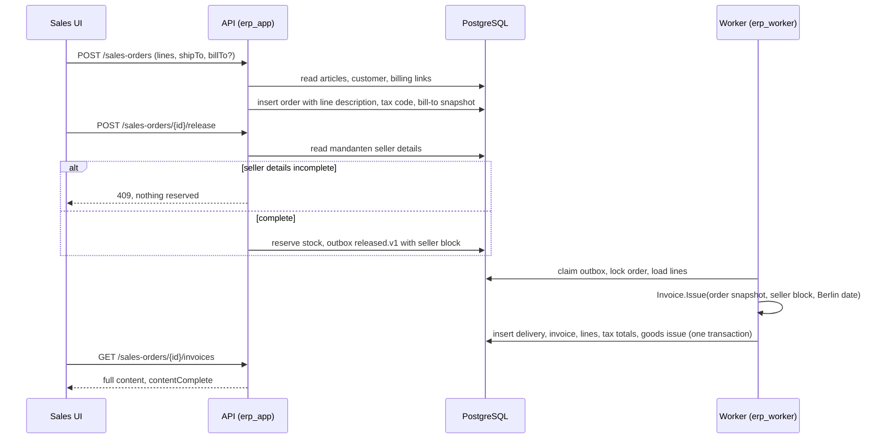
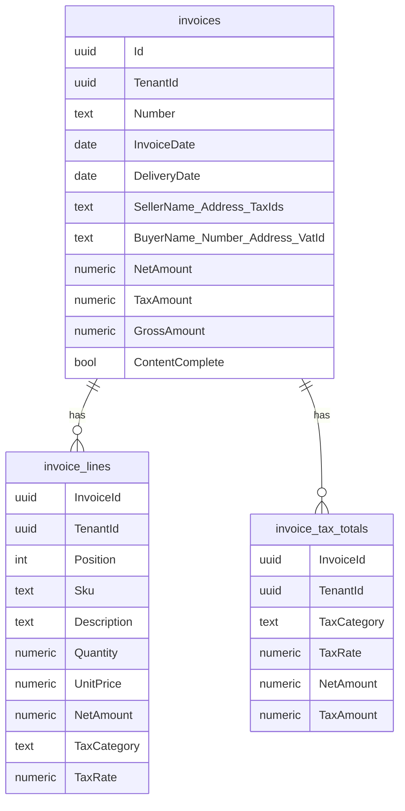
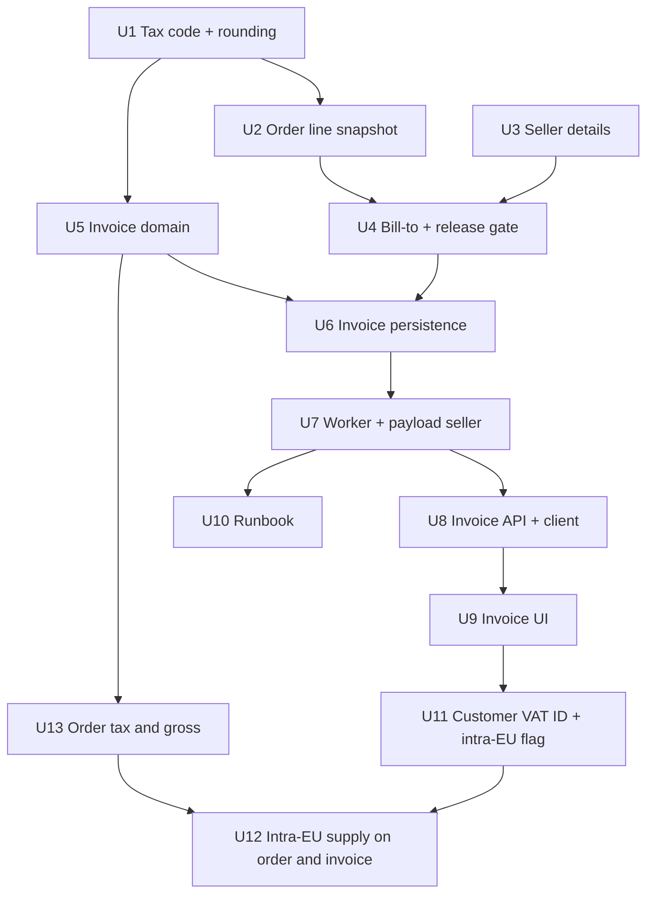

# R-16 invoices with the DACH minimum content - Plan

## Goal Capsule

- **Objective:** Every Rechnung a tenant issues carries the content that §14 Abs. 4 UStG requires: seller and buyer with names and addresses, the seller's Steuernummer or USt-IdNr, invoice date and delivery date, the lines with quantity and description, net and tax per VAT rate, and the total gross. Users can read all of it in the API and the sales UI, and an issued invoice never changes.
- **Means:** The API resolves and freezes every invoice input, at order creation or release, and the worker only copies and computes (KTD1). One commercial rounding rule lives in the domain (KTD4).
- **Authority:** Issue [#28](https://github.com/cvsckrause/cvsTest/issues/28), the R-16 block and decision D4 in `docs/plans/2026-10-14-roadmap-next-work-items.md`, and the priority comment on #28 from Roundup-01 [#100](https://github.com/cvsckrause/cvsTest/issues/100). Requirements win on product behavior. Key Technical Decisions win on mechanism inside those requirements.
- **Execution profile:** Lane B, Wave 1, `priority:P1`, `size:L`. Depends on R-13 [#25](https://github.com/cvsckrause/cvsTest/issues/25) and R-14 [#26](https://github.com/cvsckrause/cvsTest/issues/26), both merged. Blocks E-2 [#34](https://github.com/cvsckrause/cvsTest/issues/34), which can start once Phase C merges. Phase D does not block it.
- **Stop conditions:**
  - Stop if any path could number an invoice that lacks the seller address or tax number.
  - Do not grant `erp_worker` access to `erp.mandanten`.
  - Do not rewrite stored invoice rows.
  - Do not issue a 0 % intra-EU invoice without both USt-IdNrs and a ship-to in another EU member state (R18, R20, R21).
- **Ships as:** Three pull requests against `main`, one per phase A–C. Phase D (tax-free intra-EU supply) is a fourth pull request that can be cut without affecting A–C. Phase B and Phase C merge separately, but they deploy as one window: stop the worker before the Phase B image starts, and start it only after the Phase C migrator exits 0. The worker that still numbers a net-only invoice must not run once seller details gate release.

---

## Product Contract

### Summary

Articles get a VAT code (19 %, 7 %, 0 %), and order lines freeze the code and the article description next to the price. Each Mandant records its seller details (address plus Steuernummer or USt-IdNr), and releasing an order is refused while they are incomplete. Orders freeze a bill-to taken from the customer's Billing address. The worker then issues an invoice with lines, per-rate tax totals, grand totals, invoice and delivery dates, and seller and buyer snapshots. The API returns that content and the sales workspace shows it. A saved order already shows net, tax, and gross per rate, and its invoice carries the same figures. Tax-free intra-EU supplies follow in Phase D as a customer property with a mandatory foreign buyer USt-IdNr.

### Problem Frame

`Invoice` stores only a number and `NetAmount`, so no invoice the system issues today is a valid German invoice. E-2 (XRechnung/ZUGFeRD) builds on the invoice content, and German B2B issuers above €800k turnover must send e-invoices from 1 January 2027. Roundup-01 kept R-16 at P1 ahead of any new P3 domain work on lane B.

Three facts in the current code shape the work:

- No seller address or tax number exists anywhere. `Mandant` holds only `Number` and `Firmenname`.
- The worker that creates invoices runs as `erp_worker`, which has no rights on `erp.mandanten` (`20261016132349_AddMandantRegistry.cs`).
- The demo seed and every integration-test customer link only a Shipping address. The Billing role is unused.

### Key Decisions

- KD1. **Phase D's 0 % case is a tax-free intra-EU supply of goods, flagged on the customer.** D4's "reverse-charge flag" is read as §4 Nr. 1b and §6a UStG: a business buyer in another EU member state, goods shipped there, VAT category K, and the note "Steuerfreie innergemeinschaftliche Lieferung". §14a Abs. 3 UStG requires both USt-IdNrs on that invoice. Domestic reverse charge under §13b (category AE) stays out of scope. (session-settled: user-approved — chosen over domestic §13b reverse charge on the customer and over §13b goods flagged on the article: Mark picked a customer-level flag for selling to businesses in other EU states such as Austria, which is the §6a case.) Governs R17, R18, R20, R21.
- KD2. **Seller details belong to the Mandant and gate release.** Without them no compliant invoice is possible, and the release is the last point where the user can still fix it. The form ships one phase before the gate, so each Mandant can enter its details before releases depend on them. Governs R3, R4.
- KD3. **The bill-to is chosen when the order is created, like the ship-to.** It keeps the invoice deterministic across retries and replays. Governs R5.
- KD4. **Invoices issued before this change stay as issued.** GoBD forbids rewriting issued invoices. They are flagged as incomplete instead of being backfilled. Governs R12.
- KD5. **The order's net amount switches to the rounded line sum.** The order and its invoice then show the same Nettobetrag. Governs R13.
- KD6. **Invoices issued before E-2 ships are internal records and are never sent.** E-2 sends only invoices it issues after it ships, so R-16 adds no send or export path and E-2 never re-renders an older invoice. (session-settled: user-directed — chosen over E-2 sending R-16 invoices as issued and over E-2 completing seller data at send time: nobody receives invoices before E-2, and send-time completion would make a sent invoice differ from the issued one.)
- KD7. **A saved order shows tax and gross per rate, computed exactly as its invoice will be.** The line tax code is frozen at order creation (R2), so the order can show what the invoice will say. (session-settled: user-directed — chosen over computing tax only when the invoice is issued: what the user saw on the order is exactly what the invoice says.) Governs R19.

### Requirements

Tax codes and order lines

- R1. Every article has a tax code: `Standard19` (19 %), `Reduced7` (7 %), or `Zero` (0 %, Nullsteuersatz). Existing articles and articles created without a code get `Standard19`. The code can be set on create and on edit.
- R2. An order line keeps the article description and tax code that applied when the line was added, as it already keeps the unit price.

Seller and buyer

- R3. Each Mandant has seller details: Firmenname (existing), street, postal code, city, two-letter country, and at least one of Steuernummer or USt-IdNr. Any member of the tenant can read and change them, and each change is audited.
- R4. Releasing an order returns 409 while the seller details are incomplete. The response carries a readable message and a `missingSellerFields` list. Nothing is reserved and no event is written.
- R5. Every order carries a bill-to: the customer's name and number as the buyer, plus one address. That address is the Billing address chosen at order creation, or the customer's only Billing address when none is chosen. A customer with no Billing address falls back to the ship-to address. A customer with several Billing addresses and no choice gets 400.

Invoice content

- R6. An invoice carries its number, invoice date, delivery date, the seller snapshot, the buyer snapshot, the lines (position, SKU, description, quantity, unit price, line net, tax rate), one tax total per rate (rate, net, tax), and the total net, tax, and gross in EUR.
- R7. Line net is quantity × unit price, rounded to 2 decimals. Per rate, tax is the sum of that rate's line nets × the rate, rounded to 2 decimals. Gross is net plus tax. Every rounding is commercial: half away from zero.
- R8. Invoice date and delivery date are the Europe/Berlin calendar dates on which the invoice and the delivery were created.
- R9. Invoice content comes only from what the order froze at creation (lines, bill-to) and what the release froze (seller). Later edits to articles, customers, addresses, or seller details do not change it.
- R10. A `Zero` line shows 0 % and adds no exemption note. Its tax is 0.00.
- R11. Nobody can change or delete an invoice, its lines, or its tax totals: no API exists for it, and the application's database roles lack the rights.
- R12. Invoices created before this change keep their stored values and are reported as incomplete.

Order totals

- R13. The order's net amount in the order detail, the order list, and the order summary equals the sum of its rounded line nets (R7).
- R19. A saved order shows net, tax, and gross per rate and in total, from the same function as its invoice. That function takes the frozen line tax codes and, from Phase D, the frozen intra-EU flag. Its invoice carries the same figures.

Presentation

- R14. `GET /api/v1/invoices/{id}` and `GET /api/v1/sales-orders/{id}/invoices` return the full content (R6) and a `contentComplete` flag.
- R15. The invoice step in the sales workspace shows the invoice header, seller, buyer, lines, per-rate totals, and grand totals. An incomplete invoice shows a notice instead of empty sections.
- R16. The Stamm workspace lets users set an article's tax code and edit the seller details. Order capture offers a bill-to choice when the customer has more than one Billing address.

Tax-free intra-EU supply (Phase D)

- R17. A customer has an optional USt-IdNr and an intra-EU supply flag. The flag requires a USt-IdNr from an EU member state other than Germany. Name, USt-IdNr, and flag can be edited.
- R18. An order for a flagged customer freezes the flag and the buyer's USt-IdNr at creation. Creation returns 400 when the ship-to country is Germany or outside the EU.
- R20. Releasing a flagged order returns 409 while the Mandant has no USt-IdNr. A Steuernummer alone is not enough for an intra-EU invoice.
- R21. The invoice of a flagged order taxes every line at 0 % in VAT category K, shows the seller's and the buyer's USt-IdNr, and prints "Steuerfreie innergemeinschaftliche Lieferung".

### Acceptance Examples

- AE1. Covers R7. Three lines of 1 × 0.03 € at 19 %: each line net is 0.03, the 19 % tax is round(0.09 × 0.19 = 0.0171) = 0.02, not 3 × 0.01. Gross is 0.11.
- AE2. Covers R7. A line of 1 × 0.125 € has a net of 0.13 (banker's rounding would give 0.12). A 7 % total over a net of 1.50 € has tax round(0.105) = 0.11.
- AE3. Covers R6, R7. Line A is 2 × 799.00 € at 19 %, line B is 3 × 12.99 € at 7 %. The totals are 19 %: net 1598.00, tax 303.62, and 7 %: net 38.97, tax 2.73. Grand totals are net 1636.97, tax 306.35, gross 1943.32.
- AE4. Covers R5. A customer with Billing addresses B1 and B2 and no choice gets 400. Choosing B2 freezes the customer's name and number with B2's address. A customer with no Billing address gets the ship-to address under the customer's name.
- AE5. Covers R4. A Mandant without Steuernummer and USt-IdNr releases an order and gets 409. Stock reservations and the outbox are unchanged.
- AE6. Covers R9. The seller's street changes after release but before the worker runs, and the invoice shows the street at release. An article renamed after order creation keeps its old name on the invoice.
- AE7. Covers R8. The worker creates the documents at 2026-12-31T23:30Z. Invoice date and delivery date are both 2027-01-01.
- AE8. Covers R12, R14, R15. An invoice created before the migration returns `contentComplete: false` with its number and net amount, empty lines, and no tax totals. The UI shows "Altbeleg – Inhalt unvollständig".
- AE9. Covers R18, R21. A flagged customer with USt-IdNr `ATU12345678` and a ship-to in Vienna (`AT`) orders one 19 % article and one 7 % article. The invoice taxes both lines at 0 % category K with tax 0.00, shows the seller's and the buyer's USt-IdNr, and prints the intra-EU note.
- AE10. Covers R18, R20. The same customer with a ship-to in Munich (`DE`) gets 400 at order creation. A Mandant with only a Steuernummer gets 409 when releasing a flagged order.
- AE11. Covers R19. An unreleased order with the AE3 lines shows 19 %: net 1598.00, tax 303.62, and 7 %: net 38.97, tax 2.73, with gross 1943.32. Its invoice shows the same figures.

### Scope Boundaries

- No unit of measure. Quantities print without a unit until E-2 adds EN 16931 unit codes.
- No AT or CH rates. D4 adds them later as data behind the KTD3 lookup.
- No credit notes or corrections. E-3 [#35](https://github.com/cvsckrause/cvsTest/issues/35) owns them.
- No PDF, print layout, XRechnung, or ZUGFeRD output. E-2 owns them.
- No exemption notes for tax-exempt supplies (§4 UStG) other than the intra-EU note (R21), no domestic reverse charge (§13b), and no Kleinunternehmer (§19). `Zero` means the 0 % rate only (R10).
- No VIES check of USt-IdNrs (format and country prefix only), no Zusammenfassende Meldung, and no proof-of-transport handling for intra-EU supplies.
- No tax or gross in the order capture draft. R19 covers saved orders.
- No sending, export, or re-rendering of invoices issued before E-2 ships (KD6).
- No discounts, payment terms, partial deliveries, or several invoices per order.
- Considered and not built: a database trigger that blocks `UPDATE` and `DELETE` on invoice tables. Revoking the rights (KTD6) closes the same gap for every application path. Revisit if a superuser-run job ever writes invoices.
- Considered and not built: a seller-details check in the worker. The release already refuses incomplete details (R4) and the payload carries them (KTD2), so the worker only checks that the seller block is present. Revisit if a second path starts creating invoices.

#### Deferred to Follow-Up Work

- Roundup-08 [#107](https://github.com/cvsckrause/cvsTest/issues/107) moves the release handler and the worker's invoice creation into module application handlers. This plan keeps invoice computation inside `Erp.Billing` (U7) so that move stays mechanical.
- Unit of measure and EN 16931 code lists, in E-2.

### Sources

- Roadmap R-16 and D4: `docs/plans/2026-10-14-roadmap-next-work-items.md`. Issue [#28](https://github.com/cvsckrause/cvsTest/issues/28) and its Roundup-01 comment.
- Current invoice and delivery: `src/Modules/Erp.Billing/Domain/BillingEntities.cs`. The worker creates both in one transaction with the goods issue: `src/Erp.Worker/Worker.cs`.
- Order and line snapshots, `NetAmount`, release event: `src/Modules/Erp.Sales/Domain/SalesOrder.cs`. Order create, release, and read endpoints, plus the release payload: `src/Erp.Api/Endpoints/SalesEndpoints.cs`.
- Article, customer, address roles: `src/Modules/Erp.MasterData/Domain/MasterDataEntities.cs` and `src/Erp.Api/Endpoints/MasterDataEndpoints.cs`. Customers have no edit endpoint.
- Mandant registry and grants: `src/Modules/Erp.Platform/Domain/Mandant.cs`, `src/Erp.Persistence/Migrations/20261016132349_AddMandantRegistry.cs` (revokes `mandanten` from `erp_worker`), `src/Erp.Persistence/Migrations/20261016090734_SeparateDatabaseRoles.cs` (default privileges grant DML on new tables to both roles).
- Forced RLS on every tenant table and its guard tests: `src/Erp.Persistence/Migrations/20261015104501_EnableAddressRowLevelSecurity.cs`, `tests/Erp.Persistence.Tests/TenantRowLevelSecurityTests.cs`, `tests/Erp.Integration.Tests/RowLevelSecurityTests.cs`.
- Cross-tenant data migration under forced RLS, and its non-bypass upgrade test: `src/Erp.Persistence/Migrations/20261016091520_PrefixInvoiceNumbers.cs`, `tests/Erp.Integration.Tests/InvoicePrefixUpgradeTests.cs`, and KTD2/KTD4 of `docs/plans/2026-10-16-0742-feat-r22-invoice-r-prefix-plan.md`.

---

## Planning Contract

### Key Technical Decisions

- KTD1. **The API freezes every invoice input, and the worker reads only the locked order and the event payload.** Order creation freezes line description, tax code, and bill-to on the order. Release reads the seller details through `erp_app`, refuses incomplete ones (R4), and writes them into the release payload. The worker stops reading the payload's `NetAmount` and never reads `Article`, `CustomerAddress`, or `Mandant`. Reason: `erp_worker` cannot read `mandanten`, and any data error in the worker rolls back the delivery and goods issue with it, then dead-letters after five attempts while the UI keeps showing "wird erzeugt …". Freezing up front turns those errors into 4xx responses the user can act on and makes a replay days later produce the same invoice (R9).
- KTD2. **The release event stays `erp.sales-order.released.v1` and gains a `seller` block, and the worker does not read it until Phase C.** The API writes the block from Phase B on, together with the R4 gate. Stop the worker before the Phase B image starts. The worker that still allocates an invoice number from `NetAmount` alone must not run in that window, or it numbers a Rechnung that can never gain the seller address (the stop condition, and KD4 forbids backfilling it). Start the worker only after the Phase C migrator exits 0. The Phase C worker fails a message without a `seller` block rather than issuing an incomplete invoice. Leave every pending `released.v1` message, including those written since Phase B, unprocessed until that migration finishes, then replay them with `erp.replay_outbox`. `claim_outbox` skips rows that already have `DeadLetteredAt`, so a message dead-lettered in the window does not recover on its own.
- KTD3. **Tax codes map to rates and EN 16931 categories in one domain table.** `TaxCode` is an enum in `Erp.BuildingBlocks` (stored as a string), because `Erp.MasterData`, `Erp.Sales`, and `Erp.Billing` all use it and modules may reference only `Erp.BuildingBlocks` (`ModuleBoundaryTests`). A lookup in `Erp.Billing` maps each code to a rate and category: `Standard19` → 19 % S, `Reduced7` → 7 % S, `Zero` → 0 % Z. An intra-EU supply maps every line to 0 % K with exemption reason code `VATEX-EU-IC` (Phase D). The rate is looked up when the invoice is issued and stored on each invoice line and tax total. A later rate change therefore never alters an issued invoice, and AT/CH rates (D4) replace one lookup.
- KTD4. **One rounding function, half away from zero.** `Erp.BuildingBlocks` gets a 2-decimal commercial rounding helper that passes `MidpointRounding.AwayFromZero` explicitly, because .NET's default rounds half to even. The invoice, `SalesOrder.NetAmount`, and the line net all use it. The order list projection rounds each line in SQL with `round(numeric, 2)`, which PostgreSQL also rounds half away from zero, and a test pins that the list and detail amounts match (R13).
- KTD5. **Invoice content is stored, not recomputed.** `erp.invoices` gains header columns: invoice and delivery date (`date`), seller and buyer snapshot columns, total tax and gross, and `ContentComplete`. The existing `NetAmount` holds the total net and keeps its `numeric(18,4)` type, so legacy values stay exactly as stored. New invoices write it with 2 decimals. Two new tenant tables follow the address-table pattern with `TenantId` and forced `tenant_isolation`: `invoice_lines` and `invoice_tax_totals`. New amount columns are `numeric(18,2)`, unit price and quantity keep `numeric(18,4)`, and rates are `numeric(5,2)` percent.
- KTD6. **Immutability is enforced by the model and by grants.** `Invoice` exposes no mutators, and no endpoint writes invoices. The migration that creates the invoice tables revokes all rights on `invoices`, `invoice_lines`, and `invoice_tax_totals` from `erp_app` and `erp_worker`, then grants explicitly: `erp_app` gets `SELECT` only, because the API never writes invoices, and `erp_worker` gets `SELECT` and `INSERT`. The default privileges from `SeparateDatabaseRoles` would otherwise grant full DML to both. The migrating owner keeps its rights.
- KTD7. **Constant backfills use column defaults. Data-dependent backfills cross tenants with the R-22 RLS toggle. Existing invoices are only flagged.** A constant value needs no row access: `articles.TaxCode` and `sales_order_lines.TaxCode` are added as `NOT NULL DEFAULT 'Standard19'`, and `invoices.ContentComplete` as `NOT NULL DEFAULT false`. The domain always sets `ContentComplete` explicitly. Backfills that copy data from another table run inside the migration transaction between `NO FORCE ROW LEVEL SECURITY` and `FORCE ROW LEVEL SECURITY`, as `PrefixInvoiceNumbers` does. The toggle covers every table the statement reads or writes, because forced RLS on a joined table hides its rows just as it does on the updated one. The data-dependent backfills are:
  1. Phase A: order lines get their article's current name. The toggle covers `sales_order_lines` and `articles`.
  2. Phase B: orders get the customer's name and number with their ship-to address as bill-to. The toggle covers `sales_orders` and `customers`.

  The upgrade tests run the migration as a non-bypass role that owns every toggled table, as `InvoicePrefixUpgradeTests` does for `invoices`. New invoice header columns other than `ContentComplete` are nullable in the database so legacy rows stay as issued. The domain only ever creates complete invoices.
- KTD8. **Dates are Europe/Berlin dates from one instant.** The worker takes one `occurredAt` and converts it with the IANA zone `Europe/Berlin` into invoice date and delivery date. The Debian-based `mcr.microsoft.com/dotnet/runtime` and `aspnet` images ship tzdata. Both dates are stored separately, although they are equal while delivery and invoice share a transaction.
- KTD9. **Seller details are columns on `erp.mandanten`, edited through a tenant-scoped endpoint.** `GET` and `PUT /api/v1/mandant/seller` and the release's seller lookup always key on `ITenantContext.TenantId`, never on a route id or request body, because `mandanten` has no RLS. A tenant without a `mandanten` row gets 404 from both endpoints, and its releases count as incomplete (R4). Firmenname is shown read-only in the form, because registration owns it. `PUT` validates the address like `Address`, requires Steuernummer or USt-IdNr, normalizes the USt-IdNr to uppercase without spaces (two-letter prefix plus 2–12 alphanumerics), and writes an `AuditEntry`. Registered Mandanten start with empty details, and seeded ones get demo values.
- KTD10. **The bill-to lives on `SalesOrder` next to the ship-to.** New columns: nullable `BillToAddressId`, `BuyerName`, `BuyerNumber`, and `BillTo*` address columns matching `ShipTo*`. `CreateSalesOrderRequest` gains an optional `BillToAddressId`, which must be one of the customer's Billing links. `SalesOrderResponse` gains `billTo`. The address's own name prints as an extra line when it differs from the buyer name.

Alternatives set aside:

- Granting `erp_worker` `SELECT` on `mandanten`. Rejected: it undoes the registry isolation from R-23, and the worker could read every tenant's row because the table has no RLS.
- A separate `seller_profiles` tenant table with RLS. Rejected: the Mandant is the legal entity and already holds Firmenname, `erp_app` can already read and update it, and the worker would still need it in the payload (KTD1).
- Backfilling lines and addresses into existing invoices. Rejected by KD4.
- A per-line tax amount summed into the totals. Rejected by R7. Per-rate rounding avoids the cent drift shown in AE1.

### High-Level Technical Design

Where each invoice input is frozen and who reads it:

New and changed invoice tables:

### Assumptions

These are unconfirmed. Work proceeds on them. If one is corrected, the correction replaces the assumption, not the requirement.

- A2. Any tenant member may edit seller details, because the API has no roles yet. The audit entry is the safeguard.
- A3. `Zero` covers the 0 % rate under §12 Abs. 3 UStG, which needs no exemption note. Tax-exempt supplies stay out of scope.
- A4. All invoices are in EUR.
- A5. The bill-to frozen at order creation is acceptable even when a draft waits for days, as with the frozen price.
- A6. The AWS dev cell is the only deployed environment, so a manual outbox check before the Phase C deploy (KTD2) is acceptable.
- A7. `TimeZoneInfo` resolves `Europe/Berlin` in the CI runners and the container images. U7 checks this on the first CI run.
- A8. The AWS dev cell's bootstrap Mandant (`11111111-…`) may have no `mandanten` row, because only `--seed-demo` creates one and the deploy workflow's migrator run does not pass it. U3 checks this against the cell before Phase A merges. If the row is missing, the migrator's plain run ensures it, reusing `SeedMandantAsync` without demo trading data, so that the smoke script's seller `PUT` succeeds.

### Sequencing

- Phase A (PR 1): U1, U2, U3. Merge after [PR #110](https://github.com/cvsckrause/cvsTest/pull/110), which also changes `Worker.cs`, `SalesEndpoints.cs`, `Class1.cs`, and the EF model snapshot. Generate this phase's migration on top of #110's migrations.
- Phase B (PR 2): U4, after Phase A. This phase turns on the R4 gate and writes the seller block into the release payload (KTD2).
- Phase C (PR 3): U5, U6, U7, U8, U9, U10, U13, after Phase B. U5 is test-first and can start in parallel with Phase B once U1's rounding helper and `TaxCode` are on `main`, because it is pure domain code.
- Each phase regenerates `openapi/v1.json` and `api.generated.ts` for its own API changes, because CI fails on a diff after regeneration.
- Phase D (PR 4): U11, U12, after Phase C.
- Roundup-08 [#107](https://github.com/cvsckrause/cvsTest/issues/107) runs after Phase C.

---

## Implementation Units

| U-ID | Title | Key files | Depends on |
| --- | --- | --- | --- |
| U1 | Article tax code and commercial rounding | `MasterDataEntities.cs`, `MasterDataEndpoints.cs`, `Erp.BuildingBlocks/Class1.cs`, `StammWorkspace.tsx` | — |
| U2 | Order lines freeze description and tax code | `SalesOrder.cs`, `SalesEndpoints.cs`, Phase A migration | U1 |
| U3 | Seller details | `Mandant.cs`, new `MandantEndpoints.cs`, `StammWorkspace.tsx`, `smoke-dev-cell.sh` | — |
| U4 | Bill-to on the order, release gate, seller in the payload | `SalesOrder.cs`, `SalesEndpoints.cs`, `sales-model.ts`, Phase B migration | U2, U3 |
| U5 | Invoice domain: issue, lines, tax totals | `BillingEntities.cs`, new `TaxRates.cs`, `InvoiceTests.cs` | U1 |
| U6 | Invoice persistence, RLS, grants, legacy flag | `Class1.cs` (persistence), Phase C migration | U4, U5 |
| U7 | Worker issues the full invoice from frozen inputs | `Worker.cs` | U6 |
| U8 | Invoice API response and generated client | `SalesEndpoints.cs`, `openapi/v1.json`, `api.generated.ts` | U7 |
| U9 | Invoice panel in the sales workspace | `SalesWorkspace.tsx`, `sales-model.ts`, `App.test.tsx` | U8 |
| U10 | Release order and smoke check | `docs/operations/aws-dev-cell.md` | U7 |
| U11 | Customer USt-IdNr and intra-EU supply flag | `MasterDataEntities.cs`, `MasterDataEndpoints.cs`, `StammWorkspace.tsx`, `route.ts` | U9 |
| U12 | Intra-EU supply on order and invoice | `SalesOrder.cs`, `SalesEndpoints.cs`, `BillingEntities.cs`, `TaxRates.cs`, `Worker.cs`, UI | U11, U13 |
| U13 | Order tax and gross per rate | `TaxRates.cs`, `SalesEndpoints.cs`, `SalesWorkspace.tsx`, `sales-model.ts` | U5 |

### U1. Article tax code and commercial rounding

- **Goal:** Articles carry a tax code, and the codebase has one commercial rounding helper.
- **Requirements:** R1, R16 (article part). KTD3, KTD4.
- **Dependencies:** none
- **Files:**
  - `src/Erp.BuildingBlocks/Class1.cs`
  - `src/Modules/Erp.MasterData/Domain/MasterDataEntities.cs`
  - `src/Erp.Persistence/Class1.cs`
  - `src/Erp.Api/Endpoints/MasterDataEndpoints.cs`
  - `src/erp-web/src/workspaces/StammWorkspace.tsx`, `src/erp-web/src/workspaces/stamm-model.ts`, `src/erp-web/src/master-data.ts`
  - `src/Erp.Migrator/Program.cs`
  - `openapi/v1.json`, `src/erp-web/src/api.generated.ts`
  - Tests: new `tests/Erp.Domain.Tests/MoneyRoundingTests.cs`, new `tests/Erp.Domain.Tests/ArticleTaxCodeTests.cs`, `tests/Erp.Integration.Tests/SalesOrderReadTests.cs` (or a new master-data test file), `src/erp-web/src/App.test.tsx`
- **Approach:**
  1. Add the rounding helper per KTD4 and the `TaxCode` enum per KTD3, both in `Erp.BuildingBlocks`. `Article.Create` and `Article.Update` accept a tax code that defaults to `Standard19`.
  2. Map the code as a string column, `NOT NULL DEFAULT 'Standard19'` (KTD7). The migration ships with U2 as the Phase A migration.
  3. `CreateArticleRequest` and `UpdateArticleRequest` take an optional `taxCode`, and `ArticleResponse` returns it. An unknown code returns 400.
  4. The article form gets a select with "19 %", "7 %", "0 %". The article list shows the rate.
  5. Give the demo article `Standard19` explicitly in the migrator seed.
  6. Regenerate the OpenAPI document and the TS types.
- **Patterns to follow:** `AddressRole` string conversion in `ErpDbContext`. The article form in `StammWorkspace.tsx`.
- **Test scenarios:**
  - The helper rounds 0.125 → 0.13, 0.135 → 0.14, 2.675 → 2.68, −0.125 → −0.13, and 0.0049 → 0.00.
  - An article created without a code has `Standard19`. One created with `Reduced7` keeps it, and updating it to `Zero` stores `Zero`.
  - `POST /articles` with `taxCode: "Reduced7"` returns it, `GET /articles/{id}` returns it, and `taxCode: "Foo"` returns 400.
  - Web: choosing "7 %" in the article form sends `taxCode: "Reduced7"`.
- **Verification:** Domain, integration, and web tests pass. Existing article tests pass without sending a tax code.

### U2. Order lines freeze description and tax code

- **Goal:** Order lines keep the article description and tax code, and the order net is the rounded line sum.
- **Requirements:** R2, R13, KD5. KTD4, KTD7 (Phase A backfill).
- **Dependencies:** U1
- **Files:**
  - `src/Modules/Erp.Sales/Domain/SalesOrder.cs`
  - `src/Erp.Api/Endpoints/SalesEndpoints.cs`
  - `src/Erp.Persistence/Class1.cs`
  - New migration under `src/Erp.Persistence/Migrations/` (Phase A, with its `.Designer.cs` and the snapshot)
  - `src/erp-web/src/workspaces/sales-model.ts` (draft net in order capture), `src/erp-web/src/format.ts` (shared rounding, if missing)
  - `openapi/v1.json`, `src/erp-web/src/api.generated.ts`
  - Tests: new `tests/Erp.Domain.Tests/SalesOrderTotalsTests.cs`, `tests/Erp.Integration.Tests/SalesOrderReadTests.cs`, new `tests/Erp.Integration.Tests/InvoiceContentUpgradeTests.cs`, `src/erp-web/src/App.test.tsx`
- **Approach:**
  1. `SalesOrder.AddLine` takes a description and tax code, and `SalesOrderLine` stores both. Order creation passes `article.Name` and `article.TaxCode`.
  2. `SalesOrderLine` exposes its rounded net. `SalesOrder.NetAmount` sums rounded line nets, and the order list projection rounds each line in SQL (KTD4).
  3. The draft net in `sales-model.ts` rounds each line with the shared `roundCents` helper before summing, so the capture summary matches the saved order. `roundCents` scales by 100 through `toPrecision(15)` and then `Math.round`, half away from zero. Do not add `Number.EPSILON`: that sends 2.135 to 2.13 and 4.015 to 4.01. A quantity of 1 at 1.005, 2.135, and 4.015 must show 1.01, 2.14, and 4.02.
  4. `SalesOrderLineResponse` gains `description` and `taxCode`. Regenerate the OpenAPI document and the TS types.
  5. Write the Phase A migration: the article tax code column and the order line tax code column with defaults, the order line description column, and the description backfill with the RLS toggle on `sales_order_lines` and `articles` (KTD7).
- **Execution note:** Write the upgrade test first and confirm that it fails when the toggle leaves out `articles`, as `InvoicePrefixUpgradeTests` did for R-22.
- **Patterns to follow:** `PrefixInvoiceNumbers` and `InvoicePrefixUpgradeTests` for cross-tenant backfill as a non-bypass owner. The `ShipTo*` snapshot fields on `SalesOrder`.
- **Test scenarios:**
  - A line 3 × 0.3335 has net 1.00, and the order net equals the sum of rounded line nets, not 1.0005.
  - An article renamed after order creation leaves the line description unchanged (part of AE6).
  - The order list and the order detail return the same `netAmount` for an order with 4-decimal unit prices.
  - Web: a draft line of 1 × 0.125 shows a net of "0,13 €" in the capture summary.
  - Upgrade: order lines of two tenants created before the migration get `Standard19` and their article's name, although the migration runs as a non-bypass owner of both tables with a third tenant's `app.tenant_id`. Articles of both tenants get `Standard19`.
  - After the upgrade, `articles` and `sales_order_lines` still have enabled and forced `tenant_isolation`.
- **Verification:** All suites pass. The upgrade test fails when the toggle leaves out `articles`.

### U3. Seller details

- **Goal:** A Mandant can record and edit its seller details. Releases are not gated yet, so every Mandant can enter its details before U4 makes them mandatory.
- **Requirements:** R3, R16 (seller part), KD2. KTD9.
- **Dependencies:** none
- **Files:**
  - `src/Modules/Erp.Platform/Domain/Mandant.cs`
  - `src/Erp.Persistence/Class1.cs` and the Phase A migration from U2 (`mandanten` columns)
  - New `src/Erp.Api/Endpoints/MandantEndpoints.cs` and its registration in `src/Erp.Api/Program.cs`
  - `src/Erp.Migrator/Program.cs` (seed demo values, and the bootstrap Mandant row if A8 requires it)
  - `infra/scripts/smoke-dev-cell.sh` (set seller details before the smoke release)
  - `tests/Erp.Integration.Tests/PostgresFixture.cs` (seed values for tenants A and B)
  - `src/erp-web/src/route.ts`, `src/erp-web/src/App.tsx`, `src/erp-web/src/workspaces/StammWorkspace.tsx`, `src/erp-web/src/workspaces/stamm-model.ts`, `src/erp-web/src/api.ts`
  - `openapi/v1.json`, `src/erp-web/src/api.generated.ts`
  - Tests: `tests/Erp.Domain.Tests/MandantTests.cs`, new `tests/Erp.Integration.Tests/SellerDetailsTests.cs`, `src/erp-web/src/route.test.ts`, `src/erp-web/src/App.test.tsx`
- **Approach:**
  1. `Mandant` gains the seller fields, a method that sets them with validation, and a method that returns the names of the missing fields. U4's gate uses the second method.
  2. Add `GET` and `PUT /api/v1/mandant/seller` per KTD9. `PUT` writes an `AuditEntry` with action `Mandant.SellerDetailsChanged`.
  3. Add `'firma'` to `StammTab` in `route.ts`, so `/stamm/firma` parses and formats. The Stamm workspace gets a "Firma" tab with the form, Firmenname read-only.
  4. The smoke script `PUT`s fixed demo seller details for the bootstrap Mandant before it creates the smoke order. The call is idempotent, so it runs on every deploy.
  5. Check A8 against the dev cell before merging. If the bootstrap Mandant has no `mandanten` row, the migrator's plain run ensures it.
  6. Regenerate the OpenAPI document and the TS types.
  7. The Phase A pull request description tells the cell's users to enter seller details for every Mandant now, because Phase B refuses releases without them.
- **Patterns to follow:** `Mandant.RequireFirmenname` for validation. `Address.Validate` for address rules. Both endpoints read `Mandanten` through the request's `ErpDbContext`, which works because the entity has no query filter and `erp_app` holds `SELECT` and `UPDATE`. `ErpConnection.OpenRegistry` in `src/Erp.Api/EfTenantMemberships.cs` is only for reads before a tenant is verified. The article and address tabs in `StammWorkspace.tsx`.
- **Test scenarios:**
  - `PUT` with address and Steuernummer only succeeds, and with USt-IdNr only it also succeeds.
  - `PUT` without both tax identifiers returns 400. A one-letter country returns 400. USt-IdNr `de 123 456 789` is stored as `DE123456789`.
  - Tenant A's `PUT` never changes tenant B's row, and `GET` as tenant B returns B's values.
  - A tenant without a `mandanten` row gets 404 from `GET` and `PUT`.
  - Each successful `PUT` writes one audit entry for the tenant.
  - Releasing an order still works for a Mandant without seller details (the gate comes in U4).
  - Web: `/stamm/firma` round-trips through `parseRoute` and `formatRoute`. Saving the Firma form sends the values, and Firmenname is not editable.
- **Verification:** All suites pass, with tenants A and B seeded with complete seller details. The deploy workflow's smoke step passes on the Phase A deploy.

### U4. Bill-to on the order, release gate, seller in the payload

- **Goal:** The API freezes the remaining invoice inputs: the buyer and billing address at order creation, and the seller at release. Release refuses incomplete seller details.
- **Requirements:** R4, R5, R16 (bill-to part), KD2, KD3. KTD1, KTD2, KTD9, KTD10, KTD7 (Phase B backfill).
- **Dependencies:** U2, U3
- **Files:**
  - `src/Modules/Erp.Sales/Domain/SalesOrder.cs`
  - `src/Erp.Api/Endpoints/SalesEndpoints.cs` (order creation, release, release payload, audit entry)
  - `src/Erp.Persistence/Class1.cs`
  - New migration under `src/Erp.Persistence/Migrations/` (Phase B)
  - `src/Erp.Migrator/Program.cs` (link the demo address as Billing too)
  - `tests/Erp.Integration.Tests/PostgresFixture.cs` (give tenant A's customer a Billing link)
  - `src/erp-web/src/workspaces/sales-model.ts`, `src/erp-web/src/workspaces/SalesWorkspace.tsx`, `src/erp-web/src/api.ts`, `src/erp-web/src/master-data.ts`
  - `openapi/v1.json`, `src/erp-web/src/api.generated.ts`
  - Tests: `tests/Erp.Domain.Tests/UnitTest1.cs` or a new order-creation test file, new `tests/Erp.Integration.Tests/BillToTests.cs`, `tests/Erp.Integration.Tests/SellerDetailsTests.cs`, `tests/Erp.Integration.Tests/InvoiceContentUpgradeTests.cs`, `src/erp-web/src/App.test.tsx`
- **Approach:**
  1. `SalesOrder.Create` takes a buyer (name, number) and a bill-to address snapshot with an optional address id.
  2. Order creation resolves the bill-to per R5. A `billToAddressId` that is not one of the customer's Billing links returns 400.
  3. `SalesOrderResponse` gains `billTo` (buyer name, buyer number, address).
  4. Release loads the Mandant for `ITenantContext.TenantId` before reserving stock. Incomplete details or a missing row return 409 with a message and `missingSellerFields` (R4). Otherwise the release payload gains a `seller` block with the snapshot (KTD2). The worker does not read it yet.
  5. `api.ts` surfaces `missingSellerFields` on the release error. The sales workspace shows the message and a link to `/stamm/firma`.
  6. Order capture loads the customer's Billing links next to the Shipping links, and reloads both when the user returns from linking an address in Stamm. A select appears only when there are several Billing links. It preselects nothing, and saving without a choice is blocked on the client with a field message. A saved order shows its bill-to read-only.
  7. Regenerate the OpenAPI document and the TS types.
  8. Write the Phase B migration with the bill-to columns and the cross-tenant backfill, with the RLS toggle on `sales_orders` and `customers` (KTD7).
- **Patterns to follow:** Ship-to resolution and the `ShipTo*` columns in `SalesEndpoints.cs` and `SalesOrder`. The Shipping-link loading in `sales-model.ts`. The existing `ShipTo` block in the release payload.
- **Test scenarios:**
  - Covers AE4. With Billing addresses B1 and B2 and no `billToAddressId`, creation returns 400. With B2 chosen, the order's bill-to is the customer's name and number with B2's address.
  - A customer with exactly one Billing address gets it without a choice.
  - A customer without a Billing address gets the ship-to address under the customer's name.
  - A `billToAddressId` linked only as Shipping returns 400.
  - Editing B2 after order creation leaves the order's bill-to unchanged.
  - Covers AE5. Release for a Mandant without tax identifiers returns 409 with `missingSellerFields` naming them. The stock reservation, outbox, and order status are unchanged. A retry with the same idempotency key after completing the details succeeds.
  - With tenant A complete and tenant B incomplete, tenant B's release returns 409 and tenant A's succeeds. Tenant A's payload carries tenant A's seller snapshot, never B's.
  - The outbox payload of a successful release contains the `seller` block, and the unchanged worker still processes it.
  - Upgrade: existing orders of two tenants get the customer name and number plus their ship-to as bill-to, with the migration running as a non-bypass owner. `sales_orders` and `customers` keep forced RLS, and the test fails when the toggle leaves out `customers`.
  - Web: a customer with two Billing addresses shows the select, saving without a choice shows the field message, and saving with one sends the chosen id. A customer with one shows no select. A release 409 shows the message and the link to the Firma tab.
- **Verification:** All suites pass. The demo seed creates a customer with a Billing link. The deploy workflow's smoke step passes on the Phase B deploy, because U3's script already sets seller details.

### U5. Invoice domain: issue, lines, tax totals

- **Goal:** `Erp.Billing` issues a complete, immutable invoice from frozen inputs, with exact rounding.
- **Requirements:** R6, R7, R10, R11 (model part). KTD3, KTD4.
- **Dependencies:** U1, for the rounding helper and `TaxCode` in `Erp.BuildingBlocks`. Nothing else, so it can run in parallel with Phase B.
- **Files:**
  - `src/Modules/Erp.Billing/Domain/BillingEntities.cs`
  - New `src/Modules/Erp.Billing/Domain/TaxRates.cs`
  - Tests: new `tests/Erp.Domain.Tests/InvoiceTests.cs`
- **Approach:**
  1. Define input records in `Erp.Billing` for seller, buyer, and lines, built from primitives, `AddressSnapshot`, and `TaxCode`. The architecture tests forbid referencing `Erp.Sales` or `Erp.MasterData`, and all three types live in `Erp.BuildingBlocks`.
  2. A static issuing factory takes tenant, order id, number, invoice date, delivery date, seller, buyer, and lines. It numbers positions from 1, computes line nets, groups by rate and category, computes tax per KTD3 and R7, and sets `ContentComplete`.
  3. `Invoice` owns `InvoiceLine` and `InvoiceTaxTotal` collections and exposes no mutators. The private constructor for EF stays.
  4. The factory rejects an empty line list, a missing seller tax identifier, and an undefined `TaxCode` value with `ArgumentException`.
- **Execution note:** Implement test-first. AE1–AE3 are the first failing tests.
- **Patterns to follow:** `SalesOrder` with `SalesOrderLine` for an aggregate with a field-backed collection. `NumberRangePolicyTests` for pure domain tests.
- **Test scenarios:**
  - Covers AE1. Three lines of 1 × 0.03 at 19 % give one tax total with tax 0.02 and gross 0.11.
  - Covers AE2. 1 × 0.125 gives a line net of 0.13. A 7 % net of 1.50 gives tax 0.11.
  - Covers AE3. Mixed 19 % and 7 % lines give two tax totals and grand totals of 1636.97 / 306.35 / 1943.32.
  - A `Zero` line contributes a 0 % category Z tax total with tax 0.00 (R10).
  - A zero-price line is allowed and has net 0.00. An invoice whose lines are all zero-price has totals of 0.00.
  - Positions run 1..n in input order. Each line and tax total carries the rate it was issued with.
  - An empty line list, a seller without Steuernummer and USt-IdNr, and an undefined `TaxCode` value each throw.
  - Reflection check: `Invoice`, `InvoiceLine`, and `InvoiceTaxTotal` have no public setters or public mutating methods.
- **Verification:** `tests/Erp.Domain.Tests` passes, and the architecture tests still pass.

### U6. Invoice persistence, RLS, grants, legacy flag

- **Goal:** The new invoice content persists under forced RLS, cannot be changed by the application roles, and existing invoices are flagged.
- **Requirements:** R11, R12, KD4. KTD5, KTD6, KTD7 (`ContentComplete` default).
- **Dependencies:** U4, U5
- **Files:**
  - `src/Erp.Persistence/Class1.cs`
  - New migration under `src/Erp.Persistence/Migrations/` (Phase C)
  - Tests: `tests/Erp.Integration.Tests/InvoiceContentUpgradeTests.cs`, `tests/Erp.Integration.Tests/DatabaseProbe.cs`, `tests/Erp.Integration.Tests/RowLevelSecurityTests.cs`, `tests/Erp.Persistence.Tests/TenantRowLevelSecurityTests.cs`
- **Approach:**
  1. Map `InvoiceLine` and `InvoiceTaxTotal` to `invoice_lines` and `invoice_tax_totals` with `TenantId`, query filters, a foreign key to `invoices`, and an index on `(TenantId, InvoiceId)`.
  2. In the migration:
     1. Add `ContentComplete` as `NOT NULL DEFAULT false`, which flags every existing invoice without touching rows under RLS, and the other header columns as nullable (KTD7).
     2. Create both tables and enable and force `tenant_isolation`.
     3. Revoke all rights on the three tables from `erp_app` and `erp_worker`, then grant `SELECT` to `erp_app` and `SELECT, INSERT` to `erp_worker` (KTD6).
  3. `Down` drops the new tables and columns and restores the previous grants on `invoices`.
- **Patterns to follow:** The `Invoice` and `Delivery` mappings in `ErpDbContext`. `EnableAddressRowLevelSecurity` for RLS. `AddMandantRegistry` for role-specific grants.
- **Test scenarios:**
  - The persistence RLS guard and the integration RLS probe both include `invoice_lines` and `invoice_tax_totals` with forced `tenant_isolation`.
  - Covers AE8 (data part). An invoice created before the migration keeps its number and net amount and gets `ContentComplete = false`, for two tenants, with the migration running under a third tenant's `app.tenant_id`.
  - As `erp_app`, `SELECT` works on all three tables, and `INSERT`, `UPDATE`, and `DELETE` fail with a permission error.
  - As `erp_worker`, `SELECT` and `INSERT` work, and `UPDATE erp.invoices` and `DELETE FROM erp.invoice_lines` fail with a permission error.
  - Tenant B cannot read tenant A's invoice lines or tax totals.
- **Verification:** All suites pass, and the model snapshot contains the two new entities.

### U7. Worker issues the full invoice from frozen inputs

- **Goal:** Releasing an order produces an invoice with the full content, built only from the locked order and the release payload.
- **Requirements:** R6, R8, R9. KTD1, KTD2, KTD8.
- **Dependencies:** U6. The release payload already carries the `seller` block from U4.
- **Files:**
  - `src/Erp.Worker/Worker.cs`
  - `src/Erp.BuildingBlocks/Class1.cs` (Berlin date helper, if it fits there)
  - Tests: `tests/Erp.Integration.Tests/SalesOrderReadTests.cs`, new `tests/Erp.Integration.Tests/InvoiceIssueTests.cs`, `tests/Erp.Integration.Tests/WorkerDuplicateTests.cs`, `tests/Erp.Domain.Tests` (Berlin date)
- **Approach:**
  1. `ReleasedOrderPayload` in the worker gains `Seller`. A message without it fails with a clear error (KTD2).
  2. Replace the `NetAmount` invoice constructor call. The worker maps the locked order's lines, buyer, and bill-to plus the payload seller into the U5 factory, with both dates from one `occurredAt` (KTD8). It reads no master data (KTD1).
  3. Leave delivery creation and the goods issue unchanged and in the same transaction.
- **Patterns to follow:** The existing `ShipTo` payload handling and its null check in `Worker.cs`. `OutboxProcessor.ProcessOnceAsync` with `fixture.WorkerConnectionString` in integration tests.
- **Test scenarios:**
  - Release and process as `erp_worker`. The invoice has the seller snapshot from tenant A's details, the buyer and bill-to from the order, one line per order line with description and tax rate, per-rate totals, and gross. This also proves the worker needs no `mandanten` access.
  - Covers AE6. Change the seller street after release and before processing. The invoice shows the street at release.
  - Covers AE7. A Berlin-date helper test maps 2026-12-31T23:30Z to 2027-01-01 and 2026-06-30T22:30Z to 2026-07-01.
  - A released.v1 message without a `seller` block fails, creates no delivery or invoice, and records the error on the outbox row.
  - A duplicate delivery of the same message still creates one invoice (existing inbox check).
  - A cancelled order still produces no documents.
- **Verification:** All suites pass. The worker has no reference to `Mandanten`, `Articles`, or `CustomerAddresses`.

### U8. Invoice API response and generated client

- **Goal:** Both invoice endpoints return the full content.
- **Requirements:** R14.
- **Dependencies:** U7
- **Files:**
  - `src/Erp.Api/Endpoints/SalesEndpoints.cs`
  - `openapi/v1.json`
  - `src/erp-web/src/api.generated.ts`, `src/erp-web/src/api.ts`
  - Tests: `tests/Erp.Integration.Tests/SalesOrderReadTests.cs`
- **Approach:**
  1. Extend `InvoiceResponse` with `contentComplete`, `invoiceDate`, `deliveryDate`, `seller`, `buyer`, `lines`, `taxTotals`, `taxAmount`, `grossAmount`, and `currency` (`EUR`). Keep `netAmount`.
  2. Load lines and tax totals with the invoice. For legacy rows, return empty lists and nulls for the snapshot fields.
  3. Regenerate `openapi/v1.json` with `scripts/export-openapi.mjs` and the TS types with `npm run gen:api`.
- **Patterns to follow:** `ToInvoiceResponse` and `ToDeliveryResponse` in `SalesEndpoints.cs`.
- **Test scenarios:**
  - `GET /invoices/{id}` after processing returns the AE3 totals, two tax totals, lines in position order, both dates as `YYYY-MM-DD`, and `contentComplete: true`.
  - `GET /sales-orders/{id}/invoices` returns the same content in its list.
  - Covers AE8 (API part). A legacy invoice returns `contentComplete: false`, its number and net amount, `lines: []`, and `taxTotals: []`.
  - Tenant B gets 404 for tenant A's invoice (existing check stays).
- **Verification:** Integration tests pass. The Phase C OpenAPI and generated-client diff is the invoice content plus the U13 order fields `taxTotals`, `taxAmount`, and `grossAmount`.

### U9. Invoice panel in the sales workspace

- **Goal:** Users see the complete invoice in the invoice step.
- **Requirements:** R15.
- **Dependencies:** U8
- **Files:**
  - `src/erp-web/src/workspaces/SalesWorkspace.tsx`, `src/erp-web/src/workspaces/sales-model.ts`
  - `src/erp-web/src/format.ts` (date formatting, if missing)
  - `src/erp-web/src/App.css`
  - Tests: `src/erp-web/src/App.test.tsx`, `src/erp-web/src/format.test.ts`
- **Approach:**
  1. When the invoice step is selected and the order has an invoice, a panel takes the place of the capture form. The summary's Rechnung entry becomes a button that opens the same step. The panel has a header (Rechnung number, Rechnungsdatum, Leistungsdatum), seller block with tax identifier, buyer block, a line table (Pos., Artikel, Bezeichnung, Menge, Einzelpreis, USt, Netto), the per-rate block ("zzgl. 19 % USt auf …"), and totals.
  2. Format amounts with `euro()` and dates in German format. Never re-add amounts on the client.
  3. With `contentComplete: false`, show "Altbeleg – Inhalt unvollständig" and the number and net amount only.
- **Patterns to follow:** The `summary` and `document-refs` blocks in `SalesWorkspace.tsx`. The invoice fixture and the order-list test in `App.test.tsx`.
- **Test scenarios:**
  - A released order with the AE3 invoice shows both lines, "19 %" and "7 %" tax rows, and "1.943,32 €" as gross in the invoice step.
  - Seller and buyer names, the seller's USt-IdNr, and both dates appear.
  - A legacy invoice shows the Altbeleg notice and no line table.
  - While the invoice is still being created, the step keeps the existing "wird erzeugt …" text.
- **Verification:** `npm test`, `npm run lint`, and `npm run build` pass in `src/erp-web`.

### U10. Release order and smoke check

- **Goal:** Each phase deploys without stranding released orders, and the smoke test checks the invoice content.
- **Requirements:** R6, R14. KTD2.
- **Dependencies:** U7
- **Files:** `infra/scripts/smoke-dev-cell.sh`, `docs/operations/aws-dev-cell.md`
- **Approach:**
  1. After the smoke release, the script fetches the invoice and checks with `jq` that the seller, buyer, one line, one 19 % tax total, and the gross are present and `contentComplete` is true.
  2. Add the Phase B and Phase C worker hold to the runbook (KTD2): stop the worker before the Phase B image, leave pending `released.v1` messages unprocessed through the Phase C migrator, then start the worker and replay anything dead-lettered in the window.
  3. Add a runbook section on seller details: where to enter them, that releases return 409 without them, and that the smoke script sets them for the bootstrap Mandant.
- **Test expectation:** none in the test suites. The deploy workflow's smoke step on the Phase C deploy is the test.
- **Verification:** The Phase C deploy's smoke step passes with the invoice checks. The runbook names the outbox check and the seller-details section. The Phase A, B, and C pull request descriptions repeat their deploy notes.

### U13. Order tax and gross per rate

- **Goal:** A saved order shows the same per-rate tax and gross that its invoice will carry.
- **Requirements:** R19, KD7. KTD3, KTD4.
- **Dependencies:** U5
- **Files:**
  - `src/Modules/Erp.Billing/Domain/TaxRates.cs`, `src/Modules/Erp.Billing/Domain/BillingEntities.cs`
  - `src/Erp.Api/Endpoints/SalesEndpoints.cs`
  - `src/erp-web/src/workspaces/SalesWorkspace.tsx`, `src/erp-web/src/workspaces/sales-model.ts`
  - `openapi/v1.json`, `src/erp-web/src/api.generated.ts`
  - Tests: `tests/Erp.Domain.Tests/InvoiceTests.cs`, `tests/Erp.Integration.Tests/SalesOrderReadTests.cs`, `src/erp-web/src/App.test.tsx`
- **Approach:**
  1. Factor U5's grouping by rate and category and its per-rate rounding into one pure function in `Erp.Billing`. It takes (tax code, line net) pairs and an intra-EU flag. Phase C always passes false. When the flag is true, the function maps every line to 0 % category K before grouping. The invoice factory and the order response both call it, so the two cannot drift.
  2. `SalesOrderResponse` gains `taxTotals` (rate, category, net, tax), `taxAmount`, and `grossAmount`. The API composes them from the order's frozen line tax codes, because `Erp.Sales` may not reference `Erp.Billing`. The order list keeps showing net only.
  3. The order summary in the sales workspace shows one "zzgl. … % USt" row per rate and the gross for a saved order. The capture draft keeps showing net only. Never re-add amounts on the client.
  4. Regenerate the OpenAPI document and the TS types.
- **Patterns to follow:** U5's factory and AE3 tests. The `summary` block in `SalesWorkspace.tsx`.
- **Test scenarios:**
  - Covers AE11. `GET /sales-orders/{id}` for an unreleased order with the AE3 lines returns two tax totals, tax 306.35, and gross 1943.32.
  - After processing, the order's tax totals equal its invoice's tax totals.
  - An order whose lines are all `Zero` returns one 0 % Z total with tax 0.00.
  - Web: a saved order with the AE3 lines shows "19 %" and "7 %" rows and "1.943,32 €" as gross. The capture draft shows no tax rows.
- **Verification:** All suites pass. The order and invoice share one tax-totals function.

### U11. Customer USt-IdNr and intra-EU supply flag

- **Goal:** Customers can carry a USt-IdNr and be flagged for tax-free intra-EU supply.
- **Requirements:** R17, KD1.
- **Dependencies:** U9
- **Files:**
  - `src/Modules/Erp.MasterData/Domain/MasterDataEntities.cs`
  - `src/Erp.Api/Endpoints/MasterDataEndpoints.cs` (new `PUT /customers/{id}`)
  - `src/Erp.Persistence/Class1.cs` and a new migration (Phase D)
  - `src/erp-web/src/route.ts`, `src/erp-web/src/App.tsx`, `src/erp-web/src/master-data.ts`, `src/erp-web/src/workspaces/StammWorkspace.tsx`, `src/erp-web/src/workspaces/stamm-model.ts`
  - `openapi/v1.json`, `src/erp-web/src/api.generated.ts`
  - Tests: new `tests/Erp.Domain.Tests/CustomerTests.cs`, a new or existing master-data integration test file, `src/erp-web/src/route.test.ts`, `src/erp-web/src/App.test.tsx`
- **Approach:**
  1. `Customer` gains `VatId` and `IntraEuSupply` with the KTD9 normalization rule, plus an `Update` method. The flag throws without a VAT ID, and also when the VAT ID's prefix is `DE` or not an EU member-state prefix (Greece uses `EL`).
  2. Add `PUT /customers/{id}`. `CustomerResponse` returns both fields. Regenerate the OpenAPI document and the TS types.
  3. The Stamm workspace has no customer tab yet. Add `'customers'` to `StammTab`, a "Kunden" tab with list and edit form, and `refreshCustomers` in `master-data.ts` so order capture sees the change.
- **Patterns to follow:** `Article.Update` and `PUT /articles/{id}`.
- **Test scenarios:**
  - Setting the flag without a USt-IdNr returns 400, with `DE123456789` it returns 400, and with `ATU12345678` it succeeds.
  - `PUT` renames the customer and stores the normalized USt-IdNr.
  - Web: editing a customer sends the flag and USt-IdNr.
- **Verification:** All suites pass.

### U12. Intra-EU supply on order and invoice

- **Goal:** Orders for flagged customers produce tax-free intra-EU invoices.
- **Requirements:** R18, R20, R21. KTD3.
- **Dependencies:** U11, U13
- **Files:**
  - `src/Modules/Erp.Sales/Domain/SalesOrder.cs`, `src/Erp.Api/Endpoints/SalesEndpoints.cs`
  - `src/Modules/Erp.Billing/Domain/BillingEntities.cs`, `src/Modules/Erp.Billing/Domain/TaxRates.cs`
  - `src/Erp.Worker/Worker.cs`, `src/Erp.Persistence/Class1.cs` and the Phase D migration
  - `src/erp-web/src/workspaces/SalesWorkspace.tsx`, `openapi/v1.json`, `src/erp-web/src/api.generated.ts`
  - Tests: `tests/Erp.Domain.Tests/InvoiceTests.cs`, `tests/Erp.Integration.Tests/InvoiceIssueTests.cs`, `src/erp-web/src/App.test.tsx`
- **Approach:**
  1. Order creation freezes `IntraEuSupply` and `BuyerVatId` on their own `SalesOrder` columns. Do not reuse the U4 bill-to columns, which hold only the buyer name, number, and address. A flagged order whose ship-to country is `DE` or not an EU member state returns 400 (R18). The ship-to check uses the ISO country code stored on the address (`GR` for Greece). The U11 VAT-prefix check stays separate and still uses `EL` for a Greek USt-IdNr.
  2. Release of a flagged order returns 409 with `missingSellerFields: ["ustIdNr"]` while the Mandant has no USt-IdNr (R20). The seller block in the payload already carries it.
  3. The issuing factory gets an intra-EU input. Every line then maps to 0 % category K with exemption reason `VATEX-EU-IC`, regardless of its tax code. The invoice stores both USt-IdNrs and the note, and the factory rejects intra-EU input that lacks either USt-IdNr.
  4. The U13 order totals show one 0 % K row for a flagged order.
  5. The API and UI show both USt-IdNrs and the note.
- **Patterns to follow:** U5's factory and tests. U4's buyer snapshot and release gate.
- **Test scenarios:**
  - Covers AE9. Lines at 19 % and 7 % for a flagged customer shipping to `AT` give one 0 % K tax total with tax 0.00, both USt-IdNrs, and the note.
  - Covers AE10. A flagged customer with a ship-to in `DE` gets 400 at creation. A Mandant with only a Steuernummer gets 409 on release of a flagged order, and nothing is reserved.
  - Turning the flag off after order creation still yields an intra-EU invoice for that order (R9).
  - The UI shows "Steuerfreie innergemeinschaftliche Lieferung" and both USt-IdNrs.
- **Verification:** All suites pass.

---

## Verification Contract

| Check | Command | Proves |
| --- | --- | --- |
| Backend | `dotnet test Erp.slnx -c Release` (integration tests need Docker for Testcontainers) | R1–R14, R17–R21, AE1–AE11 |
| Web | `npm test`, `npm run lint`, `npm run build` in `src/erp-web` | R15, R16, R19 |
| Contract | `node scripts/export-openapi.mjs`, then `npm run gen:api` in `src/erp-web`, leave no further diff | R14, R19 |
| Infra | `npx cdk synth` in `infra` | unaffected; run because CI's `infra-synth` check requires it |

Each phase's pull request runs the full table. The Phase A and Phase B upgrade tests in `tests/Erp.Integration.Tests/InvoiceContentUpgradeTests.cs` must fail when their migration's RLS toggle leaves out a table the backfill reads.

## Definition of Done

- R1–R16 and R19 hold after Phase C. After Phase D, R17, R18, R20, and R21 hold, or Phase D is explicitly dropped.
- AE1–AE8 and AE11 pass as tests after Phase C, and AE9 and AE10 after Phase D.
- No invoice can be numbered without seller address and tax identifier, and `erp_worker` still has no rights on `erp.mandanten`.
- `erp_app` can only read invoice rows, and `erp_worker` can only read and insert them. Stored invoice values from before the change are unchanged.
- The runbook and the Phase A, B, and C pull request descriptions carry the deploy notes.
- Code from abandoned approaches is not left in the diff.

---

## Documentation / Operational Notes

- Phase A: after the deploy, enter seller details for every Mandant in the AWS dev cell. Releases keep working, but Phase B refuses them without details. The smoke script sets them for the bootstrap Mandant.
- Phase B: stop the worker service before this image starts, and leave it stopped. Releases for a Mandant without complete seller details return 409 (R4), and every release payload carries the seller block. Do not let the previous worker allocate invoice numbers during this deploy.
- Phase C: keep the worker stopped through the service rollout and the migrator. Do not process pending `released.v1` messages with either image while the invoice columns are absent. After the migrator exits 0, start the worker and replay any message dead-lettered in the window with `erp.replay_outbox`. Messages from before Phase B should already be gone, because the worker was stopped before Phase B.
- The deploy workflow updates the services first and runs the migrator afterwards. Every phase adds columns that its new code reads, so do not create or release orders in the cell until the workflow's migrator step has exited 0. For Phase B and Phase C the worker is the exception: it stays stopped until the Phase C migrator exits 0.

---

## Appendix

### Decision Log

Decisions made after the first version of this plan, recorded for review. "Confirmed" means Mark chose it. "Pending review" means an agent chose it while writing requirements, and nobody has confirmed it yet. The governing IDs hold the rule text.

| Date | Decision | Decided by | Status | Governs |
| --- | --- | --- | --- | --- |
| 2026-10-16 | Q1 answered: D4's flag is a customer-level, tax-free intra-EU supply (§6a UStG, category K), not domestic §13b reverse charge and not a §13b article code. | Mark | Confirmed | KD1, R17, R18, R21, KTD3, U11, U12 |
| 2026-10-16 | The line tax code is frozen at order creation, and a saved order shows tax and gross per rate from the same function as its invoice. | Mark | Confirmed | KD7, R2, R19, U13 |
| 2026-10-16 | Invoices issued before E-2 ships are internal records and are never sent. E-2 sends only invoices it issues itself. | Mark | Confirmed | KD6 |
| 2026-10-16 | This plan is the single R-16 plan. The separate requirements plan in #112 was closed, and its decisions were moved into this plan. | Mark | Confirmed | — |
| 2026-10-16 | A flagged order whose ship-to country is `DE` or outside the EU is refused with 400 rather than falling back to German VAT. | Agent | Pending review | R18, AE10 |
| 2026-10-16 | Releasing a flagged order needs the Mandant's USt-IdNr, and a Steuernummer alone gets 409. §14a Abs. 3 UStG requires the seller's USt-IdNr on intra-EU invoices. | Agent | Pending review | R20, AE10 |
| 2026-10-16 | No VIES check of USt-IdNrs (format and country prefix only), no Zusammenfassende Meldung, and no proof-of-transport handling. | Agent | Pending review | Scope Boundaries |
| 2026-10-16 | The order capture draft keeps showing net only. Tax and gross appear once the order is saved. | Agent | Pending review | R19, U13, Scope Boundaries |
| 2026-10-16 | Stop the worker before the Phase B image and start it only after the Phase C migrator exits 0, so no net-only invoice is numbered once seller details gate release. | Review of #111, accepted | Confirmed | KTD2, U10 |
| 2026-10-16 | The shared tax-totals function takes the frozen intra-EU flag, and that flag lives on its own order columns. | Review of #111, accepted | Confirmed | R19, U12, U13 |
