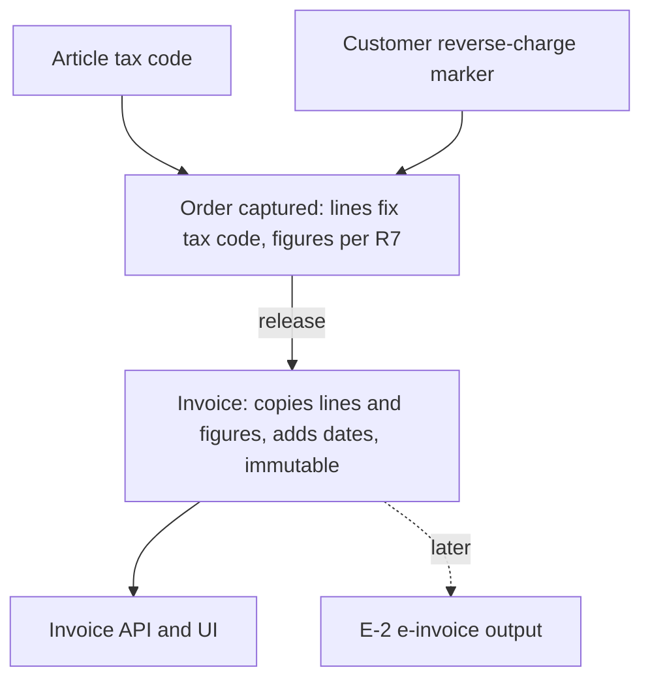

# R-16 Invoice Lines, VAT and Totals - Plan

## Goal Capsule

- **Objective:** Every invoice created from a released order carries its lines, VAT per rate, and net, tax and gross totals, and those figures match what the order showed. E-2 can then build e-invoice output on stored figures instead of recomputing them.
- **Product authority:** GitHub issue #28 and roadmap item R-16 in `docs/plans/2026-10-14-roadmap-next-work-items.md`, narrowed by the Key Decisions below. Decision D4 in the same roadmap sets the VAT scope. E-2, E-3 and E-5 are not active scope.
- **Open blockers:** None.

---

## Product Contract

### Summary

Articles get a tax code and customers get a reverse-charge marker. An order fixes each line's tax when it is captured and shows net, VAT and gross per rate. At release, the invoice copies those lines and figures unchanged and adds an invoice date and a delivery date. The invoice cannot be changed after that, and the invoice API and UI show its full content.

### Problem Frame

Today an invoice records only its order, its number and a net amount. Articles have no tax code, customers carry no tax-relevant marker, and nothing in the system computes VAT. The order screen shows a single net amount, computed as an unrounded sum of quantity times unit price.

E-2 (XRechnung / ZUGFeRD output, EN 16931) needs invoices whose lines, VAT and totals are already right. Without them, E-2 would have to invent the tax rules and the rounding itself, or recompute figures for invoices that are supposed to be immutable.

Nobody outside the system receives invoices before E-2 ships. R-16 therefore makes the figures correct and leaves the content that only a sent document needs to E-2: seller details, tax IDs and address snapshots.

### Key Decisions

- **R-16 invoices are internal records and are never sent.** E-2 sends only invoices created after it ships, so R-16 stores no seller data or tax IDs. (session-settled: user-directed — chosen over freezing seller tax data on R-16 invoices so E-2 can send them as-is, and over filling seller data in at send time: nobody receives invoices before E-2, and send-time filling would make a sent invoice differ from what was recorded at release.) Governs R15.
- **Tax is fixed when the order is captured, not when the invoice is created.** (session-settled: user-directed — chosen over reading current article tax codes and customer markers at invoice creation: the invoice says exactly what the order showed, and later quotes and order confirmations can reuse the same figures.) Governs R3, R4, R5, R6, R8.
- **Reverse charge belongs to the customer.** (session-settled: user-directed — chosen over a fourth article tax code for domestic §13b goods and over deferring the marker to E-2: the common Mittelstand case is selling to businesses in other EU countries.) Governs R2, R4, R10.
- **VAT scope is German 19 %, 7 % and 0 % plus a reverse-charge flag.** Austrian and Swiss rates come later as data. (session-settled: user-approved — decision D4, accepted as recommended on 2026-10-14 over covering AT/CH rates and intra-EU rules now.) Governs R1.
- **The value of R-16 is correct lines, VAT and totals before E-2 builds on them.** That is why address snapshots and customer VAT IDs wait for E-2.
- **Rounding follows EN 16931.** E-2 can then reuse the stored figures unchanged. Governs R7.
- **Rates are fixed values in R-16.** A statutory rate change between capture and release is not handled. D4 puts rates-as-data later. Governs R1.

### Requirements

**Master data**

- R1. Each article carries exactly one tax code: 19 %, 7 % or 0 %. Users set it when they create or edit an article.
- R2. Users can mark a customer as reverse charge, or clear the mark, in customer master data.

**Order capture**

- R3. When an order is captured, each line records its article's tax code at that moment, next to the unit price it already records.
- R4. When an order is captured for a customer marked reverse charge, the order is recorded as reverse charge and every line is taxed at 0 %, whatever its article's tax code.
- R5. Changing an article's tax code or a customer's marker later does not change orders that are already captured.
- R6. The order shows net, VAT and gross for each rate and in total, computed per R7.

**Calculation**

- R7. Each line's net (quantity × unit price) is rounded to the cent, with halves rounded away from zero. VAT for each rate is computed once, on the sum of that rate's rounded line nets, and rounded to the cent. Gross for each rate is net plus VAT, and the order totals are sums across rates.

**Invoice**

- R8. At release, the invoice copies the order's lines and its per-rate and total figures exactly, without recomputing anything from current master data. Each line includes article, SKU, quantity, unit price, line net and tax code.
- R9. The invoice records an invoice date and a delivery date. Both are the calendar day of release in German time (Europe/Berlin).
- R10. An invoice for a reverse-charge order is marked reverse charge.
- R11. An invoice cannot be changed after creation. Corrections are E-3's job.
- R12. The invoice API returns the full content of R8–R10, and the UI shows it.

**Existing data**

- R13. Existing articles start with tax code 19 %. Users change 7 % and 0 % articles by hand.
- R14. Draft orders that exist when R-16 ships take their articles' current tax codes. They are not reverse charge, because no customer is marked yet.
- R15. Invoices created before R-16 stay unchanged. The API and UI show them as having no line detail.

### Key Flows

- F1. Capture, release, view
  - **Trigger:** A user captures an order for a customer.
  - **Steps:** Each line takes its article's tax code, or 0 % if the customer is marked reverse charge, and the order shows net, VAT and gross per rate. The user releases the order. The worker creates the invoice, copies the order's lines and figures, and stamps the invoice and delivery dates. The user opens the invoice and sees the same figures as on the order.
  - **Covered by:** R3, R4, R6, R7, R8, R9, R10, R12

### Acceptance Examples

- AE1. Rounding per line and per rate
  - **Covers R7, R8.**
  - **Given** an order with three lines: 1 × 10.005 at 19 %, 1 × 2.004 at 19 %, and 2 × 4.995 at 7 %.
  - **Then** the line nets are 10.01, 2.00 and 9.99. At 19 % the order shows net 12.01, VAT 2.28 and gross 14.29. At 7 % it shows net 9.99, VAT 0.70 and gross 10.69. The totals are net 22.00, VAT 2.98 and gross 24.98, and the invoice shows exactly the same figures.
- AE2. Reverse-charge customer
  - **Covers R4, R10.**
  - **Given** a customer marked reverse charge and an order with one 19 % article and one 7 % article.
  - **Then** both lines are taxed at 0 %, VAT is 0.00, and the order and its invoice are marked reverse charge.
- AE3. Tax code changed between capture and release
  - **Covers R5, R8.**
  - **Given** an order captured while an article's tax code was 7 %, after which the article was changed to 19 %.
  - **When** the order is released.
  - **Then** the invoice line still carries 7 %, with the same VAT the order showed.
- AE4. Marker changed between capture and release
  - **Covers R5.**
  - **Given** an order captured for an unmarked customer, after which the customer is marked reverse charge.
  - **When** the order is released.
  - **Then** the invoice is not reverse charge and keeps the tax the order showed.
- AE5. Invoice from before R-16
  - **Covers R15.**
  - **Given** an invoice created before R-16 shipped.
  - **Then** it keeps its number and net amount, and the API and UI show that it has no line detail.

### Scope Boundaries

Deferred for later:

- Seller details, Steuernummer and USt-IdNr on the Mandant (E-2).
- Seller and buyer address snapshots on the invoice, including a billing address from the customer's Billing role. These are in the roadmap's R-16 text and move to E-2.
- Customer VAT ID (E-2, which needs it for reverse-charge invoices).
- Sending, printing or rendering invoices as documents (E-2).
- Austrian and Swiss rates, rates as data, and handling statutory rate changes.
- Credit notes and corrections (E-3).
- DATEV export (E-5).
- Quotes and order confirmations that reuse the order figures.

Outside this work:

- Editing or deleting an invoice after creation.

### Dependencies / Assumptions

- R-13 (issue #25) and R-14 (issue #26) are closed. Invoices already have read APIs and gapless `R-` numbers from per-tenant number ranges.
- An order and its invoice are 1:1 today. Release creates one delivery and one invoice covering all lines, with no partial deliveries. R9 relies on that.
- "Capture" means order creation. Today, lines are added only when an order is created, with the price copied from the article, and they cannot be edited afterwards. If draft line editing arrives later, R3 applies at the moment a line is entered.
- All amounts are net EUR prices. No currency field exists, and the UI formats everything as EUR.

### Outstanding Questions

Deferred to Planning:

- Where the order's VAT and gross appear during capture, whether as a live preview before saving or only after saving, and which list views switch from today's unrounded net to the R7 figures.
- Whether the tax code needs room for a reason later (zero-rated versus exempt) so E-2 can map it to EN 16931 tax categories, or whether E-2 adds that itself.

### Sources / Research

- Issue #28; roadmap R-16 and decision D4 in `docs/plans/2026-10-14-roadmap-next-work-items.md`. E-2, E-3 and E-5 are in the Wave 3 table of the same file.
- The invoice today: `src/Modules/Erp.Billing/Domain/BillingEntities.cs` (`Invoice`) and `InvoiceResponse` in `src/Erp.Api/Endpoints/SalesEndpoints.cs`.
- Invoice creation on `erp.sales-order.released.v1`: `src/Erp.Worker/Worker.cs`.
- Order lines and the unrounded `NetAmount`: `src/Modules/Erp.Sales/Domain/SalesOrder.cs`. The unit price is copied from `Article.SalesPrice` at order creation in `src/Erp.Api/Endpoints/SalesEndpoints.cs`.
- `Article`, `Customer`, `CustomerAddress` and `AddressRole`: `src/Modules/Erp.MasterData/Domain/MasterDataEntities.cs`. `Mandant` has only `Firmenname`: `src/Modules/Erp.Platform/Domain/Mandant.cs`.
- Module boundary rule: modules may reference only `Erp.BuildingBlocks` (`tests/Erp.Architecture.Tests/UnitTest1.cs`).
- Order screen totals and the invoice number display: `src/erp-web/src/workspaces/SalesWorkspace.tsx`.
